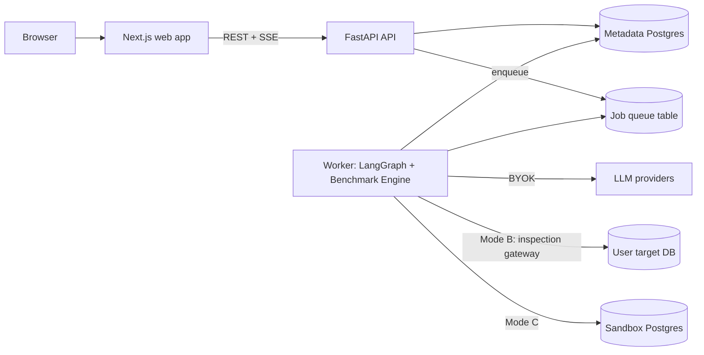

# QueryDoctor AI

> Autonomous, multi-agent investigation and *verified* optimization of PostgreSQL query performance.

**Project status: Phase 0 — Documentation & planning. No application code exists yet.**
Everything described below is *planned*. See [docs/planning/CURRENT_PHASE.md](docs/planning/CURRENT_PHASE.md) for live status.

---

## The problem

When a PostgreSQL query is slow, engineers typically:

1. Run `EXPLAIN`, squint at a plan tree, guess at a cause.
2. Add an index they *think* will help.
3. Run the query once, see it got faster, and ship it.

Step 3 is where things go wrong: a single timing is noise, the index may slow down writes, a "faster" rewrite may silently return different rows, and the warm cache may explain most of the improvement. Generic SQL chatbots make this worse — they produce confident advice with no evidence.

## What QueryDoctor does

QueryDoctor behaves like a small team of database performance engineers:

| Step | What happens | Who does it |
|---|---|---|
| Inspect | Parse SQL, collect schema, indexes, statistics, `EXPLAIN` plan | Deterministic tools |
| Investigate | Analyze plan nodes, estimates vs actuals, workload signals | Query Analyzer, Workload Investigator (LLM agents with restricted tools) |
| Hypothesize | Ranked root-cause hypotheses, each citing evidence | Supervisor + specialist agents |
| Propose | Index / rewrite / statistics candidates with risks and costs | Index Strategist, Optimization Engineer |
| Benchmark | Controlled, repeated, interleaved runs in an **isolated sandbox** | Deterministic Benchmark Engine |
| Verify | Result-set correctness, statistical significance, regressions | Benchmark Auditor (deterministic rules first, LLM second) |
| Report | Evidence-backed report with confidence, trade-offs, rollback | Report generator |

**Core principle:** a recommendation is not a *verified improvement* until it has been benchmarked against a representative workload and passed correctness checks. QueryDoctor is allowed — and expected — to conclude "inconclusive" or "no candidate is sufficiently supported."

Every claim in the UI is labeled as one of: **Observed** · **Hypothesis** · **Recommendation** · **Verified** · **Rejected** · **Inconclusive**.

## Key features (planned)

- Three execution modes with explicit trust boundaries:
  **A — Offline analysis** (uploaded SQL/plans/schema), **B — Restricted live inspection** (plain `EXPLAIN` + catalog reads only), **C — Isolated benchmarking** (sandbox clones; AI-generated DDL never touches a user's database).
- LangGraph supervisor coordinating five specialist agents with typed state, checkpointing, parallel fan-out, human approval, and bounded budgets.
- **Optimization Tournament** — candidates compete under identical, interleaved conditions; losers are rejected with reasons.
- Interactive execution-plan explorer (React Flow) and before/after plan diff.
- Reproducibility engine: SHA-256 content-addressed artifacts, report replay (no LLM calls), experiment replay, and AI re-investigation diffs.
- Live investigation timeline over Server-Sent Events.
- Bring-your-own-key LLM access (Gemini, OpenRouter).

## Architecture at a glance

Full details: [docs/architecture/ARCHITECTURE.md](docs/architecture/ARCHITECTURE.md).

## Technology stack (planned)

| Layer | Choice |
|---|---|
| Frontend | Next.js (App Router), TypeScript, Tailwind CSS, shadcn/ui, TanStack Query, Zustand (UI state only), React Flow, Recharts, CodeMirror 6 |
| Backend | Python 3.12, FastAPI, Pydantic v2, SQLAlchemy 2 (async) + Alembic, psycopg 3, SQLGlot |
| AI | LangGraph, LangChain (model integration + structured output), Gemini, OpenRouter, BYOK |
| Data | PostgreSQL for metadata (Neon in the public demo), Docker PostgreSQL for sandboxes |
| Jobs | PostgreSQL-backed job queue (`SKIP LOCKED`) + `LISTEN/NOTIFY` — no Redis in MVP ([ADR-0004](docs/engineering/adr/ADR-0004-postgres-job-queue.md)) |
| Observability | structlog JSON logs, OpenTelemetry traces, optional LangSmith |
| Testing | pytest, Vitest, Playwright, recorded-LLM evaluation fixtures |
| Delivery | Docker Compose (local), Vercel (web), single-container Python host (API + worker), GitHub Actions |

Rationale for each choice: [docs/engineering/DECISIONS.md](docs/engineering/DECISIONS.md).

## Development phases

| Phase | Theme | Status |
|---|---|---|
| 0 | Documentation & architecture | **In progress** |
| 1 | Foundation: repo, API, metadata DB, SQL/plan parsing, demo workloads, editor | Planned |
| 2 | Multi-agent intelligence: LangGraph supervisor, analyzer agents, streaming | Planned |
| 3 | Optimization & benchmarking: sandbox, benchmark engine, tournament | Planned |
| 4 | Verification & replay: auditor, lineage, replay, regression detection | Planned |
| 5 | Production polish: auth, BYOK, observability, evals, hardening, deploy | Planned |

See [docs/planning/ROADMAP.md](docs/planning/ROADMAP.md).

## Documentation index

**Agent/contributor instructions:** [CLAUDE.md](CLAUDE.md) · [AGENTS.md](AGENTS.md) · [Glossary](docs/GLOSSARY.md)

**Product:** [PRD](docs/product/PRD.md) · [Features](docs/product/FEATURES.md)

**Architecture:** [Architecture](docs/architecture/ARCHITECTURE.md) · [Agent system](docs/architecture/AGENT_SYSTEM.md) · [Database design](docs/architecture/DATABASE_DESIGN.md) · [API design](docs/architecture/API_DESIGN.md) · [Security](docs/architecture/SECURITY.md) · [Benchmark engine](docs/architecture/BENCHMARK_ENGINE.md) · [Replay engine](docs/architecture/REPLAY_ENGINE.md) · [Deployment](docs/architecture/DEPLOYMENT.md)

**Design:** [Design system](docs/design/DESIGN_SYSTEM.md) · [UI/UX](docs/design/UI_UX.md)

**Engineering:** [File map](docs/engineering/FILE_MAP.md) · [Coding standards](docs/engineering/CODING_STANDARDS.md) · [Testing strategy](docs/engineering/TESTING_STRATEGY.md) · [Observability](docs/engineering/OBSERVABILITY.md) · [Learning guide](docs/engineering/LEARNING.md) · [Decisions & ADRs](docs/engineering/DECISIONS.md)

**Diagrams (designed HTML, Mermaid stays authoritative in each doc):** [System architecture](docs/diagrams/system-architecture.html) · [Trust boundaries](docs/diagrams/trust-boundaries.html) · [Investigation graph](docs/diagrams/langgraph-topology.html)

**Planning:** [Roadmap](docs/planning/ROADMAP.md) · [Tasks](docs/planning/TASKS.md) · [Current phase](docs/planning/CURRENT_PHASE.md) · [Phase report template](docs/planning/PHASE_TEMPLATE.md) · [Risks](docs/planning/RISKS.md)

## Honesty policy

- QueryDoctor never fabricates benchmark numbers. Example numbers in these docs (e.g. "2.4 s") are illustrative only.
- Prerecorded demo benchmarks are always labeled as such and are never presented as measurements of a user's database.
- "Verified" always means "verified within the tested scope" — dataset, parameters, PostgreSQL version, and hardware are recorded alongside the result.
