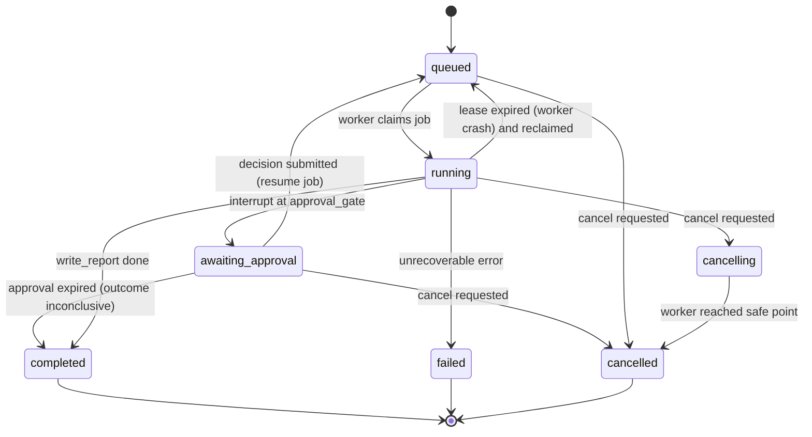

# Agent System

Status: Planned. Orchestration decision: [ADR-0002](../engineering/adr/ADR-0002-langgraph-supervisor.md). Verification authority: [ADR-0009](../engineering/adr/ADR-0009-deterministic-verification-authority.md).

## 1. Design principles

1. **Deterministic first.** Context collection, plan metrics, benchmarks, statistics, correctness and verdict rules are plain Python nodes. LLM agents reason over their outputs.
2. **Agents are bounded specialists.** Each has one output model, an explicit tool allowlist, a call budget, and a versioned prompt. No agent can execute arbitrary SQL.
3. **Evidence-grounded.** Every claim cites `evidence_ids` that exist in the run's evidence store. Validation is mechanical.
4. **References in state.** Graph state holds IDs and small summaries; bulky data lives in artifacts.
5. **Not every run uses every agent.** The supervisor routes conditionally and stops explicitly.

## 2. Roles

| Agent | Type | Inputs (state refs) | Tools (allowlist) | Output model | Runs when |
|---|---|---|---|---|---|
| **Supervisor** | LLM (planning) + deterministic router | objective, context summary, findings | none (routes only) | `InvestigationPlan`, `HypothesisSet` | always |
| **Query Analyzer** | LLM + tools | query metadata, plan summary | `get_plan_node`, `get_table_stats`, `get_column_stats`, `get_schema_object` | `QueryAnalysis` | a plan or query is available |
| **Index Strategist** | LLM + tools | query metadata, existing indexes, predicates | `list_indexes`, `get_column_stats`, `estimate_index_size` | `IndexAnalysis` | query touches ≥ 1 base table |
| **Workload Investigator** | LLM + tools | capabilities, workload snapshot refs | `get_statement_stats`, `get_activity_snapshot`, `get_lock_snapshot`, `get_table_io_stats` | `WorkloadAnalysis` | Mode B **and** at least one workload capability detected, or an imported workload snapshot exists |
| **Optimization Engineer** | LLM | hypotheses, analyses, prior verdicts | `validate_sql`, `explain_in_sandbox` (plain EXPLAIN, Mode C only) | `CandidateSet` + `ExperimentSpec` | ≥ 1 actionable hypothesis |
| **Benchmark Auditor** | Deterministic rules → LLM narrative | experiment results, correctness, plans | `get_benchmark_summary`, `get_plan_diff` | `AuditAssessment` | after each experiment |
| Benchmark runner | **Deterministic node** (not an agent) | approved `ExperimentSpec` | sandbox + benchmark engine | `ExperimentResult` | after approval |
| Report writer | Deterministic template + LLM prose (sections flagged) | all records | — | `InvestigationReport` | terminal |

Tools are thin async functions over the evidence store / inspection gateway / sandbox, with Pydantic input schemas. They **return evidence IDs alongside data** so agents can cite them.

## 3. Graph topology

Simplified designed overview: [docs/diagrams/langgraph-topology.html](../diagrams/langgraph-topology.html). The Mermaid below is authoritative and shows every node.


Notes:
- `FAN` uses LangGraph `Send` to dispatch only the agents listed in `InvestigationPlan.agents` (subset of the three analysts). Results merge via reducer fields (see §4).
- `budget_guard` is implemented as a wrapper around each node function plus a conditional edge check; when a hard limit is hit, the next routing decision is forced to `write_report`.
- The Optimization Engineer ↔ Auditor loop is bounded by `budget.max_optimization_rounds` (default 2 extra rounds).

## 4. State

`InvestigationState` is a `TypedDict` (LangGraph requirement) whose values are Pydantic models or primitives. Lists that parallel branches write to use `Annotated[list[T], operator.add]` reducers.

```python
class InvestigationState(TypedDict):
    # identity & inputs (immutable after intake)
    investigation_id: UUID
    run_id: UUID
    objective: str                      # user text, length-capped, treated as untrusted
    modes: list[ExecutionMode]
    connection_id: UUID | None          # reference only — never the DSN or password
    workload_id: str | None             # e.g. "orders_ecommerce@v1:sf=1:seed=42"
    llm_config_ref: UUID                # → llm_credentials row; key decrypted per call, never in state

    # context (refs + compact summaries)
    query: QueryMetadata | None         # artifact hash, fingerprint, tables, predicates, order_by, limit
    schema_snapshot_ref: ArtifactRef | None
    plan_refs: list[ArtifactRef]
    capabilities: TargetCapabilities | None
    context_summary: str                # ≤ 4k tokens, generated deterministically from evidence

    # reasoning (reducers allow parallel writes)
    plan: InvestigationPlan | None
    findings: Annotated[list[Finding], operator.add]
    hypotheses: list[Hypothesis]
    candidates: list[OptimizationCandidate]
    experiments: Annotated[list[ExperimentRef], operator.add]
    verifications: Annotated[list[VerificationRef], operator.add]

    # control
    approvals: list[ApprovalRef]
    errors: Annotated[list[NodeError], operator.add]
    retry_counters: dict[str, int]      # key = node name
    budget: RunBudget
    usage: BudgetUsage                  # counters updated by budget_guard
    optimization_round: int
    status: RunStatus
    outcome: RunOutcome | None
```

Never in state: DSNs, passwords, API keys, result rows, full plan JSON, full schema DDL. Evidence objects are persisted in the `evidence` table; state holds their IDs inside findings.

### Key models (abridged)

```python
class Evidence(BaseModel):
    id: str                       # "ev_" + short ulid
    kind: Literal["plan_node", "table_stat", "column_stat", "index_def", "schema_fact",
                  "workload_stat", "lock_sample", "benchmark_metric", "correctness_check",
                  "tool_error", "user_input"]
    source_artifact: ArtifactRef | None
    locator: str                  # JSON pointer into the artifact, e.g. "/0/Plan/Plans/1"
    summary: str                  # human-readable fact, ≤ 300 chars, generated deterministically
    data: dict[str, JsonScalar]   # small typed payload (row estimates, sizes, ...)
    provenance: Literal["measured", "prerecorded", "imported", "derived"]

class Finding(BaseModel):
    agent: AgentName
    title: str
    detail: str
    severity: Literal["info", "low", "medium", "high"]
    evidence_ids: list[str] = Field(min_length=1)

class Hypothesis(BaseModel):
    id: str
    statement: str
    category: Literal["missing_index", "poor_index_order", "cardinality_misestimate", "stale_statistics",
                      "inefficient_sort", "join_strategy", "query_shape", "lock_contention",
                      "io_pressure", "workload_change", "other"]
    supporting_evidence: list[str] = Field(min_length=1)
    contradicting_evidence: list[str] = []
    confidence: Literal["low", "medium", "high"]
    uncertainty_notes: str
    verification_method: Literal["benchmark", "explain_compare", "stats_refresh", "workload_observation", "not_verifiable"]

class OptimizationCandidate(BaseModel):
    id: str
    kind: Literal["create_index", "query_rewrite", "analyze_statistics", "extended_statistics", "drop_redundant_index"]
    addresses_hypotheses: list[str] = Field(min_length=1)
    sql: str                      # DDL or rewritten query; validated before persisting
    rollback_sql: str | None
    expected_benefit: str
    risks: list[str]
    prerequisites: list[str]
    estimated_cost: CandidateCost  # index size estimate, build time class, write overhead class
    requires_approval: bool       # always True for DDL
```

## 5. Agent communication

- Agents never message each other directly. They read state and write their typed output; the supervisor synthesizes.
- LLM calls use `model.with_structured_output(OutputModel, method="json_schema")` where the provider supports it, else tool-calling mode; both validated by Pydantic.
- **Citation validator** (deterministic, after every agent): every `evidence_id` must exist for this run; findings without valid citations are removed; if > 50% removed the agent is retried once with the error list.
- **Disagreement**: when analysts produce conflicting hypotheses (e.g., Query Analyzer says misestimate, Index Strategist says missing index), the supervisor keeps both with confidence levels; disagreement is resolved by **experiment**, not by debate. Candidates addressing each hypothesis compete in the tournament.

## 6. Parallelism

| Can run concurrently | Must be sequential |
|---|---|
| Query Analyzer ∥ Index Strategist ∥ Workload Investigator | intake → collect_context (context needed by everyone) |
| Catalog queries inside `collect_context` (separate read-only sessions, max 3) | synthesize → optimization_engineer → approval → benchmark → audit |
| Sandbox template build may start during analysis (speculative, cheap to discard) | Benchmark arms on the **same** sandbox host (measurement interference) |

The worker uses `asyncio`; parallel branches share one event loop. Per-run concurrency of LLM calls is capped by a semaphore (default 3) to respect provider rate limits.

## 7. Checkpointing & resume

- Checkpointer: `langgraph-checkpoint-postgres` `AsyncPostgresSaver` in the metadata DB, schema `langgraph`. `thread_id = str(run_id)`.
- A checkpoint is written after every super-step. On worker crash the reclaimed job calls `graph.ainvoke(None, config)` to continue.
- **Idempotency**: nodes write side effects keyed by deterministic IDs (`evidence.id` derived from `(run_id, kind, locator)` hash; benchmark runs keyed by `(experiment_id, arm, param_set, iteration_block)`) with `ON CONFLICT DO NOTHING`, so re-executing a partially completed node is safe. The benchmark engine resumes at the first missing iteration block.
- **Finalization**: `write_report` executes `finalize_run` atomically (events cutoff, events digest, report artifacts, manifest, terminal status) — [REPLAY_ENGINE §5](REPLAY_ENGINE.md#5-atomic-finalization). If it re-runs after a crash, it detects `finalized_at` and is a no-op. Cancelled and failed runs are finalized the same way with partial reports.
- Checkpoints are retained for 30 days after a run reaches a terminal state, then deleted (report replay does not need them; see [REPLAY_ENGINE.md](REPLAY_ENGINE.md)).

## 8. Human-in-the-loop

Approval is required for:

| Trigger | Default | Can be pre-authorized? |
|---|---|---|
| Any sandbox DDL / rewrite execution | required | Yes, per investigation, for demo workloads only |
| Mode B `EXPLAIN` on a connection with `environment = production` | required | No |
| Budget extension (more rounds/time) | required | No |
| Candidate classified `high` risk (e.g., large index on write-heavy table) | required, flagged | No |

Mechanism: `approval_gate` creates an `approval_requests` row (with the exact SQL to be run and sandbox target), emits `approval.requested`, then calls `interrupt(payload)`. The run status becomes `awaiting_approval`. The decision endpoint validates the user owns the run and that the request is still `pending` (idempotent), then enqueues a `resume` job. Approvals expire after 24 h → run ends `inconclusive` (`approval_expired`).

## 9. Run status state machine



`completed` always carries an `outcome`: `verified_recommendation`, `unverified_recommendations`, `no_action_needed`, or `inconclusive`. `failed` and `cancelled` keep partial results viewable.

## 10. Failure recovery matrix

| Failure | Node behaviour | Retry policy |
|---|---|---|
| Provider rate limit (429) | Backoff `min(2^n + jitter, 30s)` | ≤ 3, then fallback model if configured, then `NodeError` |
| Provider 5xx / timeout (60 s) | Same as above | ≤ 3 |
| Invalid structured output | Re-prompt with validation errors | 1 repair attempt |
| Uncited claims | Remove claims; retry if > 50% removed | 1 |
| Tool timeout / DB error | Tool returns `ToolError` evidence; agent may continue | Tool-level: 1 retry for transient connection errors only |
| Benchmark failure (sandbox) | Experiment `failed`, candidates `inconclusive` | 1 sandbox re-provision |
| Verification failure (all rejected) | Route back to Optimization Engineer with rejection reasons | bounded by `max_optimization_rounds` |
| Cancellation | Raise `RunCancelled` at next safe point | none |
| Partial results | Report renders whatever sections have data; missing sections are labeled | — |

## 11. Budgets

Defaults (configurable per profile in `agents/budgets.py`; demo profile is stricter):

| Budget | Local default | Demo default |
|---|---|---|
| LLM calls per run | 40 | 20 |
| Total tokens per run | 400k | 150k |
| Tool calls per run | 80 | 40 |
| Tool calls per agent invocation | 8 | 6 |
| Run wall-clock | 20 min | 5 min |
| Benchmark time per experiment | 8 min | n/a (prerecorded) |
| Candidates per round | 4 | 3 |
| Extra optimization rounds | 2 | 1 |
| Concurrent runs per user | 2 | 1 |
| Worker concurrency | 2 | 1 |

`budget_guard` checks **before** each LLM/tool call; exceeding a limit raises `BudgetExhausted`, caught by the node wrapper, which routes to `write_report`.

## 12. Termination criteria

The run ends when any of these holds:
1. A candidate is `verified` and the tournament is complete → `verified_recommendation`.
2. No hypothesis is actionable (e.g., query already optimal for the data) → `no_action_needed` (requires supporting evidence, e.g., Index Only Scan with low cost and no misestimates).
3. Candidates exist but Mode C is unavailable or all approvals were declined → `unverified_recommendations`.
4. All candidates rejected/inconclusive and rounds/budget exhausted → `inconclusive`.
5. Cancellation → `cancelled`; unrecoverable error → `failed`.

## 13. Prompts and versioning

- One file per agent in `agents/prompts/`, with a module constant `PROMPT_VERSION = "query_analyzer@3"`.
- System prompt sections: role, rules (cite evidence, do not invent numbers, say "unknown"), input data block (fenced, see [SECURITY.md §6](SECURITY.md#6-prompt-injection)), output schema.
- Prompt + model versions are recorded per `agent_executions` row and in the replay manifest.

## 14. Agent evaluation

Agents are evaluated on **decisions**, not JSON validity. See [TESTING_STRATEGY.md §5](../engineering/TESTING_STRATEGY.md#5-agent-evaluation). Summary of scored dimensions: root-cause top-k accuracy, evidence validity, tool selection (necessary tools called, no unnecessary ones), hypothesis calibration, correct escalation to approval, correct termination outcome, and recovery after injected tool failures.
