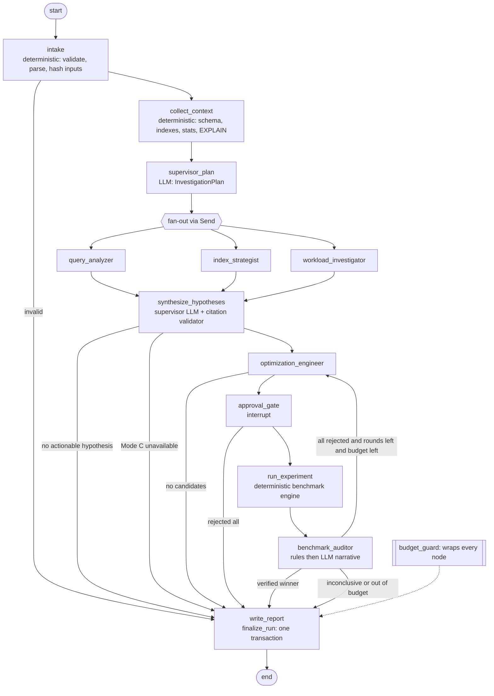
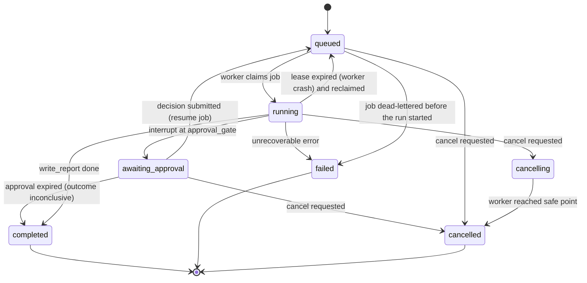

# Agent System

Status: Planned. Orchestration decision: [ADR-0002](../engineering/adr/ADR-0002-langgraph-supervisor.md). Verification authority: [ADR-0009](../engineering/adr/ADR-0009-deterministic-verification-authority.md).

## 1. Design principles

1. **Deterministic first.** Context collection, plan metrics, benchmarks, statistics, correctness and verdict rules are plain Python nodes. LLM agents reason over their outputs.
2. **Agents are bounded specialists.** Each has one output model, an explicit tool allowlist, a call budget, and a versioned prompt. No agent can execute arbitrary SQL.
3. **Evidence-grounded.** Every claim cites `evidence_ids` that exist in the run's evidence store. Validation is mechanical.
4. **References in state.** Graph state holds IDs and small summaries; bulky data lives in artifacts.
5. **Not every run uses every agent.** The supervisor routes conditionally and stops explicitly.

## 2. Roles

| Agent | Type | Inputs (state refs) | Tools (allowlist) | Output model | Runs when |
|---|---|---|---|---|---|
| **Supervisor** | LLM (planning) + deterministic router | objective, context summary, findings | none (routes only) | `InvestigationPlan`, `HypothesisSet` | always |
| **Query Analyzer** | LLM + tools | query metadata, plan summary | `get_plan_node`, `get_table_stats`, `get_column_stats`, `get_schema_object` | `QueryAnalysis` | a plan or query is available |
| **Index Strategist** | LLM + tools | query metadata, existing indexes, predicates | `list_indexes`, `get_column_stats`, `estimate_index_size` | `IndexAnalysis` | query touches ≥ 1 base table |
| **Workload Investigator** | LLM + tools | capabilities, workload snapshot refs | `get_statement_stats`, `get_activity_snapshot`, `get_lock_snapshot`, `get_table_io_stats` | `WorkloadAnalysis` | Mode B **and** at least one workload capability detected, or an imported workload snapshot exists |
| **Optimization Engineer** | LLM | hypotheses, analyses, prior verdicts | `validate_sql`, `explain_in_sandbox` (plain EXPLAIN, Mode C only) | `CandidateSet` + `ExperimentSpec` | ≥ 1 actionable hypothesis |
| **Benchmark Auditor** | Deterministic rules → LLM narrative | experiment results, correctness, plans | `get_benchmark_summary`, `get_plan_diff` | `AuditAssessment` | after each experiment |
| Benchmark runner | **Deterministic node** (not an agent) | approved `ExperimentSpec` | sandbox + benchmark engine | `ExperimentResult` | after approval |
| Report writer | Deterministic template + LLM prose (sections flagged) | all records | — | `InvestigationReport` | terminal |

Tools are thin async functions over the evidence store / inspection gateway / sandbox, with Pydantic input schemas. They **return evidence IDs alongside data** so agents can cite them.

**Tool protocol (implemented in T2.9, `agents/agent_runner.run_tool_agent`).** Providers are not asked for native tool calling. Each turn the model returns one JSON object validated as `AgentTurn`: `{"action": "call_tool", "tool", "args"}` or `{"action": "final", "analysis"}`. Our code then:
- refuses tools outside the agent's allowlist (`tool_executions.status = refused`, `TOOL_NOT_ALLOWED`) and tells the model which tools exist;
- validates arguments with the tool's input model (`INVALID_ARGUMENTS` goes back to the model);
- charges the per-invocation cap (exhaustion is soft: the model is asked for its final answer) and the run-wide budget (exhaustion stops the run);
- records evidence, a `tool_executions` row and `tool.started`/`tool.completed` events, and returns the result **fenced** (`kind=tool_result`).

Every provider call is written as it finishes (`tool_call` turns get their own status, migration `0006`), so tool rows always reference an existing execution row. The final answer goes through the same citation check and single retry as other agents. At most 14 turns.

Allowlists are exactly the table above. Index size is a deterministic btree leaf-level approximation (rows × (8-byte header + MAXALIGN'd key widths + 4-byte line pointer) at fillfactor 90, labelled `derived`). Workload tools use four fixed catalog templates (`statement_stats`, `activity_summary`, `lock_summary`, `table_io`) that return aggregates only: no other sessions' query text, user names or client addresses; `pg_stat_statements` text is truncated to 500 characters and fenced. Each call stores a `workload_snapshot` artifact (role `context.workload`) that its evidence points at.

## 3. Graph topology

Simplified designed overview: [docs/diagrams/langgraph-topology.html](../diagrams/langgraph-topology.html). The Mermaid below is authoritative and shows every node.



Notes:
- `FAN` uses LangGraph `Send` to dispatch only the agents listed in `InvestigationPlan.agents` (subset of the three analysts). Results merge via reducer fields (see §4).
- `budget_guard` is implemented as a wrapper around each node function plus a conditional edge check; when a hard limit is hit, the next routing decision is forced to `write_report`.
- The Optimization Engineer ↔ Auditor loop is bounded by `budget.max_optimization_rounds` (default 2 extra rounds).

### Deterministic context nodes (implemented in T2.6)

- **intake** reads the run's inputs by `run_artifacts` role (`input.query`, `input.plan`, `input.schema`, `input.param_sets`), validates the SQL with the Phase 1 validator, and checks mode requirements: a query or a plan is required, and Mode B needs a connection and the query. Invalid input emits `error` events and sets `stop_reason = invalid_input`, which routes to `write_report`. Valid queries produce `query_fact` evidence (tables, columns, ORDER BY, LIMIT, parameters).
- **collect_context** turns an uploaded plan into `plan_summary` + one `plan_node` per node (`imported`) and uploaded DDL into `schema_fact`/`index_def`. In Mode B it opens the hardened gateway through `GatewayInspectorFactory`: capabilities, plain EXPLAIN (stored as artifact role `context.plan`) and a redacted schema snapshot (role `context.schema_snapshot`) become `measured` evidence. Each live step that fails (connect, explain, snapshot) becomes `tool_error` evidence and the run continues on the remaining evidence. A production connection is refused (`APPROVAL_REQUIRED`) until the Phase 3 approval gate exists.
- Evidence summaries are generated from the numbers by `evidence/builders.py` (no LLM), and every number in a summary is also in `data`. Untrusted identifiers and text go through `evidence/sanitize.py` (control characters stripped, PostgreSQL-style quoting, 63-character identifiers). `context_summary` is a deterministic, bounded (16k chars ≈ 4k tokens) list of `[ev_…] (kind) summary` lines.
- Evidence writes are idempotent (`ON CONFLICT (run_id, id) DO NOTHING`) and announce only newly inserted IDs in `evidence.created`, so a node re-run after a crash adds no rows and no events. They take `FOR NO KEY UPDATE` on the run row (the lock the event `seq` update needs anyway; `FOR SHARE` deadlocked parallel analysts upgrading to it) and refuse a finalized run.

## 4. State

`InvestigationState` is a `TypedDict` (LangGraph requirement). **Implemented (T2.5): values are JSON only** (str/int/bool/None, lists, dicts); domain models in `domain/investigation.py` are dumped on write and validated on read (`findings_of`, `plan_of`, …). The checkpointer then never revives Python classes from database content: `langgraph-checkpoint`'s default serializer is permissive (it imports any class named in the checkpoint, with a warning), and we construct it strict. Lists that parallel branches write to use `Annotated[list[T], operator.add]` reducers; `stop_reason` has a priority reducer (`cancelled` > `failed` > `budget_exhausted` > `invalid_input`) because parallel branches may stop for different reasons in the same step. The block below is the target shape; Phase 2 implements the subset up to hypotheses, with IDs as strings.

```python
class InvestigationState(TypedDict):
    # identity & inputs (immutable after intake)
    investigation_id: UUID
    run_id: UUID
    objective: str                      # user text, length-capped, treated as untrusted
    modes: list[ExecutionMode]
    connection_id: UUID | None          # reference only — never the DSN or password
    workload_id: str | None             # e.g. "orders_ecommerce@v1:sf=1:seed=42"
    llm_config_ref: UUID                # → llm_credentials row; key decrypted per call, never in state

    # context (refs + compact summaries)
    query: QueryMetadata | None         # artifact hash, fingerprint, tables, predicates, order_by, limit
    schema_snapshot_ref: ArtifactRef | None
    plan_refs: list[ArtifactRef]
    capabilities: TargetCapabilities | None
    context_summary: str                # ≤ 4k tokens, generated deterministically from evidence

    # reasoning (reducers allow parallel writes)
    plan: InvestigationPlan | None
    findings: Annotated[list[Finding], operator.add]
    hypotheses: list[Hypothesis]
    candidates: list[OptimizationCandidate]
    experiments: Annotated[list[ExperimentRef], operator.add]
    verifications: Annotated[list[VerificationRef], operator.add]

    # control
    approvals: list[ApprovalRef]
    errors: Annotated[list[NodeError], operator.add]
    retry_counters: dict[str, int]      # key = node name
    budget: RunBudget
    usage: BudgetUsage                  # counters updated by budget_guard
    optimization_round: int
    status: RunStatus
    outcome: RunOutcome | None
```

Never in state: DSNs, passwords, API keys, result rows, full plan JSON, full schema DDL. Evidence objects are persisted in the `evidence` table; state holds their IDs inside findings.

### Key models (abridged)

```python
class Evidence(BaseModel):
    id: str                       # "ev_" + short ulid
    kind: Literal["plan_node", "plan_summary", "query_fact", "table_stat", "column_stat", "index_def", "schema_fact",
                  "workload_stat", "lock_sample", "benchmark_metric", "correctness_check",
                  "tool_error", "user_input"]
    source_artifact: ArtifactRef | None
    locator: str                  # JSON pointer into the artifact, e.g. "/0/Plan/Plans/1"
    summary: str                  # human-readable fact, ≤ 300 chars, generated deterministically
    data: dict[str, JsonScalar]   # small typed payload (row estimates, sizes, ...)
    provenance: Literal["measured", "prerecorded", "imported", "derived"]

class Finding(BaseModel):
    agent: AgentName
    title: str
    detail: str
    severity: Literal["info", "low", "medium", "high"]
    evidence_ids: list[str] = Field(min_length=1)

class Hypothesis(BaseModel):
    id: str
    statement: str
    category: Literal["missing_index", "poor_index_order", "cardinality_misestimate", "stale_statistics",
                      "inefficient_sort", "join_strategy", "query_shape", "lock_contention",
                      "io_pressure", "workload_change", "other"]
    supporting_evidence: list[str] = Field(min_length=1)
    contradicting_evidence: list[str] = []
    confidence: Literal["low", "medium", "high"]
    uncertainty_notes: str
    verification_method: Literal["benchmark", "explain_compare", "stats_refresh", "workload_observation", "not_verifiable"]

class OptimizationCandidate(BaseModel):
    id: str
    kind: Literal["create_index", "query_rewrite", "analyze_statistics", "extended_statistics", "drop_redundant_index"]
    addresses_hypotheses: list[str] = Field(min_length=1)
    sql: str                      # DDL or rewritten query; validated before persisting
    rollback_sql: str | None
    expected_benefit: str
    risks: list[str]
    prerequisites: list[str]
    estimated_cost: CandidateCost  # index size estimate, build time class, write overhead class
    requires_approval: bool       # always True for DDL
```

## 5. Agent communication

- Agents never message each other directly. They read state and write their typed output; the supervisor synthesizes.
- LLM calls go through `llm.structured.call_structured` (T2.4). Providers run in **JSON mode** (Gemini `response_mime_type=application/json`, OpenRouter `response_format=json_object`) with the output model's JSON Schema appended to the prompt, and return raw text; Pydantic validation in our code is the only gate. This replaces the planned `with_structured_output(method="json_schema")`: providers accept different JSON Schema dialects, a single validation path behaves identically for Gemini, OpenRouter, eval replays and test fakes, and eval recordings become plain model text.
- The structured layer owns retries (provider SDK retries are off). It calls a `before_call` hook before **every** provider request, including retries and repairs, where `budget_guard` raises `BudgetExhausted`; an `after_call` hook receives a `CallRecord` (model, status, tokens, latency, error code) for accounting and `agent_executions`. Logs carry only those fields, never prompt or output text.
- Provider policy: free OpenRouter models only ([ADR-0016](../engineering/adr/ADR-0016-free-openrouter-models-only.md)). OpenRouter is called directly through its OpenAI-compatible API so each call's served model, upstream provider and `usage.cost` can be checked and recorded; free-quota exhaustion or a non-zero cost stops the run (never a paid fallback). The free-only rule is enforced **before dispatch**, not only by the cost reported afterwards: startup validation refuses non-free `LLM_MODEL`/`LLM_FALLBACK_MODEL`, and `OpenRouterClient` re-checks its model id when constructed and before every request (a model swapped after validation is refused with no network call, and the run stops with `LLM_PAID_USAGE_BLOCKED`). The zero-cost check on each response remains as the second layer.
- Keys come from `llm.credentials.resolve_api_key` (local profile: `GEMINI_API_KEY` / `OPENROUTER_API_KEY`; demo: BYOK in Phase 5) and live only inside the client object passed to nodes through the run's runtime context, never in graph state.
- **Citation validator** (deterministic, after every agent): every `evidence_id` must exist for this run; findings without valid citations are removed; if > 50% removed the agent is retried once with the error list. Implemented in T2.7 (`agents/citations.py`, `agents/outputs.py`):
  - Unknown IDs are **stripped** and reported; a claim is removed only when no valid ID remains. Exactly 50% removed does not retry.
  - Speed-up numbers ("10x faster", "40% reduction in latency") are removed unless a cited item is `benchmark_metric` evidence, which cannot exist before Phase 3 (the TESTING_STRATEGY §5 forbid rule, enforced mechanically).
  - After the one retry, the remaining cited claims are accepted and the drop is logged.
  - Draft models accept any string as an evidence ID, so invented IDs reach this validator (stripped and reported) rather than failing JSON validation.
- **Agent runner** (`agents/agent_runner.py`): structured call → citation check → at most one citation retry → persistence. Each provider call becomes an `agent_executions` row (`failed`, `invalid_output` with `UNCITED_CLAIMS`, or the single `succeeded`), and the accepted output is stored as an `agent_output` artifact (role `output.agent`) with its citation report. A re-run with the same `invocation_key` returns the stored output without an LLM call. A provider outage raises `AgentFailed` (the run continues without that agent); budget exhaustion and cancellation propagate to the node wrapper after the calls already made are recorded. LLM calls share a per-run semaphore (3).
- **Supervisor (implemented in T2.8, `agents/nodes/supervisor.py`).**
  - `supervisor_plan`: the model proposes analysts, focus points and a rationale. The plan is intersected with deterministic eligibility (`eligible_agents`: Query Analyzer if a query or plan exists; Index Strategist if the query names a table; Workload Investigator only in Mode B with `pg_stat_statements` or `pg_read_all_stats`). An empty intersection falls back to all eligible analysts; a failed supervisor call runs all eligible analysts with a recoverable error recorded; no eligible analyst routes straight to the report without an LLM call.
  - `route_after_plan` returns one `Send` per planned analyst, or `write_report` on a stop or with no plan.
  - `synthesize_hypotheses`: findings (fenced too, since they are model output derived from untrusted data) + the current evidence summary → `HypothesisSet`, passed through the citation validator. Hypotheses are re-ranked deterministically by confidence (stable within a level) because the eval's top-1 is "the highest-confidence hypothesis". Keys are `hy_` + hash of (run, round, rank), so a reused output gives the same keys. `proposed_by` is computed from analysts whose findings share a citation (else `supervisor`), never taken from the model. `no_action_needed` requires the model to cite evidence in `no_action_evidence`; unknown IDs are stripped. After ranking, the deterministic **materiality check** (`evidence/materiality.py`, [ADR-0017](../engineering/adr/ADR-0017-deterministic-materiality-gate.md)) decides whether anything material is at stake. It runs on evidence only (prompts are unchanged) and returns `material`, `not_material` or `undetermined`. On `not_material`, every hypothesis stays visible but is capped at `low` confidence, gets the reasons appended to `uncertainty_notes`, and cites the materiality evidence as `contradicting_evidence`; that evidence also becomes `no_action_evidence`, and an `agent.summary` event says "Not worth optimizing: …". The verdict is stored in state (`materiality`) and in the report. The model never sees or sets it.
- **Disagreement**: when analysts produce conflicting hypotheses (e.g., Query Analyzer says misestimate, Index Strategist says missing index), the supervisor keeps both with confidence levels; disagreement is resolved by **experiment**, not by debate. Candidates addressing each hypothesis compete in the tournament.

## 6. Parallelism

| Can run concurrently | Must be sequential |
|---|---|
| Query Analyzer ∥ Index Strategist ∥ Workload Investigator | intake → collect_context (context needed by everyone) |
| Catalog queries inside `collect_context` (separate read-only sessions, max 3) | synthesize → optimization_engineer → approval → benchmark → audit |
| Sandbox template build may start during analysis (speculative, cheap to discard) | Benchmark arms on the **same** sandbox host (measurement interference) |

The worker uses `asyncio`; parallel branches share one event loop. Per-run concurrency of LLM calls is capped by a semaphore (default 3) to respect provider rate limits.

## 7. Checkpointing & resume

- Checkpointer: `langgraph-checkpoint-postgres` `AsyncPostgresSaver` in the metadata DB, schema `langgraph`. `thread_id = str(run_id)`.
- A checkpoint is written after every super-step. On worker crash the reclaimed job calls `graph.ainvoke(None, config)` to continue.
- **Idempotency**: nodes write side effects keyed by deterministic IDs (`evidence.id` derived from `(run_id, kind, locator)` hash; benchmark runs keyed by `(experiment_id, arm, param_set, iteration_block)`) with `ON CONFLICT DO NOTHING`, so re-executing a partially completed node is safe. The benchmark engine resumes at the first missing iteration block.
- **Finalization**: `write_report` executes `finalize_run` atomically (events cutoff, events digest, report artifacts, manifest, terminal status) — [REPLAY_ENGINE §5](REPLAY_ENGINE.md#5-atomic-finalization). If it re-runs after a crash, it detects `finalized_at` and is a no-op. Cancelled and failed runs are finalized the same way with partial reports.
- Checkpoints are retained for 30 days after a run reaches a terminal state, then deleted (report replay does not need them; see [REPLAY_ENGINE.md](REPLAY_ENGINE.md)).

**Implemented (T2.10):** `agents/graph.py` assembles the Phase 2 subset (through `synthesize_hypotheses → write_report`); `agents/run.execute_run` is the job handler body.
- The checkpointer (`agents/checkpointer.py`) uses a psycopg pool with `search_path=langgraph` and a **strict** serializer. `setup()` is never called (migration `0004` created the tables as the owner).
- A job finds out whether to resume with `aget_tuple(thread)`: if a checkpoint exists it calls `ainvoke(None)`, otherwise it starts fresh. Already-terminal runs are a no-op.
- A reclaimed job (lease expired) records `running → queued → running`.
- Tested: a crash raised during synthesis, after the analyst fan-out was checkpointed, resumes on the next attempt without calling the analysts again and without adding evidence or findings (ROADMAP Phase 2 acceptance #2); a worker job that crashes is retried and completes.
- Missing LLM configuration fails the run with `CONFIGURATION_ERROR` before the graph starts. A dead-lettered job fails its run (`JOB_DEAD_LETTERED`) via the worker's `on_dead` callback, which now fires for both dead-letter paths.
- Phase 2 `write_report` is deterministic: outcome from stop reason → a `not_material` verdict with cited evidence (`no_action_needed`, even when capped hypotheses exist) → hypotheses (`unverified_recommendations`, since nothing is benchmarked yet) → cited `no_action_evidence` (`no_action_needed`) → `inconclusive`. A `cancelling` run always ends `cancelled`. It stores an interim report (`reports/interim.py`, builder `interim-report@2`, which adds the materiality verdict to `@1`; no clock reads) as `report_json`/`report_md` artifacts, roles `output.report_json`/`output.report_md`, then changes status in the same transaction. `report.ready` is not emitted until Phase 4 (it carries a manifest digest). Runs failed by dead-lettering have no report (they never reached `write_report`); Phase 4 finalization covers them.

### Optimization loop (implemented in Phase 3)

- **Mode C context:** `collect_context` opens the same hardened inspection gateway on a throwaway clone of the demo workload as `qc_bench` (`agents/services.sandbox_inspector`), so Mode C runs get `measured` plain-EXPLAIN plan evidence and a schema snapshot. The template is built here if needed.
- **`optimization_engineer`** (`optimization_engineer@1`): one structured call per round (`invocation_key = optimization_engineer:<round>`), no tools. `agents/candidates.judge_candidates` keeps only candidates that address known hypothesis keys, pass the sandbox DDL allowlist / SELECT validator for their kind, are not repeats (by SQL digest) of an earlier candidate, and fit `candidates_per_round`. More than half removed → one retry listing the problems. Keys are `oc_` + hash(run, round, position).
- **`approval_gate`**: see §8; `interrupt()` re-runs the node on resume, so the node reads the decision from `approval_requests` and is idempotent.
- **`run_experiment`**: builds `ExperimentConfig` from the approval payload (the SQL the human saw), runs the engine in a worker thread (`asyncio.to_thread`) with `DbHooks` bridging persistence and progress back to the loop, stores `experiment_config` / `environment` / `plan_analyze` / `experiment_result` artifacts, sets candidate statuses from the rule verdicts, records `benchmark_metric` and `correctness_check` evidence, and emits `verification.completed`. Experiment IDs are `uuid5(run, round)`, so a re-run resumes the same experiment. Since `bench@2` (ADR-0019), a noisy round whose arms pass the noise screen runs up to two replicate experiments through `run_replicated`, with deterministic IDs so a crash resumes them too. Each replicate is an `experiments` row with `replicate > 0` that adds evidence only. The `replication_result` artifact then sets the final candidate status (`verified_with_noise_warning` or `inconclusive`). A noise-warning winner gives the run outcome `verified_recommendation`, and the report and UI always state the warning.
- **Loop:** no verified winner and a `rejected`/`inconclusive` round → `next_round` (bounded by `budget.max_optimization_rounds`, default 2; demo 1) → the engineer sees earlier candidates with their reason codes. A failed experiment (sandbox unavailable) goes to the report.
- **Outcomes** (`write_report`): verified winner → `verified_recommendation`; expired approval, or benchmarked without a winner → `inconclusive`; never benchmarked (declined, no Mode C, no valid candidate) → `unverified_recommendations`. Report builder `interim-report@3` adds the rounds; `interim-report@4` adds replicate experiments and replication verdicts, and runs without replicates still build byte-identical `@3`.
- The Benchmark Auditor is Phase 4; until then the route goes straight from `run_experiment` to the loop or the report.

## 8. Human-in-the-loop

Approval is required for:

| Trigger | Default | Can be pre-authorized? |
|---|---|---|
| Any sandbox DDL / rewrite execution | required | Yes, per investigation, for demo workloads only |
| Mode B `EXPLAIN` on a connection with `environment = production` | required | No |
| Budget extension (more rounds/time) | required | No |
| Candidate classified `high` risk (e.g., large index on write-heavy table) | required, flagged | No |

Implemented in Phase 3 (`agents/nodes/approval_gate.py`, `jobs/approvals.py`): pre-authorization (`pre_authorize_demo_sandbox`, demo workloads) writes the row already `approved` with `decided_by = pre_authorized`; time spent awaiting approval is added to `investigation_runs.waiting_seconds` and excluded from the wall-clock budget; the worker sweeps expired approvals every 60 s; the benchmark engine refuses any arm whose SQL digest differs from the approved one. One approval covers the round's replicate experiments (the same SQL in new disposable clones, ADR-0019), and the approval card says so.

Mechanism: `approval_gate` creates an `approval_requests` row (with the exact SQL to be run and sandbox target), emits `approval.requested`, then calls `interrupt(payload)`. The run status becomes `awaiting_approval`. The decision endpoint validates the user owns the run and that the request is still `pending` (idempotent), then enqueues a `resume` job. Approvals expire after 24 h → run ends `inconclusive` (`approval_expired`).

## 9. Run status state machine



`completed` always carries an `outcome`: `verified_recommendation`, `unverified_recommendations`, `no_action_needed`, or `inconclusive`. `failed` and `cancelled` keep partial results viewable.

## 10. Failure recovery matrix

| Failure | Node behaviour | Retry policy |
|---|---|---|
| Provider rate limit (429) | Backoff `min(2^n + jitter, 30s)` | ≤ 3, then fallback model if configured, then `NodeError` |
| Provider 5xx / timeout (60 s) | Same as above | ≤ 3 |
| Invalid structured output | Re-prompt with validation errors | 1 repair attempt |
| Uncited claims | Remove claims; retry if > 50% removed | 1 |
| Tool timeout / DB error | Tool returns `ToolError` evidence; agent may continue | Tool-level: 1 retry for transient connection errors only |
| Benchmark failure (sandbox) | Experiment `failed`, candidates `inconclusive` | 1 sandbox re-provision |
| Verification failure (all rejected) | Route back to Optimization Engineer with rejection reasons | bounded by `max_optimization_rounds` |
| Cancellation | Raise `RunCancelled` at next safe point | none |
| Partial results | Report renders whatever sections have data; missing sections are labeled | — |

## 11. Budgets

Defaults (configurable per profile in `agents/budgets.py`; demo profile is stricter):

| Budget | Local default | Demo default |
|---|---|---|
| LLM calls per run | 40 | 20 |
| Total tokens per run | 400k | 150k |
| Tool calls per run | 80 | 40 |
| Tool calls per agent invocation | 8 | 6 |
| Run wall-clock | 20 min | 5 min |
| Benchmark time per experiment | 8 min | n/a (prerecorded) |
| Candidates per round | 4 | 3 |
| Extra optimization rounds | 2 | 1 |
| Concurrent runs per user | 2 | 1 |
| Worker concurrency | 2 | 1 |

`budget_guard` checks **before** each LLM/tool call; exceeding a limit raises `BudgetExhausted`, caught by the node wrapper, which routes to `write_report`.

Implementation (T2.5, `agents/budgets.py`, `agents/runtime.py`):
- Counters live in `investigation_runs.usage` (`llm_calls`, `input_tokens`, `output_tokens`, `tool_calls`), not in graph state: parallel branches cannot see each other's state, so a per-branch counter could overspend. Each charge is one conditional `UPDATE … RETURNING`, so concurrent branches share one budget without races and counts survive a crash.
- The same statement requires `cancel_requested_at IS NULL` and elapsed wall clock under the limit, so every LLM/tool charge is also a cancellation point. `guard.check()` is the between-nodes safe point.
- Tokens are recorded after each call; the token limit is enforced on the next charge (a single call can overshoot by its own size).
- Tool calls: run-wide counter in the DB plus a per-invocation cap held in memory (`ToolAllowance`).
- `budget.warning` is emitted once per budget, in the charging transaction, when usage reaches 80%.
- `guarded(node)` wraps every node: skip if a stop is recorded, `guard.check()`, `node.started`/`node.completed` events; `BudgetExhausted` → `stop_reason=budget_exhausted` (+ `error` event), `RunCancelled` → `stop_reason=cancelled`; any other exception propagates so the job retries from the last checkpoint. `write_report` is `terminal`: it always runs, without the guard check, so cancelled and exhausted runs still get a partial report. Routers use `unless_stopped(next)`.

## 12. Termination criteria

The run ends when any of these holds:
1. A candidate is `verified` and the tournament is complete → `verified_recommendation`.
2. No hypothesis is actionable (e.g., query already optimal for the data) → `no_action_needed` (requires supporting evidence, e.g., Index Only Scan with low cost and no misestimates). The deterministic materiality check ([ADR-0017](../engineering/adr/ADR-0017-deterministic-materiality-gate.md)) also reaches this outcome when nothing material is at stake, even if the model proposed fixes.
3. Candidates exist but Mode C is unavailable or all approvals were declined → `unverified_recommendations`.
4. All candidates rejected/inconclusive and rounds/budget exhausted → `inconclusive`.
5. Cancellation → `cancelled`; unrecoverable error → `failed`.

## 13. Prompts and versioning

- One file per agent in `agents/prompts/`, with a module constant `PROMPT_VERSION = "query_analyzer@3"`.
- System prompt sections: role, rules (cite evidence, do not invent numbers, say "unknown"), input data block (fenced, see [SECURITY.md §6](SECURITY.md#6-prompt-injection)), output schema.
- Prompt + model versions are recorded per `agent_executions` row and in the replay manifest.

## 14. Agent evaluation

Agents are evaluated on **decisions**, not JSON validity. See [TESTING_STRATEGY.md §5](../engineering/TESTING_STRATEGY.md#5-agent-evaluation). Summary of scored dimensions: root-cause top-k accuracy, evidence validity, tool selection (necessary tools called, no unnecessary ones), hypothesis calibration, correct escalation to approval, correct termination outcome, and recovery after injected tool failures.
