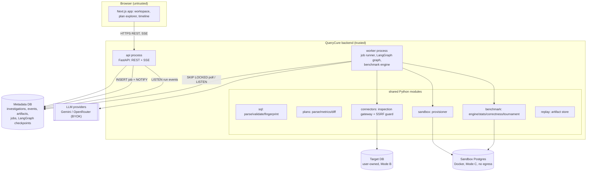

# Architecture

Status: Planned (Phase 0). Decisions referenced as ADR-NNNN live in [../engineering/adr/](../engineering/adr/).

## 1. Shape of the system

QueryCure is a **modular monolith** ([ADR-0001](../engineering/adr/ADR-0001-modular-monolith.md)): one Next.js frontend and one Python package that runs as two processes — `api` (FastAPI) and `worker` (LangGraph + benchmark engine). PostgreSQL is used three distinct ways and the three are never mixed.

Designed version: [docs/diagrams/system-architecture.html](../diagrams/system-architecture.html) (Mermaid below is the editable source of truth).

## 2. Components and responsibilities

| Component | Responsibility | Must not |
|---|---|---|
| **Web app** (`frontend/`) | Rendering, editing, SSE consumption, client UI state. | Hold secrets beyond the session cookie; talk to any DB. |
| **API** (`querycure.api`) | AuthN/Z, validation, CRUD on metadata, enqueue jobs, approval decisions, SSE fan-out from persisted events. | Run LLM calls or benchmarks inline (keeps request latency bounded). |
| **Worker** (`querycure.worker`) | Claim jobs; run/resume LangGraph runs; execute benchmarks; write events/artifacts. | Accept inbound network traffic. |
| **SQL module** | SQLGlot parsing, statement classification, allowlist validation, normalized fingerprint. | Be treated as the security boundary (see SECURITY §4). |
| **Plans module** | Parse PG JSON plans to a typed tree; derived metrics; plan diff. | Call LLMs. |
| **Inspection gateway** | The only path to a target DB: SSRF guard, session hardening, templated catalog queries, plain `EXPLAIN`. | Execute arbitrary SQL, `EXPLAIN ANALYZE`, DDL/DML. |
| **Sandbox provisioner** | Start/locate sandbox server, build template DBs from workloads, clone per arm, destroy. | Connect to non-sandbox hosts. |
| **Benchmark engine** | Deterministic measurement, correctness fingerprints, statistics, tournament verdict rules. | Depend on LLM output for any number or verdict. |
| **Agent graph** (`querycure.agents`) | Supervisor + five agents, typed state, routing, budgets, approvals. | Hold DB clients or secrets in state. |
| **Artifact store** | SHA-256 content-addressed immutable blobs in metadata DB; evidence lineage. | Store target-DB row data beyond bounded, opt-in samples (none in MVP). |
| **Metadata DB** | System of record. | Be reachable from agents directly (repositories only). |

## 3. Execution modes

| Mode | Inputs | DB access | May execute user/AI SQL? | Where it runs |
|---|---|---|---|---|
| A — Offline | Uploaded SQL, plan JSON, DDL | None | No | Everywhere |
| B — Live inspection | Connection (restricted role) | Target DB via gateway | Plain `EXPLAIN` of the validated user query only | Local profile; public demo disabled by default ([ADR-0003](../engineering/adr/ADR-0003-execution-modes.md)) |
| C — Sandbox benchmark | Workload (demo or user-provisioned sandbox) | Sandbox DB only | Yes, after approval, in disposable clones | Local profile; public demo uses prerecorded results |

A run may combine **B + C** (diagnose on target, verify on a sandbox with a similar workload). The report must state that verification happened on the sandbox dataset, not on the target.

## 4. Core data flow (one run)

1. **API** validates the request, writes `investigations` + `investigation_runs` (status `queued`), stores input artifacts (hashes), inserts a `jobs` row, `NOTIFY jobs`.
2. **Worker** claims the job (`FOR UPDATE SKIP LOCKED`), loads/creates the LangGraph thread (`thread_id = run_id`), and executes nodes.
3. Each node emits **events** into `investigation_events` (monotonic `seq` per run) and `NOTIFY run_<id>`; large outputs go to **artifacts**; facts go to **evidence**.
4. **API SSE endpoint** replays events after `Last-Event-ID`, then streams new ones on `NOTIFY` ([ADR-0005](../engineering/adr/ADR-0005-sse-event-log.md)).
5. At an approval gate the graph calls `interrupt()`; the job completes with status `awaiting_approval`. The API's decision endpoint inserts a `resume` job; the worker resumes from the checkpoint with `Command(resume=decision)`.
6. Benchmarks run inside the worker against sandbox clones; results persist as `benchmark_runs`; the deterministic audit produces `verification_results`.
7. The report node **finalizes** the run in one transaction: fixes the event cutoff, computes the events digest, builds the report from persisted records only (enables zero-LLM report replay), stores report and manifest artifacts, and sets the terminal status ([REPLAY_ENGINE §5](REPLAY_ENGINE.md#5-atomic-finalization)).

## 5. Trust boundaries (summary)

Browser ↔ API, API/worker ↔ LLM provider, worker ↔ target DB, worker ↔ sandbox. Details, threat model, and the boundary diagram: [SECURITY.md](SECURITY.md).

## 6. Failure handling

| Failure | Detection | Response |
|---|---|---|
| Worker crash mid-run | Job lease (`locked_until`) expires | Another worker reclaims; LangGraph resumes from last checkpoint; nodes are idempotent (artifact hashes, `ON CONFLICT DO NOTHING` on natural keys). |
| LLM 429/5xx/timeout | Provider exception | Exponential backoff with jitter (max 3), then optional fallback model, then node failure → partial result. |
| Invalid structured output | Pydantic validation error | One repair retry with the validation error; then drop output, record `agent_error` event. |
| Target DB unreachable / timeout | psycopg error / `statement_timeout` | Record tool error as evidence of *absence*; supervisor continues with remaining evidence (degrade to Mode A). |
| Sandbox failure | Provisioner error | Experiment `failed`; candidates `inconclusive` with reason `sandbox_unavailable`. |
| Benchmark noise too high | CV > threshold | Verdict `inconclusive` (`insufficient_evidence`) — never `verified`. |
| User cancels | `cancel_requested_at` set | Checked between nodes and between benchmark iterations; running sandbox query cancelled via `pg_cancel_backend`; status `cancelled`, partial results kept. |
| Budget exhausted | Budget guard before each LLM/tool call | Route to `report` with outcome `inconclusive` or `unverified_recommendations`. |

## 7. Scaling considerations

The MVP targets one worker with concurrency 2 (local) / 1 (demo). Scaling levers, in order:

1. More worker processes (queue already supports competing consumers).
2. Separate sandbox host from worker host (benchmarks are CPU/I/O heavy and noisy neighbours hurt measurement quality).
3. Move large artifacts to object storage (S3-compatible) behind the same `ArtifactStore` interface.
4. Replace `LISTEN/NOTIFY` fan-out with Redis pub/sub only if many API replicas make Postgres connections scarce.

Benchmark quality — not throughput — is the binding constraint: two benchmarks on the same host interfere. The provisioner holds a **per-sandbox-host advisory lock** so only one benchmark measures at a time per host.

## 8. Cross-references

- Agents: [AGENT_SYSTEM.md](AGENT_SYSTEM.md) · Schema: [DATABASE_DESIGN.md](DATABASE_DESIGN.md) · API: [API_DESIGN.md](API_DESIGN.md)
- Benchmarks: [BENCHMARK_ENGINE.md](BENCHMARK_ENGINE.md) · Replay: [REPLAY_ENGINE.md](REPLAY_ENGINE.md) · Deploy: [DEPLOYMENT.md](DEPLOYMENT.md)
