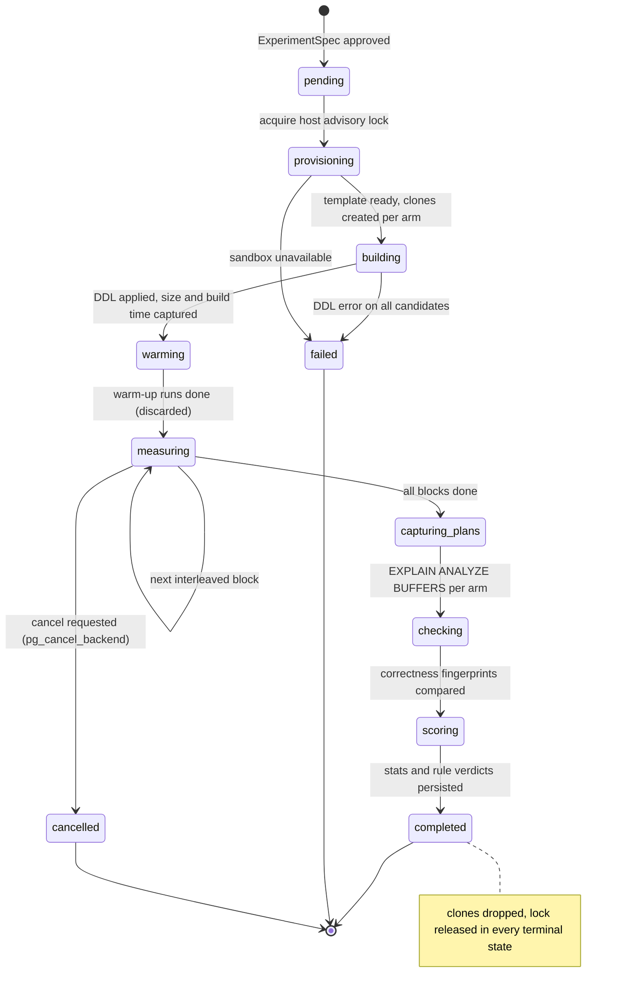
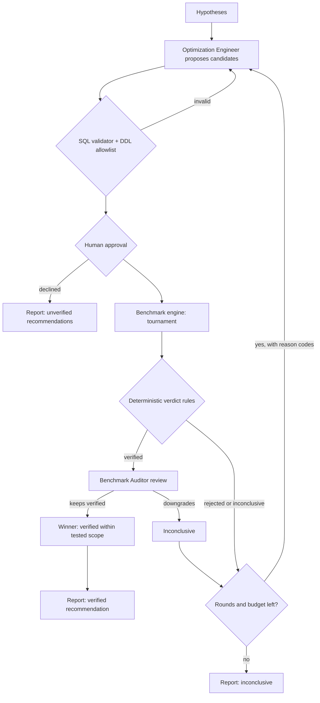

# Benchmark Engine

Status: **Implemented in Phase 3** (`bench@1`; the Benchmark Auditor follows in Phase 4). Decisions: [ADR-0007](../engineering/adr/ADR-0007-sandbox-template-clones.md) (sandbox clones), [ADR-0008](../engineering/adr/ADR-0008-benchmark-statistics.md) (statistics), [ADR-0009](../engineering/adr/ADR-0009-deterministic-verification-authority.md) (verdict authority), [ADR-0018](../engineering/adr/ADR-0018-robust-sample-quality-gate.md) (robust sample-quality gate).

Code: `benchmark/` (`stats`, `schedule`, `correctness`, `rules`, `tournament`, `executor`, `engine`), `sandbox/provisioner.py`, `sql/ddl_allowlist.py`, `replay/canonical/row_v1.py`, models in `domain/benchmark.py`. The engine is synchronous and runs in one worker thread; persistence and progress go through an `EngineHooks` protocol, so it is tested against the real sandbox with in-memory hooks (`tests/integration/test_benchmark_engine.py`, `test_benchmark_eval_table.py`).

The benchmark engine is **pure, deterministic Python**. It never calls an LLM. Its job is to answer: *under controlled, recorded conditions, is candidate X faster than the baseline, by how much, with what uncertainty, and does it return the same results?*

## 1. Inputs and outputs

```python
class ExperimentConfig(BaseModel):          # stored as an artifact (hash in manifest)
    schema_version: Literal[1] = 1
    experiment_id: UUID
    workload_id: str                         # "orders_ecommerce@v1:sf=1:seed=42"
    baseline_query: str                      # validated SELECT
    candidates: list[CandidateArm]           # id, kind, ddl[], query (rewrite) | None
    param_sets: list[ParamSet]               # name, values; ≥ 1, ≤ 5
    warmup_runs: int = 5
    measured_runs: int = 30                  # per arm × param set
    block_size: int = 5                      # interleaving granularity
    query_timeout_ms: int = 10_000
    max_index_bytes: int | None              # constraint from user/budget
    max_build_ms: int | None
    min_effect: float = 1.10                 # required speedup (CI lower bound)
    max_regression: float = 0.95             # any param set below this → reject
    max_cv: float = 0.25                     # coefficient of variation ceiling
    row_hash_cap: int = 100_000
    seed: int                                # interleaving + bootstrap RNG
    cache_mode: Literal["warm"] = "warm"     # "cold" is Advanced (F-48)

class ExperimentResult(BaseModel):
    experiment_id: UUID
    environment: EnvironmentFingerprint      # see below; stored on `experiments.environment`
    engine_version: str                      # "bench@1"; bumped when measurement or stats code changes output
    arms: list[ArmResult]                    # per arm × param set: latencies_ns (int samples), fingerprint, plan ref, buffers
    build: list[BuildResult]                 # per candidate: index size, build time, DDL errors
    stats: list[SpeedupStats]                # per candidate × param set
    verdicts: list[RuleVerdict]              # deterministic verdict + reason codes

class EnvironmentFingerprint(BaseModel):     # canonicalized with qc-json-v1; digest stored as environment_digest
    pg_version: str                          # server_version_num, e.g. "170002"
    pg_settings: dict[str, str]              # fixed list of planner/memory GUCs (REPLAY_ENGINE §9.3)
    sandbox_image_digest: str                # container image digest
    workload_id: str
    workload_data_digest: str                # digest of the template DB's table checksums
    row_profile: Literal["qc-row-v1"]
    cpu_arch: str; cpu_model: str; cpu_count: int; memory_bytes: int
    os: str; container_runtime: str
```

Samples are stored as integer nanoseconds (`perf_counter_ns`); milliseconds are a display unit only. This keeps raw evidence exact under canonicalization ([REPLAY_ENGINE §2.1](REPLAY_ENGINE.md#21-qc-json-v1-rules)) and lets any statistic be recomputed for replay comparison.

## 2. Lifecycle



Each state transition emits a `benchmark.progress` event. Persistence is coarser: `experiments.status` stores `pending`, `provisioning`, `running` (covers building → scoring), `completed`, `failed`, `cancelled`; the fine-grained state travels in the event payload's `state` field ([API_DESIGN §3](API_DESIGN.md#3-streaming-sse)). Measurement is resumable at block granularity (`benchmark_runs` unique key `(experiment_id, arm, param_set, block)`).

## 3. Sandbox layout

- One sandbox **server** (Docker `postgres:17` in local profile; version recorded) on an internal network.
- Per workload version a **template database** `qc_tpl_<workload_hash>` built once: schema + deterministic data + `ANALYZE` + `VACUUM (FREEZE)`; marked `datistemplate`.
- Per experiment arm a **clone** `qc_clone_<experiment>_<arm>` via `CREATE DATABASE … TEMPLATE qc_tpl_…` (file-level copy; far faster than reloading data). Clones are dropped at the end.
- Same server for all arms of an experiment → comparable hardware/config; one experiment at a time per server (advisory lock) → no neighbour interference from ourselves.
- Settings pinned and recorded: `shared_buffers`, `work_mem`, `effective_cache_size`, `random_page_cost`, `jit`, `max_parallel_workers_per_gather`. Default: `jit=off` (JIT compile time adds variance on short queries; recorded as a limitation).

**As implemented (Phase 3):**
- **Roles.** The compose superuser (`qc_sandbox_admin`) is used only by the provisioner (trusted code) to create and drop databases and build templates. Every template object and clone belongs to `qc_bench`: `NOSUPERUSER NOCREATEDB NOCREATEROLE NOREPLICATION NOBYPASSRLS`, connection limit 16, no `pg_execute_server_program` / `pg_read_server_files` / `pg_write_server_files`. Candidate DDL and benchmark queries only ever run as `qc_bench`. `bootstrap()` makes this idempotent. The password comes from `SANDBOX_BENCH_PASSWORD`.
- **Templates** `qc_tpl_<sha256(workload ref ‖ tpl@1)[:16]>` are built under a temporary name (`qc_tplbuild_…`) as `qc_bench`: workload statements, then `autovacuum_enabled = false` per table (clones inherit it), then `VACUUM (FREEZE)` with **no ANALYZE** (`stale_stats` depends on that). The build then renames the database, sets `IS_TEMPLATE true ALLOW_CONNECTIONS false`, and records `workload|tpl@1|data_digest` in the database comment. `data_digest` = `qc-json-v1` digest of the per-table md5 checksums. Rebuilding produces the same digest (integration test).
- **Clones** `qc_clone_<experiment[:12]>_<arm index>` use `CREATE DATABASE … TEMPLATE … OWNER qc_bench STRATEGY FILE_COPY`, with at most `max_clones` (8) at once.
- **Lease.** A session-level `pg_try_advisory_lock` on the admin database is polled until a deadline and gives up early on cancellation. A crashed worker's lock ends with its connection. Each lease starts with `cleanup_orphans()`: under the lock, every `qc_clone_*` / `qc_tplbuild_*` is an orphan.
- **Local network.** The worker and tests run on the host, which cannot join an `internal` network. `sandbox-relay` (`alpine/socat:1.8.0.3`) forwards `127.0.0.1:55432` → `sandbox-db:5432` and nothing else, so `sandbox-db` stays on `sandbox_net` with no egress (re-verified: TCP, DNS and metadata-db are all unreachable from it).

## 4. Measurement procedure

For each param set:
1. **Build** (per candidate clone): apply DDL in order and record `pg_relation_size` of new indexes and wall time of each DDL. Constraint violations (size/time) → candidate marked `rejected: constraint_violation`, excluded from measurement. The engine never runs an implicit `ANALYZE`: if it did, an index candidate would also silently get fresh statistics and the comparison would be confounded. Statistics changes happen only as explicit `analyze_statistics` candidates. Autovacuum is disabled on clone tables for the experiment's duration (recorded in the environment fingerprint).
2. **Warm-up**: `warmup_runs` executions per arm, discarded. Purpose: populate shared buffers/OS cache so all arms are measured in the same (warm) regime.
3. **Interleaved measurement**: build a schedule of blocks; each block runs every arm `block_size` times; arm order within each block is shuffled with `Random(seed)`. Blocks repeat until `measured_runs` per arm. Interleaving prevents slow drift (thermal, background autovacuum) from systematically favouring whichever arm ran later.
4. **Timing**: wall-clock around execute+fetch with `time.perf_counter_ns()` on the worker, using a dedicated connection per arm with prepared statement disabled (`prepare_threshold=None`) so plan caching is consistent; rows are streamed in chunks of 1,000 (libpq chunked-rows mode, `cursor.stream(size=1000)`) into the fingerprint hasher (fetch cost counts — the user pays it too). Each execution runs in a `READ ONLY` transaction opened **before** the timer starts, because BEGIN is harness overhead. *Changed from the plan:* a server-side cursor costs a DECLARE plus one FETCH round trip per batch. Streaming keeps memory bounded with a single round trip, and on the local Docker relay it roughly halved the per-sample floor (≈ 1.1 ms → ≈ 0.55 ms).
5. **Plan capture**: after timing, one `EXPLAIN (ANALYZE, BUFFERS, FORMAT JSON)` per arm × param set, stored as artifact. Kept separate from timing because `ANALYZE` instrumentation adds overhead.
6. **Cancellation check** between every block; long queries bounded by `statement_timeout`. A timeout counts as a failed sample (`timeout` reason), not as `query_timeout_ms`.

## 5. Correctness checks

| Check | Method | Fails when |
|---|---|---|
| Row count | count during fetch | differs from baseline |
| Result fingerprint (unordered) | SHA-256 over **sorted** per-row hashes (multiset) | differs |
| Result fingerprint (ordered) | streaming SHA-256 in result order | applied only when the ORDER BY is *total* (keys include a unique column); differs |
| Tie awareness | detect non-total ORDER BY + LIMIT | result sets may legitimately differ → `inconclusive: nondeterministic_order` unless multisets match |
| Truncation | > `row_hash_cap` rows | `inconclusive: result_too_large` |
| Error parity | baseline vs candidate errors | candidate errors where baseline doesn't (rejected in gate 3, not counted as noise in gate 2) |
| Arm stability | every successful execution of an arm returns the same fingerprint | otherwise `inconclusive: nondeterministic_order` ("results vary between executions") |

**Total ORDER BY** is proved conservatively (`correctness.order_is_total`): one base table, no joins, and the ORDER BY's plain columns cover a unique, non-partial, non-expression index read from the clone's catalog. When it cannot be proved, a reordering with equal multisets is accepted, and different rows under LIMIT are `inconclusive`, never `rejected`.

Row canonicalization uses the frozen `qc-row-v1` profile ([REPLAY_ENGINE §2.2](REPLAY_ENGINE.md#22-qc-text-v1-qc-raw-v1-qc-row-v1)), so fingerprints from an original experiment and its replay are comparable across Python and driver versions.

**Scope of claims.** Matching fingerprints across the tested param sets show *equivalence on the tested data*, not formal SQL equivalence. Reports say exactly that. Rewrites (which can change semantics, e.g., `NOT IN` vs `NOT EXISTS` with NULLs) require **≥ 3 param sets** including at least one designed edge case (NULL-bearing, empty result), and are labeled "tested equivalence" in the UI. Index-only candidates cannot change semantics by construction, but are still fingerprinted (catches collation/planner bugs and our own harness bugs).

## 6. Statistics

Per arm × param set (n = measured runs, after excluding timeouts):

| Statistic | Rule |
|---|---|
| median | always |
| p95 | only if n ≥ 20; otherwise shown as "n/a (n<20)" |
| min, max, IQR | always |
| CV = stdev / mean | always (reported) |
| robust CV = IQR / (1.349 · median) | always; > `max_cv` → gate 4b `insufficient_evidence` ([ADR-0018](../engineering/adr/ADR-0018-robust-sample-quality-gate.md)) |
| Speedup ratio | `median(baseline) / median(candidate)` |
| 95% CI of speedup | percentile bootstrap, 2,000 resamples, `Random(seed)`; resample each arm independently, recompute ratio of medians |

Why bootstrap of median ratio: latency distributions are skewed with outliers, so means and t-tests mislead; medians are robust, and the bootstrap needs no distribution assumption and only stdlib (`statistics`, `random`). See ADR-0008 for alternatives considered (Mann–Whitney U, HDR histograms).

**Sample size.** Default 30 measured runs per arm/param set gives a stable median and a usable p95 for queries in the ms–s range. For queries > 2 s the engine lowers `measured_runs` to fit the time budget but never below 10; with n < 20 the best possible verdict is `verified` only if CI lower bound ≥ `min_effect` *and* CV ≤ `max_cv`; otherwise `inconclusive`.

## 7. Verdict rules (deterministic)

Evaluated in order; first failing gate sets the verdict and reason code.

| # | Gate | Fail → verdict (reason code) |
|---|---|---|
| 1 | DDL applied; constraints (`max_index_bytes`, `max_build_ms`) met | `rejected` (`ddl_failed`, `constraint_violation`) |
| 2 | No errors/timeouts above 10% of samples | `inconclusive` (`unstable_execution`) |
| 3 | Correctness: all param sets match baseline | `rejected` (`result_mismatch`) / `inconclusive` (`nondeterministic_order`, `result_too_large`) |
| 4a | Sample count: n ≥ 10 for both arms | `inconclusive` (`insufficient_evidence`) |
| 5 | No regression: every param set's CI **upper** bound ≥ `max_regression` | `rejected` (`regression`) |
| 4b | Sample quality: robust CV ≤ `max_cv` for both arms | `inconclusive` (`insufficient_evidence`) |
| 6 | Effect: primary param set CI **lower** bound ≥ `min_effect` | `inconclusive` (`effect_not_significant`) if CI straddles; `rejected` (`no_improvement`) if CI upper < 1.0 |
| — | All gates pass | `verified` |

Gate 5 runs before 4b ([ADR-0018](../engineering/adr/ADR-0018-robust-sample-quality-gate.md)): noise only widens a bootstrap CI, so a CI entirely below `max_regression` is real harm even when the samples are noisy. Gate 3 also holds rewrites of parameterized queries to the ≥ 3 param sets with an edge case rule (§5) (`inconclusive: insufficient_evidence`). The engine reports the first failing gate's number in `RuleVerdict.gate`.

The Benchmark Auditor agent then reviews plans and context and may **downgrade** `verified` → `inconclusive` with a stated reason (e.g., "speedup comes from a plan relying on a correlation present only in synthetic data"). It may never upgrade.

## 8. Optimization Tournament

- All approved candidates of a round run in one experiment against one shared baseline, same schedule, same seed.
- Ranking among `verified`: primary key = CI lower bound of speedup on primary param set (desc); tie-break (within 5%) = smaller index bytes, then lower write-overhead class, then simpler change (statistics < index < rewrite).
- Combined candidates (e.g., index + rewrite) are allowed only as an explicit arm proposed by the Optimization Engineer, never inferred.
- If no candidate is `verified`, rejection reasons feed the next round (bounded loop below).



## 9. Operational costs captured

| Cost | MVP | How |
|---|---|---|
| Index size | ✅ | `pg_relation_size(indexrelid)` |
| Index build time | ✅ | wall time of `CREATE INDEX` (non-concurrent in sandbox; report notes `CONCURRENTLY` in production takes longer and doesn't block writes) |
| Write overhead | Post-MVP (F-47) | N single-row inserts/updates in a rolled-back transaction per arm, interleaved, same statistics |
| Plan stability | ✅ | plan shape per param set; warn when the plan differs between param sets |

Until F-47 ships, the Index Strategist provides a qualitative write-overhead class (`low/medium/high`, from table write stats if available) and the report marks it **unmeasured**.

## 10. Known limitations (stated in every report)

- Warm cache only; cold-cache behaviour can differ by orders of magnitude.
- Single-session measurement; no concurrency, lock, or connection-pool effects.
- Synthetic or user-provisioned sandbox data; distribution may differ from production — and the planner's choices depend on statistics derived from that data.
- Sandbox hardware/config ≠ production; ratios transfer better than absolute times, but neither is guaranteed.
- Docker on macOS adds virtualization noise; CV gate exists for this reason.

## 11. Demo workloads (ground-truth fixtures)

Deterministic generators (`workloads/registry.py`, seeded, versioned; workload ID `name@vN:sf=X:seed=N`). Scale factor `sf` (0.01–10) scales row counts.

- **Generation:** data is generated server-side from `generate_series` and an `md5`-based per-column hash of (row, seed, salt). It never uses `random()`, `now()` or `hashtext()`: they change between runs or PostgreSQL versions. Timestamps count back from a fixed epoch (2026-01-01 UTC).
- **SQL safety:** statements are composed with `psycopg.sql`, using literals and identifiers only.
- **Verified reproducible:** an identical ref gives identical per-table md5 checksums. The sf=1 `orders_ecommerce` checksums matched across two independent loads and a rewrite of the generator code.
- **Implemented:** all six. `orders_ecommerce`, `rewrite_trap` and `no_benefit` arrived in Phase 1. `join_fanout`, `stale_stats` and `index_regression` arrived in Phase 3 (T3.3), each checked on real plans in the sandbox:
  - `join_fanout`: `tier = country % 3`, so `country = $1 AND tier = $2` is estimated as two independent predicates (underestimate). `posts.author_id` has no index.
  - `stale_stats`: `events_kind_idx` exists, and 'view' rows are analyzed. The same number of 'purchase' rows is then bulk-loaded **after** ANALYZE, so 'purchase' is estimated at ~1 row and the join to `accounts` runs as a nested loop. `ANALYZE events` fixes it.
  - `index_regression`: rows are inserted in hash order, and 'escalated' (1%) exists only among the newest 1% of tickets. With an index on `(opened_at, id)`, `ORDER BY opened_at, id LIMIT 10` finds 10 'open' tickets at once (measured 4.6× faster at sf=0.1). For 'escalated' it walks ~99% of the index (5.5× slower).

| Workload | Injected problem | Expected result |
|---|---|---|
| `orders_ecommerce` | No index on `(customer_id, created_at)`; query filters + orders + limits | Composite index `verified` |
| `join_fanout` | Join on unindexed FK column + misestimated join cardinality | Index on join key `verified`; misestimate hypothesis cited |
| `stale_stats` | Data bulk-loaded after `ANALYZE` (template built without re-analyze, flagged) | `ANALYZE` candidate `verified`; stale-stats hypothesis |
| `rewrite_trap` | `NOT IN` over nullable column | `NOT EXISTS` rewrite `rejected: result_mismatch` |
| `no_benefit` | Tiny table, already optimal plan | `no_action_needed` or all `inconclusive` |
| `index_regression` | Low-selectivity predicate where an index scan is slower than seq scan for one param set | candidate `rejected: regression` |

These double as the eval suite's ground truth ([TESTING_STRATEGY.md](../engineering/TESTING_STRATEGY.md)).
