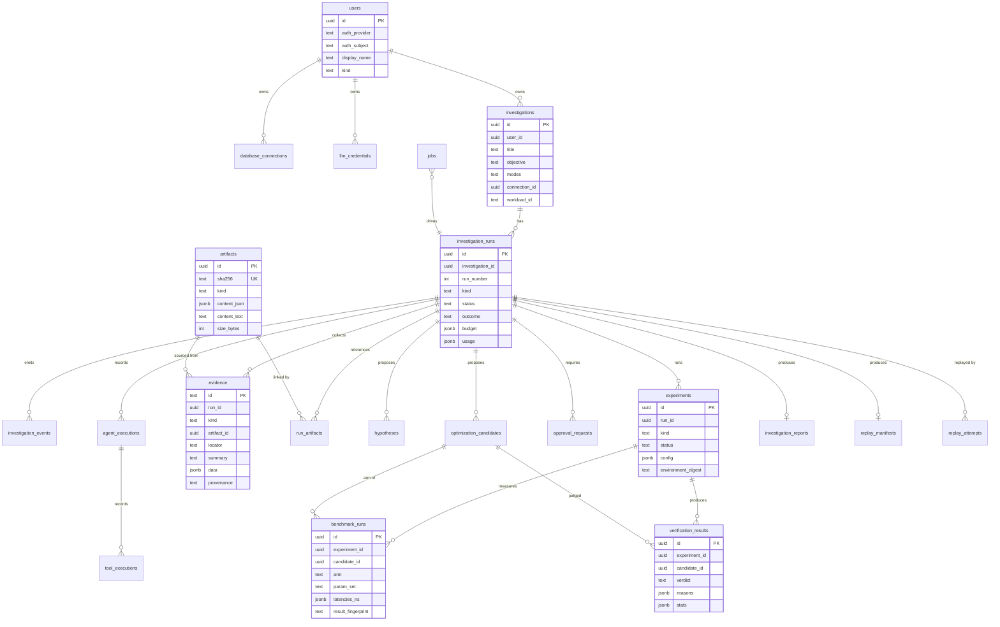

# Database Design

Status: Planned. Conventions: [ADR-0006](../engineering/adr/ADR-0006-metadata-schema-conventions.md).

## 1. Three databases, three roles

| Database | Owner | Purpose | Access path | Lifecycle |
|---|---|---|---|---|
| **Metadata DB** | QueryCure | System of record: users, investigations, events, artifacts, evidence, jobs, checkpoints | SQLAlchemy async repositories (`querycure.db`) | Persistent; Neon in public demo, Docker locally |
| **Target DB** | User | Read-only inspection (Mode B) | `connectors.inspection_gateway` only | Not ours; never written to |
| **Sandbox DB** | QueryCure (ephemeral) | Benchmark clones (Mode C) | `sandbox` + `benchmark` modules | Template per workload version; clones per experiment arm, dropped after use |

This document specifies the **metadata DB**. Sandbox layout is in [BENCHMARK_ENGINE.md](BENCHMARK_ENGINE.md#3-sandbox-layout).

## 2. Conventions (applies to all metadata tables)

- `id UUID PRIMARY KEY DEFAULT uuid_generate_v4()` (extension `uuid-ossp`, created in migration 0001).
- Strings are `TEXT`; enums are `TEXT` with `CHECK (col IN (...))` so migrations stay simple and values map 1:1 to Python `StrEnum`s.
- Timestamps `TIMESTAMPTZ`, UTC. Standard columns: `created_at TIMESTAMPTZ NOT NULL DEFAULT now()`, `updated_at TIMESTAMPTZ`, `deleted_at TIMESTAMPTZ`.
- `updated_at` maintained by one shared trigger function `set_updated_at()` defined in migration 0001.
- **No foreign-key constraints and no cascades.** Relationships are enforced in repositories and in transactions; every relationship column is indexed. Rationale and trade-offs in ADR-0006.
- **Soft delete** for user-facing entities (`deleted_at`). Append-only records (events, benchmark runs, artifacts) are never updated; they are purged by retention jobs (the only hard deletes, done by system jobs, documented below).
- Partial indexes `WHERE deleted_at IS NULL` for active-record lookups.
- JSON payloads use `JSONB`, schema-validated by Pydantic before writing; each JSONB column has a documented model.
- Migrations: Alembic, forward-only in production, one concern per migration.

Exception: LangGraph's checkpointer manages its own tables in schema `langgraph`; we do not alter them.

## 3. Entity overview

Consolidations versus the original entity list (justified):
- `QueryArtifact`, `SchemaSnapshot`, `ExecutionPlan` → one **`artifacts`** table with `kind` (they share hashing, immutability, retention, and lineage). Typed access via Pydantic models per kind.
- `ToolExecution` and `AgentExecution` remain separate (different cardinality and fields), both append-only.
- `Experiment` holds the tournament; `BenchmarkRun` holds per-arm × per-param-set measurements.



(`evidence.id` is a text ID `ev_…` because agents cite it in prompts; short, stable, deterministic.)

## 4. Tables

Standard columns (`created_at`, `updated_at`, `deleted_at`) are omitted below unless relevant.

### users
| Column | Type | Notes |
|---|---|---|
| id | UUID | |
| kind | TEXT | `local`, `anonymous`, `oauth` |
| auth_provider / auth_subject | TEXT | `github` / provider user id; NULL for local/anonymous |
| display_name, email | TEXT | email nullable; never sent to LLMs |
| last_seen_at | TIMESTAMPTZ | anonymous-user retention |

Index: unique `(auth_provider, auth_subject) WHERE deleted_at IS NULL AND auth_provider IS NOT NULL`.

### sessions
`id`, `user_id`, `token_hash TEXT` (SHA-256 of the opaque cookie token), `expires_at`, `ip_hash`, `user_agent`. Index on `token_hash` (unique), `expires_at`.

### llm_credentials
| Column | Type | Notes |
|---|---|---|
| user_id | UUID | |
| provider | TEXT | `gemini`, `openrouter` |
| ciphertext | BYTEA | AES-256-GCM of the API key ([ADR-0012](../engineering/adr/ADR-0012-byok-credential-storage.md)) |
| nonce | BYTEA | 12 bytes |
| key_version | INT | master-key rotation |
| key_hint | TEXT | last 4 chars, for display |
| default_model | TEXT | |
| last_used_at | TIMESTAMPTZ | |

### database_connections
| Column | Type | Notes |
|---|---|---|
| user_id | UUID | |
| name | TEXT | |
| host, port, dbname, username | TEXT/INT | |
| password_ciphertext, password_nonce, key_version | BYTEA/INT | same scheme as llm_credentials |
| sslmode | TEXT | `require` minimum outside local profile |
| environment | TEXT | `development`, `staging`, `production` (user-declared; production forces approval) |
| purpose | TEXT | `inspection` (Mode B) or `sandbox` (user-provisioned Mode C target) |
| capabilities | JSONB | `TargetCapabilities` from last test |
| last_tested_at, last_test_status | TIMESTAMPTZ, TEXT | |

Index: `(user_id) WHERE deleted_at IS NULL`.

### investigations
`user_id`, `title`, `objective TEXT` (≤ 2,000 chars, CHECK), `modes TEXT[]`, `connection_id`, `workload_id TEXT` (e.g. `orders_ecommerce@v1:sf=1:seed=42`), `query_artifact_id`, `latest_run_id`, `latest_outcome`.
Indexes: `(user_id, created_at DESC) WHERE deleted_at IS NULL`; GIN trigram on `title` is Post-MVP.

### investigation_runs
| Column | Type | Notes |
|---|---|---|
| investigation_id | UUID | |
| run_number | INT | unique per investigation |
| kind | TEXT | `initial`, `reinvestigation`, `experiment_replay` |
| parent_run_id | UUID | for re-investigation/replay comparisons |
| status | TEXT | `queued`, `running`, `awaiting_approval`, `cancelling`, `completed`, `failed`, `cancelled` |
| outcome | TEXT | nullable until completed |
| llm_provider, llm_model | TEXT | |
| budget, usage | JSONB | `RunBudget`, `BudgetUsage` |
| cancel_requested_at, started_at, finished_at | TIMESTAMPTZ | |
| error | JSONB | last fatal error (redacted) |
| idempotency_key | TEXT | from `Idempotency-Key` header |
| last_event_seq | INT | NOT NULL DEFAULT 0; event sequence counter |
| finalized_at | TIMESTAMPTZ | set once by `finalize_run` ([REPLAY_ENGINE §5](REPLAY_ENGINE.md#5-atomic-finalization)); after it, content writes are rejected |
| events_cutoff_seq | INT | last content event included in the events digest |

Indexes: unique `(investigation_id, run_number)`; `(status) WHERE status IN ('queued','running','awaiting_approval')`; unique `(idempotency_key) WHERE idempotency_key IS NOT NULL`.

### investigation_events (append-only)
`id BIGINT GENERATED ALWAYS AS IDENTITY`, `run_id`, `seq INT` (monotonic per run, assigned in the same transaction via `UPDATE investigation_runs SET last_event_seq = last_event_seq + 1 WHERE id = $run RETURNING last_event_seq` — the row lock serializes writers; `investigation_runs.last_event_seq INT NOT NULL DEFAULT 0`), `type TEXT`, `payload JSONB`, `created_at`.
Index: unique `(run_id, seq)`. This table backs SSE resume (`Last-Event-ID = seq`) and report replay. Once the run is finalized, only the lifecycle types `report.ready` and `run.status_changed` may be appended (seq > `events_cutoff_seq`).

### agent_executions / tool_executions (append-only)
- `agent_executions`: `run_id`, `agent`, `node`, `attempt`, `prompt_version`, `model`, `input_tokens`, `output_tokens`, `latency_ms`, `status`, `output_artifact_id`, `error`.
- `tool_executions`: `agent_execution_id`, `run_id`, `tool`, `args JSONB` (redacted), `status`, `latency_ms`, `evidence_ids TEXT[]`, `error`.
Indexes on `run_id`; `agent_execution_id`.

### artifacts (immutable, content-addressed)
| Column | Type | Notes |
|---|---|---|
| sha256 | TEXT | profile-tagged digest `SHA-256(profile ‖ LF ‖ canonical bytes)`, lowercase hex ([REPLAY_ENGINE §2.3](REPLAY_ENGINE.md#23-digest-definition)); UNIQUE |
| kind | TEXT | `query`, `param_sets`, `schema_snapshot`, `plan`, `plan_analyze`, `stats_snapshot`, `workload_snapshot`, `experiment_config`, `agent_output`, `report_json`, `report_md`, `environment`, `replay_manifest` |
| media_type | TEXT | `application/json`, `text/sql`, `text/markdown` |
| content | BYTEA | exact canonical bytes; CHECK `octet_length ≤ 5 MB`. **Not JSONB/TEXT:** JSONB reorders keys, normalizes numbers and rejects `\u0000`, and TEXT rejects NUL, so either could make a stored artifact fail digest verification. Query JSON content ad hoc with `convert_from(content, 'UTF8')::jsonb`. |
| canonicalization | TEXT | profile ID: `qc-json-v1`, `qc-text-v1`, `qc-raw-v1` (frozen; see REPLAY_ENGINE §2) |

Artifacts are shared across runs by hash; ownership comes from `run_artifacts`. Because they are immutable and purged only by retention, `updated_at`/`deleted_at` stay NULL (no trigger fires: the app role cannot `UPDATE`).

**Insert, dedupe, and read under the restricted `qc_app` role.** These paths need only `INSERT` and `SELECT`:

1. **Store.**
   - `INSERT … ON CONFLICT (sha256) DO NOTHING RETURNING id`. `DO NOTHING` needs only `INSERT`; `DO UPDATE` would need `UPDATE` and is forbidden here.
   - When the insert returns no row (dedupe hit), `SELECT id, canonicalization, kind FROM artifacts WHERE sha256 = $1`.
   - If the existing row's `canonicalization` differs from the one being written, raise `ArtifactConflict`. This can only happen through a bug, because the digest includes the profile.
2. **Link.** `INSERT INTO run_artifacts … ON CONFLICT (run_id, artifact_id, role) DO NOTHING`.
3. **Read.** Plain `SELECT`. Verification re-canonicalizes and re-hashes in application code.
4. **Never lock.** Never use `SELECT … FOR UPDATE/FOR SHARE` on `artifacts`, `investigation_events`, or `benchmark_runs`. Row-locking clauses require `UPDATE` privilege. Writers serialize on the owning `investigation_runs` / `experiments` row instead.
5. **Concurrency.** Two transactions inserting the same digest concurrently: the second waits on the unique index, then takes the `DO NOTHING` path and re-selects. No error and no duplicate.

### run_artifacts
`run_id`, `artifact_id`, `role TEXT` (e.g. `input.query`, `context.plan`, `output.report`), `produced_by TEXT` (node name). Unique `(run_id, artifact_id, role)`.

### evidence
As in the ER diagram. Unique `(run_id, id)`. `id` = `ev_` + first 12 hex of `sha256(run_id|kind|artifact_sha|locator)` (deterministic → idempotent inserts).

### hypotheses, optimization_candidates
Mirror the Pydantic models in [AGENT_SYSTEM.md §4](AGENT_SYSTEM.md#key-models-abridged) with `run_id`, `round INT`, `status` (`proposed`, `approved`, `declined`, `benchmarked`, `verified`, `rejected`, `inconclusive`), and `sql_artifact_id` for candidate SQL.

### approval_requests
`run_id`, `kind` (`sandbox_execution`, `production_explain`, `budget_extension`), `payload JSONB` (exact SQL list + target), `status` (`pending`, `approved`, `partially_approved`, `declined`, `expired`), `decided_by`, `decided_at`, `expires_at`, `decision JSONB` (approved candidate ids).
Index: `(run_id) WHERE status = 'pending'`.

### experiments
`run_id`, `kind` (`single`, `tournament`), `status` (`pending`, `provisioning`, `running`, `completed`, `failed`, `cancelled`), `config_artifact_id` (full `ExperimentConfig`), `environment JSONB` (`EnvironmentFingerprint`), `environment_digest TEXT`, `engine_version TEXT` (`bench@N`), `row_profile TEXT` (`qc-row-v1`), `replay_of_experiment_id` (nullable, set by experiment replay), `round INT`, `started_at`, `finished_at`.

### benchmark_runs (append-only)
`experiment_id`, `candidate_id` (NULL = baseline), `arm TEXT`, `param_set TEXT`, `block INT` (interleaving block index), `latencies_ns JSONB` (array of integers; raw samples, never floats — REPLAY_ENGINE §2.1 rule 4), `rows_returned INT`, `result_fingerprint TEXT`, `plan_artifact_id`, `buffers JSONB`, `index_size_bytes BIGINT`, `index_build_ns BIGINT`, `provenance TEXT`.
Unique `(experiment_id, arm, param_set, block)` → idempotent resume.

### verification_results
`experiment_id`, `candidate_id`, `verdict` (`verified`, `rejected`, `inconclusive`), `reasons JSONB` (list of `{code, detail}`), `stats JSONB` (`SpeedupStats` per param set), `auditor_notes TEXT`, `auditor_downgraded BOOL`.

### investigation_reports
`run_id` (unique), `report_json_artifact_id`, `report_md_artifact_id`, `outcome`, `confidence`, `report_schema_version INT`, `builder_version TEXT`, `md_renderer_version TEXT` ([REPLAY_ENGINE §7](REPLAY_ENGINE.md#7-report-builder-and-renderer-versioning)).

### replay_manifests
`run_id` (unique), `manifest_artifact_id`, `manifest_sha256`, `manifest_schema_version INT`, `events_cutoff_seq INT`, `events_digest TEXT`. Written inside the finalization transaction. Content defined in [REPLAY_ENGINE §4](REPLAY_ENGINE.md#4-replay-manifest).

### replay_attempts
| Column | Type | Notes |
|---|---|---|
| user_id | UUID | owner (requester) |
| kind | TEXT | `report`, `experiment` |
| source_run_id | UUID | run being replayed |
| source_experiment_id | UUID | experiment replay only |
| replay_run_id / replay_experiment_id | UUID | experiment replay only; the new run (`kind = experiment_replay`) and experiment |
| approval_request_id | UUID | experiment replay: approval created by the confirmation |
| status | TEXT | report: `verifying`, `verified`, `verified_stored_only`, `not_replayable`, `integrity_failed`, `error`; experiment: `checking`, `not_replayable`, `queued`, `running`, `comparing`, `reproduced`, `reproduced_with_drift`, `not_reproduced`, `inconclusive`, `failed`, `cancelled` |
| failure_code | TEXT | primary code ([REPLAY_ENGINE §8](REPLAY_ENGINE.md#8-replay-lifecycles-and-failure-codes)); NULL on success |
| warnings | TEXT[] | e.g. `builder_retired` |
| result | JSONB | report: `checks[]`; experiment: `comparison_mode` (`same_environment` / `cross_environment`), pairwise comparison, both environment fingerprints + classified diff, `config` |
| started_at / finished_at | TIMESTAMPTZ | |

Indexes: `(source_run_id, created_at DESC)`; `(status) WHERE status IN ('checking','queued','running','comparing')`; `(replay_run_id)`.

### jobs
| Column | Type | Notes |
|---|---|---|
| id | UUID | |
| kind | TEXT | `run_start`, `run_resume`, `experiment_replay`, `retention_sweep` |
| run_id | UUID | nullable for system jobs |
| payload | JSONB | |
| status | TEXT | `pending`, `running`, `done`, `failed`, `dead` |
| attempts / max_attempts | INT | default max 3 |
| run_after | TIMESTAMPTZ | backoff scheduling |
| locked_by / locked_until | TEXT / TIMESTAMPTZ | lease; heartbeat extends |
| dedupe_key | TEXT | unique where not null (prevents duplicate resume jobs) |

Claim query:
```sql
UPDATE jobs SET status='running', locked_by=$1, locked_until=now()+interval '60 seconds', attempts=attempts+1
WHERE id = (
  SELECT id FROM jobs
  WHERE (status='pending' AND run_after <= now())
     OR (status='running' AND locked_until < now())
  ORDER BY run_after
  FOR UPDATE SKIP LOCKED
  LIMIT 1)
RETURNING *;
```
Index: `(run_after) WHERE status = 'pending'`; `(locked_until) WHERE status = 'running'`.

### rate_limits
`bucket_key TEXT PRIMARY KEY`, `tokens FLOAT`, `refilled_at TIMESTAMPTZ` — token bucket updated atomically with a single `UPDATE … RETURNING` (Phase 5).

## 5. Ownership & authorization

**Database roles.** The application role (`qc_app`) has `INSERT`/`SELECT` but no `UPDATE`/`DELETE` on the append-only tables `artifacts`, `investigation_events`, and `benchmark_runs`, plus `USAGE` on any sequences those inserts need (e.g. the identity sequence of `investigation_events`). Each table's grants ship in the migration that creates the table, so the restriction exists from the first phase that uses the table. Roles are created in the Phase 1 baseline migration. Only `qc_retention`, used solely by the `retention_sweep` job, may delete from them. Migrations run as the owner role. This prevents application-level mutation of sealed evidence; it is not protection against a compromised owner credential ([REPLAY_ENGINE §6](REPLAY_ENGINE.md#6-integrity-scope-what-the-digests-do-and-do-not-prove)).


Every user-facing row is reachable from `users.id` via `investigations.user_id` or a direct `user_id`. Repositories take `user_id` as a mandatory parameter for user-scoped reads (`get_run(user_id, run_id)` → returns `None` for another user's run; API maps to 404, never 403, to avoid existence leaks). Artifacts are only readable through a `run_artifacts` join scoped to the user.

## 6. Data lifecycle & retention

| Data | Retention (default) | Mechanism |
|---|---|---|
| Anonymous demo users + their investigations | 7 days after `last_seen_at` | `retention_sweep` job: soft delete, then hard purge after 7 more days |
| Registered users' investigations | Until user deletes (soft) + 30 days | sweep |
| LangGraph checkpoints | 30 days after terminal status | sweep |
| Events, agent/tool executions, replay attempts | Same as parent investigation | sweep |
| Orphaned artifacts (no `run_artifacts`) | 7 days | sweep |
| Connection passwords | Deleted immediately on connection delete (ciphertext nulled, not soft) | repository |
| BYOK keys | Deleted immediately on removal | repository |
| Sessions | until `expires_at` + 1 day | sweep |

## 7. Status transitions & idempotency

- Run status transitions are enforced in one function `transition_run(run_id, from_states, to_state)` using `UPDATE … WHERE status = ANY($from) RETURNING`; zero rows → `InvalidTransition`. Allowed transitions = the state machine in [AGENT_SYSTEM.md §9](AGENT_SYSTEM.md#9-run-status-state-machine).
- `POST` endpoints that create work accept `Idempotency-Key`; stored on the created row with a unique partial index.
- Event insertion and status transition happen in the same transaction so SSE never shows a status the DB doesn't have.

## 8. Versioning

- Schema: Alembic revision chain; `alembic_version` recorded in the replay manifest.
- Artifact formats: frozen canonicalization profile (`canonicalization`) + per-kind `schema_version` field inside JSON content. Report outputs additionally record builder and renderer versions.
- Prompts/models: `agent_executions.prompt_version`, `model`.
- Workloads: `workload_id` includes generator version and seed.

## 9. Sensitive data handling

| Data | Classification | Handling |
|---|---|---|
| DB passwords, API keys | Secret | AES-256-GCM at rest; decrypted in-process only for the duration of use; never logged, never in state/events/artifacts |
| Query text | User confidential | Stored as artifact; sent to the user's chosen LLM (disclosed in UI) |
| Schema (names, comments) | User confidential | Stored; sent to LLM; comments truncated to 200 chars |
| Column statistics values (MCVs, histogram bounds) | Potentially personal data | **Not collected** by default; only numeric stats (`null_frac`, `n_distinct`, `correlation`, `avg_width`) |
| Result rows (target DB) | Never collected | Mode B never executes the query |
| Result rows (sandbox) | Synthetic demo data | Hashed for fingerprints; not persisted |
| IP addresses | Personal data | Stored only as salted hash for rate limiting |

## 10. Indexing strategy summary

All relationship columns indexed; partial indexes on active rows; append-only tables indexed by `(run_id, …)`; queue tables with partial indexes on actionable states. Expected sizes are small (thousands of runs), so the priority is correctness of predicates (always include `deleted_at IS NULL`), not exotic indexing. Fittingly, QueryCure's own slow queries make good eval fixtures later.
