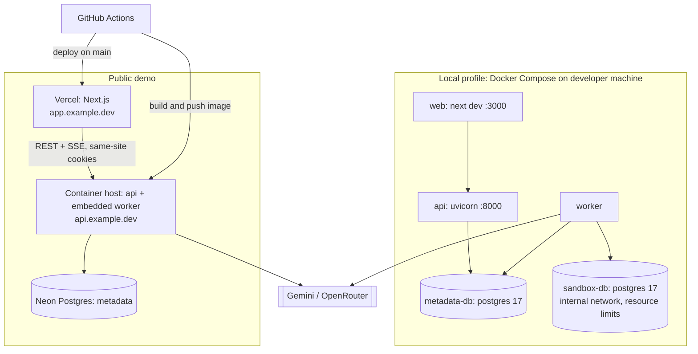

# Deployment

Status: **Phase 5: deployment artifacts prepared and the restricted demo profile verified locally (2026-10-16); no public deployment has been made** (that needs the owner's approval, a domain and accounts). Two operational profiles share one codebase; behaviour differs via `QC_PROFILE=local|demo` and feature flags.

## 1. Profiles

| Capability | Local full development | Public demo |
|---|---|---|
| Mode A offline analysis | ✅ | ✅ |
| Mode B live inspection | ✅ (private targets allowed by flag) | ❌ by default (`FEATURE_LIVE_INSPECTION_PUBLIC=false`) |
| Mode C sandbox benchmarking | ✅ Docker sandbox | ❌ live; ✅ **prerecorded** demo benchmarks, labeled |
| Multi-agent investigations | ✅ | ✅ (BYOK, stricter budgets) |
| Report / experiment replay | ✅ / ✅ | ✅ / ❌ |
| Auth | Single local user (auto session) | Anonymous sessions; GitHub and Google OAuth (Phase 5) |
| Worker | separate process | embedded in API container (`WORKER_MODE=embedded`) or separate process |
| LLM keys | `.env` fallback or BYOK | BYOK only (no shared server key) |

### What is real-time, simulated, or prerecorded on the public demo

| Feature | Status | Label shown |
|---|---|---|
| SQL parsing, plan parsing, plan explorer, schema parsing | Real, live | — |
| Agent investigation on uploaded inputs / demo workloads | Real LLM calls (user's key) | "Live analysis" |
| Benchmarks and tournament results for demo workloads | Prerecorded from local-profile runs (with environment fingerprint) | "Prerecorded on <hardware>, <date> — not your database" |
| Saved example investigations | Report replay of real local runs | "Replay" |
| Live benchmarking of user databases | Not offered | — |

Prerecorded evidence is stored with `provenance = "prerecorded"`; the verdict engine refuses to mix prerecorded and measured samples.

## 2. Deployment architecture

### Local Compose services (`infra/docker/compose.yaml`)

*Implemented (Phase 3; default changed by [ADR-0020](../engineering/adr/ADR-0020-container-worker-default-for-local-benchmarks.md), D12):*
- `metadata-db`;
- `sandbox-db`, with planner settings pinned with `-c`;
- `sandbox-relay` (`alpine/socat:1.8.0.3`, loopback `127.0.0.1:55432` → `sandbox-db:5432`), so a host-run worker and the tests can reach the internal-only sandbox;
- `worker`, built from `backend/Dockerfile`, on `default` + `sandbox_net`.

`docker compose up -d` starts all four. **The container worker is the default local Mode C benchmarking path:**
- an in-network `SELECT 1` round trip is ≈ 33–40 µs, versus ≈ 355–451 µs through the published port;
- it sets `QC_BENCH_PATH=docker-network`, recorded as the environment fingerprint's `container_runtime`;
- after backend changes, rebuild it with `docker compose up -d --build worker`.

**Host-run development is still supported:** start `docker compose up -d metadata-db sandbox-db sandbox-relay` and run the worker on the host. Its default `QC_BENCH_PATH=docker-relay` is what the fingerprint then records. **Never run both workers**: they would split jobs across measurement paths. The Playwright e2e starts its own host worker with the stub LLM, so run `docker compose stop worker` first and start it again afterwards. `api` and `web` run on the host.

| Service | Image | Notes |
|---|---|---|
| `metadata-db` | `postgres:17` | port 5432 on localhost only; volume `qc_meta` |
| `sandbox-db` | `postgres:17` + `hypopg` (optional) | networks: `sandbox_net` (internal: true); `cpus: 2`, `mem_limit: 2g`, `shm_size: 512m`; tuned `postgresql.conf` checked into repo |
| `api` | built from `backend/Dockerfile` | `uvicorn querycure.api.main:app` |
| `worker` | built from `backend/Dockerfile` | `python -m querycure.worker` as uid 10001; joins default + `sandbox_net`; **default** local benchmarking path (ADR-0020) |
| `web` | `node:22` (dev) | `pnpm dev`; or run on host |

Developers may run `api`/`worker`/`web` on the host and only the databases in Docker; both are supported.

## 2b. Deployment artifacts (Phase 5, implemented)

| Artifact | Purpose |
|---|---|
| `backend/Dockerfile` | One image for the **API** (`uvicorn querycure.api.main:app`), the **worker** (default CMD) and the **migration step** (`alembic upgrade head`). Ships `migrations/` (readiness compares with the head) and the demo's prerecorded benchmark fixtures. Runs as uid 10001; SIGTERM drains jobs |
| `frontend/Dockerfile` | Web app for container hosts (Vercel builds natively instead). `NEXT_PUBLIC_API_BASE_URL` is a build argument |
| `infra/docker/compose.demo.yaml` | The restricted demo profile, end to end, on one machine: Postgres, a one-shot `migrate` service as the owner role, the API with the **embedded worker**, and the web app. `FEATURE_SANDBOX=false`, no Mode B, BYOK only, strict rate limits |
| `.github/workflows/audit.yml` | Weekly `pip-audit` and `pnpm audit`, plus on every lockfile change |
| CI | Builds both images on every push (they must stay buildable) |

**Verified locally on 2026-10-16** with `compose.demo.yaml`:
- readiness `ok/current`;
- `/docs` → 404, and `/internal/metrics` → 404 without its token, 200 with it;
- session cookies `Secure; HttpOnly; SameSite=lax`;
- `/me` → `profile: demo`, live inspection and sandbox off;
- an analysis run without a user key → 503 "add your own OpenRouter key";
- `sandbox_benchmark` → 403, `/connections` → 403;
- the gallery serves 7 bundles and 4 benchmark fixtures;
- HSTS, `X-Frame-Options`, `no-store` and the web CSP present;
- `docker compose stop api` → the embedded worker logged `worker_stopped`, and the process exited in about 2 s.

The BYOK run path was not exercised against OpenRouter from the demo stack (it would send a fabricated key to a third party); it is covered by `test_byok_api.py`.

## 3. Public demo hosting

| Component | Recommendation | Why | Alternative |
|---|---|---|---|
| Web | Vercel Hobby | Native Next.js, free tier | Netlify, Cloudflare Pages |
| API + worker | One small always-on container (Fly.io, Railway, or Render) | SSE needs long-lived connections; embedded worker needs CPU outside request handling (rules out scale-to-zero platforms that throttle CPU between requests) | Google Cloud Run with CPU always allocated (cost ↑) |
| Metadata DB | Neon free tier | Serverless Postgres, branching for previews; supports `uuid-ossp` and `LISTEN/NOTIFY` on direct (non-pooled) connections | Supabase |
| Secrets | Host's secret store | `QC_MASTER_KEY`, `DATABASE_URL`, OAuth secrets | — |

### Can free tiers host this safely? (Phase 5 review)

Prices, quotas and policies change: verify them on the day you deploy. This review records characteristics, not numbers.

| Component | Free-tier fit | Notes |
|---|---|---|
| Web (Vercel Hobby) | ✅ for a non-commercial portfolio demo | Hobby is for personal, non-commercial use; check the current terms. SSE goes directly to the API, not through Vercel |
| API + embedded worker | ⚠️ only on an **always-on** container | Platforms that spin services down when idle, or throttle CPU between requests, break SSE streams and stall the worker. Leases recover the jobs, but users see stalls. A small paid always-on instance is the honest recommendation |
| Metadata DB (Neon free) | ✅ with caveats | Compute auto-suspend adds cold-start latency; `LISTEN` needs the direct (non-pooled) endpoint; storage is small but demo data is disposable; point-in-time restore window is limited |
| **Sandbox (Mode C)** | ❌ **not on shared free tiers** | Isolation needs a Docker internal network with no egress, CPU/memory/pids limits and a non-superuser role (SECURITY §8). Shared free platforms offer none of these, and noisy neighbours would make measurements meaningless (R1, R21). **Decision: the public demo runs `FEATURE_SANDBOX=false` and shows prerecorded, labelled benchmarks.** Live benchmarking stays a local-profile feature, or needs a dedicated VM later |

**Neon caveat:** the pooled endpoint (PgBouncer, transaction mode) accepts no startup options and no session state. Request traffic uses the pooled endpoint with the metadata timeouts applied per transaction; `LISTEN/NOTIFY` (the API's single listener) and the LangGraph checkpointer use the direct endpoint. Settings refuse a pooled `DATABASE_URL` without `DATABASE_URL_DIRECT` ([ADR-0025](../engineering/adr/ADR-0025-pgbouncer-compatible-metadata-connections.md)). Neon compute auto-suspend may add cold-start latency to the first request.

**Cost target:** free tiers + one small container ≈ $0–10/month. Prices change; verify before deploying. LLM cost is borne by users via BYOK. Exact host choice is an open decision ([CURRENT_PHASE](../planning/CURRENT_PHASE.md#open-decisions)).

**Domains & cookies:** serve web and API on subdomains of one registrable domain (`app.` and `api.`) so cookies are same-site (`SameSite=Lax` works, `Domain=.example.dev`). SSE connects directly to `api.` rather than through a Vercel rewrite (avoids proxy buffering/timeouts on streaming responses).

## 4. CI/CD (GitHub Actions)

| Workflow | Trigger | Jobs |
|---|---|---|
| `ci.yml` | PR, push | backend: ruff, mypy, unit tests; frontend: lint, typecheck, vitest, build |
| `integration.yml` | PR (backend paths) | service containers `postgres:17` ×2 → integration + security tests |
| `evals-smoke.yml` | PR (agents paths) | recorded-fixture eval suite (no LLM cost) |
| `e2e.yml` | PR to `main`, nightly | Playwright against compose stack, LLM calls stubbed |
| `deploy.yml` | push to `main` | migrations (`alembic upgrade head`) → API image deploy → Vercel deploy |
| `audit.yml` | weekly | `pip-audit`, `pnpm audit` |

Migrations run as a separate release step before new API instances start; migrations must be backward-compatible with the previous app version (expand → migrate → contract).

## 4b. Release procedure (Phase 5)

1. **CI green** on the commit: lint, types, unit, integration, security, evals (smoke + Mode C fixtures), e2e (including axe), and image builds.
2. **Migrate first** (expand → migrate → contract): run the image once with `alembic upgrade head` and `DATABASE_MIGRATION_URL` (owner role). Migrations 0013–0015 only add tables, columns and indexes, so the previous app version keeps working against the new schema.
3. **Deploy the API/worker image**, then wait for `GET /api/v1/readyz` to return 200 (`database: ok`, `migrations: current`). Liveness is `GET /api/v1/healthz`.
4. **Deploy the web app** with `NEXT_PUBLIC_API_BASE_URL` pointing at the API's public origin.
5. **Smoke check:** `/me` (profile, features), the demo gallery, one digest verification, `/internal/metrics` with the token.

**Rollback:** redeploy the previous image tag. The schema stays (expand-only migrations are backward compatible); do not run `alembic downgrade` on a database with user data. 0015's downgrade drops stored keys, and 0013's drops the idempotency columns. Downgrades exist for development databases only.

**Worker lifecycle:**
- SIGTERM stops claiming jobs and lets in-flight jobs finish for `WORKER_SHUTDOWN_GRACE_SECONDS` (default 20 s); give the platform's stop timeout a little more (compose: `stop_grace_period: 30s`).
- After the grace period, jobs are abandoned to lease expiry (≤ `WORKER_LEASE_SECONDS`), and the next worker resumes them from their LangGraph checkpoint.
- Every 5 minutes the worker logs `stuck_work_detected` (expired leases, active runs with no job) and drops orphaned sandbox clones.

**Backups:** use the metadata DB provider's point-in-time restore (Neon free tier: a short window). Demo data is disposable by design. Losing `QC_MASTER_KEY` makes stored BYOK keys undecryptable (users re-enter them); it must persist across deploys, but it never protects evidence or reports.

**Retention:** schedule `python -m querycure.ops retention` with `DATABASE_RETENTION_URL` (the `qc_retention` role) daily. It deletes long-expired sessions, idle rate-limit buckets and wiped credential rows, never evidence.

## 5. Operational limitations

- Single API/worker instance on the demo: a restart interrupts SSE connections (clients auto-reconnect with `Last-Event-ID`) and in-flight runs resume from checkpoints after lease expiry (≤ 60 s).
- No HA, no multi-region; acceptable for a portfolio demo.
- Benchmarks on the local profile depend on the developer's machine; reports record it.
- Backups: Neon point-in-time restore (free tier window is limited); demo data is disposable by design.

## 6. Configuration (environment variables)

| Variable | Purpose |
|---|---|
| `QC_PROFILE` | `local` or `demo` |
| `DATABASE_URL` / `DATABASE_URL_DIRECT` | metadata DB pooled / direct (LISTEN), as the restricted `qc_app` role |
| `DATABASE_MIGRATION_URL` | owner role, used only by Alembic |
| `SANDBOX_ADMIN_URL` | sandbox server admin DSN (local only) |
| `QC_BENCH_PATH` | `docker-relay` (default, host worker) or `docker-network` (worker container on `sandbox_net`); recorded as `container_runtime` in the environment fingerprint (ADR-0020) |
| `QC_MASTER_KEY` | AES-256-GCM key (base64, 32 bytes) |
| `ALLOW_PRIVATE_TARGETS` | SSRF guard bypass for local profile |
| `FEATURE_LIVE_INSPECTION_PUBLIC`, `FEATURE_SANDBOX` | feature flags |
| `WORKER_MODE` | `separate` or `embedded` |
| `WORKER_CONCURRENCY` | default 2 local / 1 demo |
| `SSE_HEARTBEAT_SECONDS` | SSE heartbeat comment interval (default 15) |
| `WORKER_LEASE_SECONDS` / `WORKER_HEARTBEAT_SECONDS` / `WORKER_POLL_SECONDS` | job lease (default 60), heartbeat (20; must be under half the lease) and idle poll (1) |
| `CORS_ORIGINS`, `COOKIE_DOMAIN` | web origin config |
| `SESSION_TTL_SECONDS` | session and CSRF cookie lifetime (default 30 days) |
| `TRUSTED_PROXY_HOPS` | reverse proxies that append to `X-Forwarded-For` (default 0: the header is ignored); rate limits key on the client address |
| `GITHUB_CLIENT_ID` / `GITHUB_CLIENT_SECRET` | GitHub OAuth app; sign-in is offered only when both are set |
| `GOOGLE_CLIENT_ID` / `GOOGLE_CLIENT_SECRET` | Google OAuth client (Web application); sign-in is offered only when both are set. Authorized redirect URI: `<PUBLIC_API_URL>/api/v1/auth/google/callback`. Scopes `openid profile`; no email is read |
| `PUBLIC_API_URL` / `WEB_BASE_URL` | public origins (OAuth callback, post-sign-in redirect); must be `https://` when any OAuth sign-in is enabled outside the local profile |
| `OTEL_EXPORTER_OTLP_ENDPOINT`, `LANGSMITH_API_KEY` | reserved: OTel export and LangSmith are **not implemented** (deferred, see PHASE_5_REPORT) |
| `METRICS_TOKEN` | bearer token for `/api/v1/internal/metrics` outside the local profile (empty = endpoint answers 404) |
| `DB_POOL_SIZE` / `DB_MAX_OVERFLOW` / `DB_POOL_TIMEOUT_SECONDS` | metadata connection pool (defaults 5 / 5 / 10 s) |
| `DB_STATEMENT_TIMEOUT_MS` / `DB_IDLE_IN_TRANSACTION_TIMEOUT_MS` | server-side limits on the app's metadata connections (60 s / 120 s) |
| `WORKER_SHUTDOWN_GRACE_SECONDS` | drain time on SIGTERM (default 20) |
| `DATABASE_RETENTION_URL` | `qc_retention` role for `python -m querycure.ops retention` |
| `GEMINI_API_KEY`, `OPENROUTER_API_KEY` | local-profile fallback only; ignored in demo |
| `LLM_PROVIDER` / `LLM_MODEL` / `LLM_FALLBACK_MODEL` | default `openrouter` / `nvidia/nemotron-3-super-120b-a12b:free` (pinned by the Phase 2 benchmark) / none; must be free models while `LLM_FREE_ONLY` is on ([ADR-0016](../engineering/adr/ADR-0016-free-openrouter-models-only.md)); the eval-chosen model is pinned with `LLM_MODEL` |
| `LLM_FREE_ONLY` | default `true`: refuse non-free models at startup, refuse a non-free model id in the OpenRouter client before any request is sent, and stop a run on any non-zero-cost response |
| `LLM_REQUESTS_PER_MINUTE` / `LLM_DAILY_REQUEST_LIMIT` / `LLM_MAX_CONCURRENCY` | free-tier limits: 16 / 45 / 1 by default (OpenRouter free tier: ~20/min, 50/day without credits) |
| `OPENROUTER_BASE_URL` | default `https://openrouter.ai/api/v1` |
