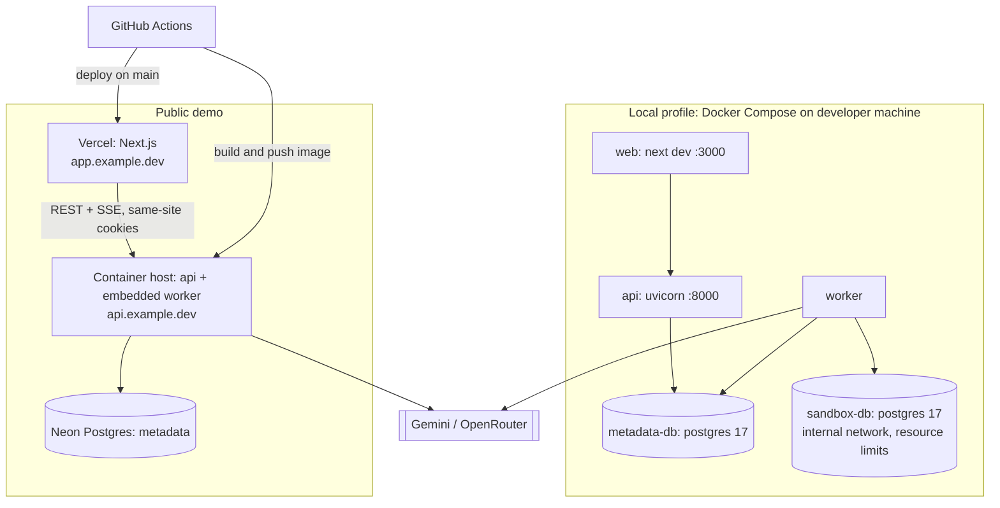

# Deployment

Status: Planned. Two operational profiles share one codebase; behaviour differs via `QC_PROFILE=local|demo` and feature flags.

## 1. Profiles

| Capability | Local full development | Public demo |
|---|---|---|
| Mode A offline analysis | ✅ | ✅ |
| Mode B live inspection | ✅ (private targets allowed by flag) | ❌ by default (`FEATURE_LIVE_INSPECTION_PUBLIC=false`) |
| Mode C sandbox benchmarking | ✅ Docker sandbox | ❌ live; ✅ **prerecorded** demo benchmarks, labeled |
| Multi-agent investigations | ✅ | ✅ (BYOK, stricter budgets) |
| Report / experiment replay | ✅ / ✅ | ✅ / ❌ |
| Auth | Single local user (auto session) | Anonymous sessions; GitHub OAuth (Phase 5) |
| Worker | separate process | embedded in API container (`WORKER_MODE=embedded`) or separate process |
| LLM keys | `.env` fallback or BYOK | BYOK only (no shared server key) |

### What is real-time, simulated, or prerecorded on the public demo

| Feature | Status | Label shown |
|---|---|---|
| SQL parsing, plan parsing, plan explorer, schema parsing | Real, live | — |
| Agent investigation on uploaded inputs / demo workloads | Real LLM calls (user's key) | "Live analysis" |
| Benchmarks and tournament results for demo workloads | Prerecorded from local-profile runs (with environment fingerprint) | "Prerecorded on <hardware>, <date> — not your database" |
| Saved example investigations | Report replay of real local runs | "Replay" |
| Live benchmarking of user databases | Not offered | — |

Prerecorded evidence is stored with `provenance = "prerecorded"`; the verdict engine refuses to mix prerecorded and measured samples.

## 2. Deployment architecture

### Local Compose services (planned `infra/docker/compose.yaml`)

| Service | Image | Notes |
|---|---|---|
| `metadata-db` | `postgres:17` | port 5432 on localhost only; volume `qc_meta` |
| `sandbox-db` | `postgres:17` + `hypopg` (optional) | networks: `sandbox_net` (internal: true); `cpus: 2`, `mem_limit: 2g`, `shm_size: 512m`; tuned `postgresql.conf` checked into repo |
| `api` | built from `backend/Dockerfile` | `uvicorn querycure.api.main:app` |
| `worker` | same image | `python -m querycure.worker`; joins default + `sandbox_net` |
| `web` | `node:22` (dev) | `pnpm dev`; or run on host |

Developers may run `api`/`worker`/`web` on the host and only the databases in Docker; both are supported.

## 3. Public demo hosting

| Component | Recommendation | Why | Alternative |
|---|---|---|---|
| Web | Vercel Hobby | Native Next.js, free tier | Netlify, Cloudflare Pages |
| API + worker | One small always-on container (Fly.io, Railway, or Render) | SSE needs long-lived connections; embedded worker needs CPU outside request handling (rules out scale-to-zero platforms that throttle CPU between requests) | Google Cloud Run with CPU always allocated (cost ↑) |
| Metadata DB | Neon free tier | Serverless Postgres, branching for previews; supports `uuid-ossp` and `LISTEN/NOTIFY` on direct (non-pooled) connections | Supabase |
| Secrets | Host's secret store | `QC_MASTER_KEY`, `DATABASE_URL`, OAuth secrets | — |

**Neon caveat:** `LISTEN/NOTIFY` requires a direct (non-pgbouncer) connection; the API uses the direct endpoint for its single listener connection and the pooled endpoint for request traffic. Neon compute auto-suspend may add cold-start latency to the first request.

**Cost target:** free tiers + one small container ≈ $0–10/month. Prices change; verify before deploying. LLM cost is borne by users via BYOK. Exact host choice is an open decision ([CURRENT_PHASE](../planning/CURRENT_PHASE.md#open-decisions)).

**Domains & cookies:** serve web and API on subdomains of one registrable domain (`app.` and `api.`) so cookies are same-site (`SameSite=Lax` works, `Domain=.example.dev`). SSE connects directly to `api.` rather than through a Vercel rewrite (avoids proxy buffering/timeouts on streaming responses).

## 4. CI/CD (GitHub Actions)

| Workflow | Trigger | Jobs |
|---|---|---|
| `ci.yml` | PR, push | backend: ruff, mypy, unit tests; frontend: lint, typecheck, vitest, build |
| `integration.yml` | PR (backend paths) | service containers `postgres:17` ×2 → integration + security tests |
| `evals-smoke.yml` | PR (agents paths) | recorded-fixture eval suite (no LLM cost) |
| `e2e.yml` | PR to `main`, nightly | Playwright against compose stack, LLM calls stubbed |
| `deploy.yml` | push to `main` | migrations (`alembic upgrade head`) → API image deploy → Vercel deploy |
| `audit.yml` | weekly | `pip-audit`, `pnpm audit` |

Migrations run as a separate release step before new API instances start; migrations must be backward-compatible with the previous app version (expand → migrate → contract).

## 5. Operational limitations

- Single API/worker instance on the demo: a restart interrupts SSE connections (clients auto-reconnect with `Last-Event-ID`) and in-flight runs resume from checkpoints after lease expiry (≤ 60 s).
- No HA, no multi-region; acceptable for a portfolio demo.
- Benchmarks on the local profile depend on the developer's machine; reports record it.
- Backups: Neon point-in-time restore (free tier window is limited); demo data is disposable by design.

## 6. Configuration (environment variables)

| Variable | Purpose |
|---|---|
| `QC_PROFILE` | `local` or `demo` |
| `DATABASE_URL` / `DATABASE_URL_DIRECT` | metadata DB pooled / direct (LISTEN), as the restricted `qc_app` role |
| `DATABASE_MIGRATION_URL` | owner role, used only by Alembic |
| `SANDBOX_ADMIN_URL` | sandbox server admin DSN (local only) |
| `QC_MASTER_KEY` | AES-256-GCM key (base64, 32 bytes) |
| `ALLOW_PRIVATE_TARGETS` | SSRF guard bypass for local profile |
| `FEATURE_LIVE_INSPECTION_PUBLIC`, `FEATURE_SANDBOX` | feature flags |
| `WORKER_MODE` | `separate` or `embedded` |
| `WORKER_CONCURRENCY` | default 2 local / 1 demo |
| `SSE_HEARTBEAT_SECONDS` | SSE heartbeat comment interval (default 15) |
| `WORKER_LEASE_SECONDS` / `WORKER_HEARTBEAT_SECONDS` / `WORKER_POLL_SECONDS` | job lease (default 60), heartbeat (20; must be under half the lease) and idle poll (1) |
| `CORS_ORIGINS`, `COOKIE_DOMAIN` | web origin config |
| `SESSION_TTL_SECONDS` | session and CSRF cookie lifetime (default 30 days) |
| `OTEL_EXPORTER_OTLP_ENDPOINT`, `LANGSMITH_API_KEY` | optional observability |
| `GEMINI_API_KEY`, `OPENROUTER_API_KEY` | local-profile fallback only; ignored in demo |
| `LLM_PROVIDER` / `LLM_MODEL` / `LLM_FALLBACK_MODEL` | default `openrouter` / `openrouter/free` / none; must be free models while `LLM_FREE_ONLY` is on ([ADR-0016](../engineering/adr/ADR-0016-free-openrouter-models-only.md)); the eval-chosen model is pinned with `LLM_MODEL` |
| `LLM_FREE_ONLY` | default `true`: refuse non-free models at startup and stop a run on any non-zero-cost response |
| `LLM_REQUESTS_PER_MINUTE` / `LLM_DAILY_REQUEST_LIMIT` / `LLM_MAX_CONCURRENCY` | free-tier limits: 16 / 45 / 1 by default (OpenRouter free tier: ~20/min, 50/day without credits) |
| `OPENROUTER_BASE_URL` | default `https://openrouter.ai/api/v1` |
