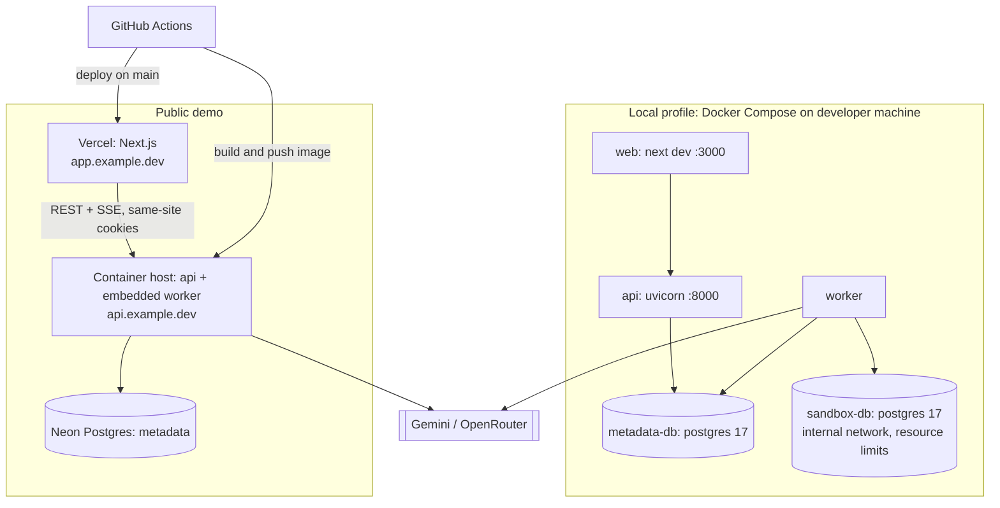
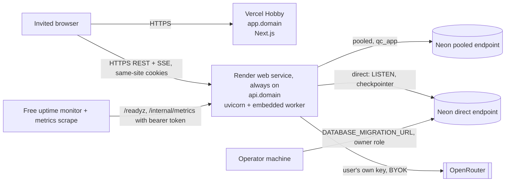

# Deployment

Status: **Phase 5: deployment artifacts prepared and the restricted demo profile verified locally (2026-10-16); hosted-trial architecture recommended in §3a (2026-10-23); no public deployment has been made** (that needs the owner's approval, a domain and accounts). Two operational profiles share one codebase; behaviour differs via `QC_PROFILE=local|demo` and feature flags.

## 1. Profiles

| Capability | Local full development | Public demo |
|---|---|---|
| Mode A offline analysis | ✅ | ✅ |
| Mode B live inspection | ✅ (private targets allowed by flag) | ❌ by default (`FEATURE_LIVE_INSPECTION_PUBLIC=false`) |
| Mode C sandbox benchmarking | ✅ Docker sandbox | ❌ live; ✅ **prerecorded** demo benchmarks, labeled |
| Multi-agent investigations | ✅ | ✅ (BYOK, stricter budgets) |
| Report / experiment replay | ✅ / ✅ | ✅ / ❌ |
| Auth | Single local user (auto session) | Anonymous sessions; GitHub and Google OAuth (Phase 5) |
| Worker | separate process | embedded in API container (`WORKER_MODE=embedded`) or separate process |
| LLM keys | `.env` fallback or BYOK | BYOK only (no shared server key) |

### What is real-time, simulated, or prerecorded on the public demo

| Feature | Status | Label shown |
|---|---|---|
| SQL parsing, plan parsing, plan explorer, schema parsing | Real, live | — |
| Agent investigation on uploaded inputs / demo workloads | Real LLM calls (user's key) | "Live analysis" |
| Benchmarks and tournament results for demo workloads | Prerecorded from local-profile runs (with environment fingerprint) | "Prerecorded on <hardware>, <date> — not your database" |
| Saved example investigations | Report replay of real local runs | "Replay" |
| Live benchmarking of user databases | Not offered | — |

Prerecorded evidence is stored with `provenance = "prerecorded"`; the verdict engine refuses to mix prerecorded and measured samples.

## 2. Deployment architecture

### Local Compose services (`infra/docker/compose.yaml`)

*Implemented (Phase 3; default changed by [ADR-0020](../engineering/adr/ADR-0020-container-worker-default-for-local-benchmarks.md), D12):*
- `metadata-db`;
- `sandbox-db`, with planner settings pinned with `-c`;
- `sandbox-relay` (`alpine/socat:1.8.0.3`, loopback `127.0.0.1:55432` → `sandbox-db:5432`), so a host-run worker and the tests can reach the internal-only sandbox;
- `worker`, built from `backend/Dockerfile`, on `default` + `sandbox_net`.

`docker compose up -d` starts all four. **The container worker is the default local Mode C benchmarking path:**
- an in-network `SELECT 1` round trip is ≈ 33–40 µs, versus ≈ 355–451 µs through the published port;
- it sets `QC_BENCH_PATH=docker-network`, recorded as the environment fingerprint's `container_runtime`;
- after backend changes, rebuild it with `docker compose up -d --build worker`.

**Host-run development is still supported:** start `docker compose up -d metadata-db sandbox-db sandbox-relay` and run the worker on the host. Its default `QC_BENCH_PATH=docker-relay` is what the fingerprint then records. **Never run both workers**: they would split jobs across measurement paths. The Playwright e2e starts its own host worker with the stub LLM, so run `docker compose stop worker` first and start it again afterwards. `api` and `web` run on the host.

| Service | Image | Notes |
|---|---|---|
| `metadata-db` | `postgres:17` | port 5432 on localhost only; volume `qc_meta` |
| `sandbox-db` | `postgres:17` + `hypopg` (optional) | networks: `sandbox_net` (internal: true); `cpus: 2`, `mem_limit: 2g`, `shm_size: 512m`; tuned `postgresql.conf` checked into repo |
| `api` | built from `backend/Dockerfile` | `uvicorn querycure.api.main:app` |
| `worker` | built from `backend/Dockerfile` | `python -m querycure.worker` as uid 10001; joins default + `sandbox_net`; **default** local benchmarking path (ADR-0020) |
| `web` | `node:22` (dev) | `pnpm dev`; or run on host |

Developers may run `api`/`worker`/`web` on the host and only the databases in Docker; both are supported.

## 2b. Deployment artifacts (Phase 5, implemented)

| Artifact | Purpose |
|---|---|
| `backend/Dockerfile` | One image for the **API** (`uvicorn querycure.api.main:app`), the **worker** (default CMD) and the **migration step** (`alembic upgrade head`). Ships `migrations/` (readiness compares with the head) and the demo's prerecorded benchmark fixtures. Runs as uid 10001; SIGTERM drains jobs |
| `frontend/Dockerfile` | Web app for container hosts (Vercel builds natively instead). `NEXT_PUBLIC_API_BASE_URL` is a build argument |
| `infra/docker/compose.demo.yaml` | The restricted demo profile, end to end, on one machine: Postgres, a one-shot `migrate` service as the owner role, the API with the **embedded worker**, and the web app. `FEATURE_SANDBOX=false`, no Mode B, BYOK only, strict rate limits |
| `.github/workflows/audit.yml` | Weekly `pip-audit` and `pnpm audit`, plus on every lockfile change |
| CI | Builds both images on every push (they must stay buildable) |

**Verified locally on 2026-10-16** with `compose.demo.yaml`:
- readiness `ok/current`;
- `/docs` → 404, and `/internal/metrics` → 404 without its token, 200 with it;
- session cookies `Secure; HttpOnly; SameSite=lax`;
- `/me` → `profile: demo`, live inspection and sandbox off;
- an analysis run without a user key → 503 "add your own OpenRouter key";
- `sandbox_benchmark` → 403, `/connections` → 403;
- the gallery serves 7 bundles and 4 benchmark fixtures;
- HSTS, `X-Frame-Options`, `no-store` and the web CSP present;
- `docker compose stop api` → the embedded worker logged `worker_stopped`, and the process exited in about 2 s.

The BYOK run path was not exercised against OpenRouter from the demo stack (it would send a fabricated key to a third party); it is covered by `test_byok_api.py`.

## 3. Public demo hosting

| Component | Recommendation | Why | Alternative |
|---|---|---|---|
| Web | Vercel Hobby | Native Next.js, free tier | Netlify, Cloudflare Pages |
| API + worker | One small always-on container (Fly.io, Railway, or Render) | SSE needs long-lived connections; embedded worker needs CPU outside request handling (rules out scale-to-zero platforms that throttle CPU between requests) | Google Cloud Run with CPU always allocated (cost ↑) |
| Metadata DB | Neon free tier | Serverless Postgres, branching for previews; supports `uuid-ossp` and `LISTEN/NOTIFY` on direct (non-pooled) connections | Supabase |
| Secrets | Host's secret store | `QC_MASTER_KEY`, `DATABASE_URL`, OAuth secrets | — |

### Can free tiers host this safely? (Phase 5 review)

Prices, quotas and policies change: verify them on the day you deploy. This review records characteristics, not numbers.

| Component | Free-tier fit | Notes |
|---|---|---|
| Web (Vercel Hobby) | ✅ for a non-commercial portfolio demo | Hobby is for personal, non-commercial use; check the current terms. SSE goes directly to the API, not through Vercel |
| API + embedded worker | ⚠️ only on an **always-on** container | Platforms that spin services down when idle, or throttle CPU between requests, break SSE streams and stall the worker. Leases recover the jobs, but users see stalls. A small paid always-on instance is the honest recommendation |
| Metadata DB (Neon free) | ✅ with caveats | Compute auto-suspend adds cold-start latency; `LISTEN` needs the direct (non-pooled) endpoint; storage is small but demo data is disposable; point-in-time restore window is limited |
| **Sandbox (Mode C)** | ❌ **not on shared free tiers** | Isolation needs a Docker internal network with no egress, CPU/memory/pids limits and a non-superuser role (SECURITY §8). Shared free platforms offer none of these, and noisy neighbours would make measurements meaningless (R1, R21). **Decision: the public demo runs `FEATURE_SANDBOX=false` and shows prerecorded, labelled benchmarks.** Live benchmarking stays a local-profile feature, or needs a dedicated VM later |

**Neon caveat:** the pooled endpoint (PgBouncer, transaction mode) accepts no startup options and no session state. Request traffic uses the pooled endpoint with the metadata timeouts applied per transaction; `LISTEN/NOTIFY` (the API's single listener) and the LangGraph checkpointer use the direct endpoint. Settings refuse a pooled `DATABASE_URL` without `DATABASE_URL_DIRECT` ([ADR-0025](../engineering/adr/ADR-0025-pgbouncer-compatible-metadata-connections.md)). Neon compute auto-suspend may add cold-start latency to the first request.

**Cost target:** free tiers + one small container ≈ $0–10/month. Prices change; verify before deploying. LLM cost is borne by users via BYOK. Exact host choice is an open decision ([CURRENT_PHASE](../planning/CURRENT_PHASE.md#open-decisions)).

**Domains & cookies:** serve web and API on subdomains of one registrable domain (`app.` and `api.`) so cookies are same-site (`SameSite=Lax` works, `Domain=.example.dev`). SSE connects directly to `api.` rather than through a Vercel rewrite (avoids proxy buffering/timeouts on streaming responses).

## 3a. Restricted hosted trial: recommended architecture (2026-10-23, not deployed)

Recommendation for the first restricted trial. Nothing here has been provisioned. Prices and quotas below are from general knowledge, not checked today: **verify each on the provider's pricing page on the day you deploy.**

| Component | Choice | Why | Notes |
|---|---|---|---|
| Web | **Vercel Hobby** | Native Next.js, free; it serves the static app only | Hobby is for personal, non-commercial use. The build needs `NEXT_PUBLIC_API_BASE_URL` (the build fails without it). SSE goes browser → API directly, never through Vercel |
| API + worker | **One Render web service, paid always-on instance, `WORKER_MODE=embedded`** | SSE needs long-lived connections, and the worker needs CPU between requests. Render's free web services spin down when idle, which breaks both | One service is enough for the trial: with `FEATURE_SANDBOX=false` the worker only runs agent jobs (I/O-bound LLM calls). Durability comes from the Postgres queue (leases, retries, LangGraph checkpoints), not from a separate process |
| Separate worker (later) | Render background worker from the same image (default CMD `python -m querycure.worker`), `WORKER_MODE=separate` on the API | Isolates API latency from job CPU, and lets the two restart separately | Split when API p95 suffers during runs, or when worker concurrency must grow. No code change needed |
| Metadata DB | **Neon**, pooled URL for `DATABASE_URL`, direct URL for `DATABASE_URL_DIRECT` (ADR-0025) | Already migrated (0016) and verified | **Cost risk (inferred, not measured):** the always-on worker heartbeats every 20 s and polls every second, so the Neon compute never auto-suspends. A compute running all month (about 720 h) is likely more than the free plan's monthly compute allowance; check the plan's allowance and budget for the paid tier or for a mid-month suspension. Raising `WORKER_POLL_SECONDS` does not help, because the heartbeat alone keeps it awake |
| Sandbox (Mode C) | **Not hosted for the trial** (`FEATURE_SANDBOX=false`, prerecorded and labelled benchmarks) | Serverless and shared container hosts give no Docker internal network, no `pids`/CPU/memory limits per clone and no quiet host. Measurements would be noise, and isolation (SECURITY §8) could not be met | Later, on a **dedicated VM** that runs the compose `sandbox-db` on an internal network, with a worker on that VM only. This needs job routing by kind (today every worker claims every kind), so it needs an ADR and a code change first |
| Secrets | Render environment (secret values), Vercel project env | No secrets in Git or images | `QC_MASTER_KEY` is the existing key, never regenerated, with a second offline copy (§4c) |
| TLS / domain | One registrable domain: `app.` → Vercel, `api.` → Render; both hosts issue certificates | Same-site cookies with `SameSite=Lax` and `COOKIE_DOMAIN=.<domain>` | The web build sends HSTS, and the API sends HSTS in the demo profile. Neither uses `preload` |

### Expected monthly cost (verify on the day)

| Item | Expected |
|---|---|
| Vercel Hobby | $0 |
| Render always-on web service (smallest paid instance) | about $7 |
| Render background worker (only after a split) | about $7 more |
| Neon | $0 on free if the compute allowance holds (see the risk above); otherwise the smallest paid plan |
| Domain | about $10–15 per year |
| LLM | $0 to the operator: BYOK only, no server key in the demo profile |
| **Trial total** | **≈ $7–10/month**, plus Neon if the free compute allowance runs out |

### Environment variables (names only)

| Where | Set | Must not be set |
|---|---|---|
| Vercel (build) | `NEXT_PUBLIC_API_BASE_URL` (`https://api.<domain>`) | anything secret: every `NEXT_PUBLIC_*` value is public |
| Render, secret values | `DATABASE_URL` (Neon pooled, `qc_app`), `DATABASE_URL_DIRECT` (Neon direct, `qc_app`), `QC_MASTER_KEY`, `METRICS_TOKEN` (≥ 32 chars), `GITHUB_CLIENT_SECRET`, `GOOGLE_CLIENT_SECRET` | `DATABASE_MIGRATION_URL`, `DATABASE_RETENTION_URL` (owner and retention roles stay on the operator machine), `OPENROUTER_API_KEY`, `GROQ_API_KEY`, `GEMINI_API_KEY`, `SANDBOX_ADMIN_URL`, `SANDBOX_BENCH_PASSWORD` |
| Render, plain values | `QC_PROFILE=demo`, `QC_MASTER_KEY_VERSION`, `WORKER_MODE=embedded`, `FEATURE_SANDBOX=false`, `FEATURE_LIVE_INSPECTION_PUBLIC=false`, `ALLOW_PRIVATE_TARGETS=false`, `CORS_ORIGINS=["https://app.<domain>"]`, `COOKIE_DOMAIN=.<domain>`, `PUBLIC_API_URL`, `WEB_BASE_URL`, `TRUSTED_PROXY_HOPS`, `GITHUB_CLIENT_ID`, `GOOGLE_CLIENT_ID`, `TZ=UTC`, optionally `LOG_LEVEL`, `DB_POOL_SIZE`, `DB_MAX_OVERFLOW`, `WORKER_SHUTDOWN_GRACE_SECONDS` | `LLM_PROVIDER=stub` (refused outside local) |
| Operator machine only | `DATABASE_MIGRATION_URL`, `DATABASE_RETENTION_URL` | — |

The API refuses to start with a wildcard or plain-http CORS origin, http public URLs, a short metrics token, or without `DATABASE_URL` / `CORS_ORIGINS` (OBSERVABILITY §0).

**`TRUSTED_PROXY_HOPS` must match the host's proxy chain.** With `0`, every visitor shares the proxy's address, so rate limits become global and users block each other. With too high a value, a client can choose its own rate-limit key. Before the trial opens, confirm from the host's documentation how many entries its proxy appends to `X-Forwarded-For`.

### Database migrations

No migration is pending: Neon is at `0016`, which is the code's head (checked 2026-10-18; the readiness probe re-checks on every deploy). For a future release, run §4b from the operator machine, with `DATABASE_MIGRATION_URL` set in that shell only. Never put the owner role into the Render environment or a pre-deploy hook. Before migrating, create a Neon branch of production as the restore point.

### Worker deployment and health checks

- **Render health check:** `/api/v1/readyz` (database reachable and migrations current). Liveness is `/api/v1/healthz`.
- **Worker health:** `/readyz` does not see the embedded worker. Check `qc_workers_alive == 1` and its `source_digest` against the release in `/internal/metrics`, and alert when it is 0 (OBSERVABILITY §8).
- **Deploys and shutdown:** the host stops the old instance after starting the new one, so for a few seconds two embedded workers overlap. That is safe: `SKIP LOCKED` claims and leases. Set the host's shutdown delay above `WORKER_SHUTDOWN_GRACE_SECONDS` (default 20 s). Jobs still running at the cut resume from their checkpoint after the lease expires (≤ 60 s).
- **Retention:** run `python -m querycure.ops retention` as `qc_retention` from the operator machine, weekly (or later as a scheduled job).

### Deployment order

1. **Owner prerequisites:** choose the domain and accounts; delete the stale `env.bak`; confirm the Neon PITR window and the compute allowance (above); choose the access strategy (below).
2. **CI green** on the release commit: all `ci.yml` jobs and `audit.yml`.
3. **Neon restore point:** create a branch of production named `pre-trial-YYYYMMDD`.
4. **API:** create the Render web service from `backend/Dockerfile` with start command `uvicorn querycure.api.main:app --host 0.0.0.0 --port $PORT`, health check `/api/v1/readyz`, an always-on instance in the region closest to Neon, and the variables above.
5. **Verify the API** on its host URL: `/readyz` → `ok/current`; `/me` → `profile: demo`, sandbox and live inspection off; `/internal/metrics` with the token → `qc_workers_alive 1` and the release digest.
6. **DNS:** point `api.<domain>` at Render, then wait for TLS.
7. **Web:** create the Vercel project (root `frontend/`) with `NEXT_PUBLIC_API_BASE_URL=https://api.<domain>`, deploy, and attach `app.<domain>`. Check that the CSP header names the API origin and that HSTS is present.
8. **OAuth:** register the callbacks `https://api.<domain>/api/v1/auth/{github,google}/callback`, set the client IDs and secrets, redeploy the API, and run [OAUTH_VERIFICATION_CHECKLIST](../engineering/OAUTH_VERIFICATION_CHECKLIST.md) with test accounts.
9. **Probe:** `uv run python -m querycure.ops.demo_probe --base-url https://api.<domain> --web-origin https://app.<domain>` must pass every check.
10. **Monitoring:** set up the uptime monitors, the metrics scrape with the OBSERVABILITY §8 rules, and the log drain alerts. Confirm one test alert reaches you.
11. **Open** to the restricted audience.

### Rollback and recovery

| Failure | Action |
|---|---|
| Bad web release | Vercel: promote the previous deployment (instant, stateless) |
| Bad API release | Render: roll back to the previous deploy. Migrations are expand-only, so the older image runs on the newer schema |
| Bad migration | Stop the release before traffic. Restore the `pre-…` Neon branch (or PITR to a child branch), run `verify-integrity`, then repoint both URLs (§4c). Never `alembic downgrade` a database with user data |
| Worker stuck or dead | Restart the service. Leases expire and jobs resume from checkpoints |
| Abuse or a security issue | Kill switch: suspend the Render service (the web app then shows API errors), or set `FEATURE_*` off and redeploy. Sealed reports are immutable and survive |
| Leaked database password | §4d. The master key is never rotated as part of that |

### Restricted-access strategy for the trial

The demo profile today allows **anonymous sessions**: anyone who has the URL can use the app. BYOK, strict rate limits and the disabled Mode B/C bound the damage (no server LLM spend, no access to databases), but they do not restrict who gets in.

| Option | Restricts access? | Change needed |
|---|---|---|
| A. Unlisted domain + existing demo limits | No; obscurity only | None |
| B. **Sign-in allowlist** (recommended): turn anonymous sessions off in the demo, and admit only listed `(provider, subject)` pairs after OAuth | Yes | Backend change (session creation and the OAuth callback, plus a setting). **Needs owner approval** as a contract change; no migration if the list lives in configuration |
| C. Access proxy (e.g. an identity-aware proxy in front of both subdomains) | Yes | Infrastructure only, but it must pass credentialed cross-origin requests and SSE from `app.` to `api.`; verify that before relying on it |

Until option B (or C) is in place, treat the trial as **open to anyone with the link**.

## 4. CI/CD (GitHub Actions)

Two workflows exist (checked 2026-10-18). Earlier drafts of this section listed separate `integration.yml`, `evals-smoke.yml`, `e2e.yml` and `deploy.yml` files; those were never created. Their jobs live in `ci.yml`, and there is **no deploy workflow**.

| Workflow | Trigger | Jobs |
|---|---|---|
| `ci.yml` | push to `main`, every PR | **Backend** (Python 3.12 and 3.13): ruff, format check, `mypy`, unit tests. **Backend integration** (`postgres:17` service containers): integration + security tests, eval smoke (recorded), eval Mode C (recorded + prerecorded fixtures, no sandbox). **Frontend:** lint, typecheck, Vitest, build, plus a build of both demo-profile images. **End-to-end:** Playwright with the stub LLM |
| `audit.yml` | Mondays 06:17 UTC, manual, and PR/push touching a lockfile | `pip-audit` (backend runtime deps), `pnpm audit --prod --audit-level high` |

Deployment is manual (§4b) until a host is chosen. Migrations run as a separate release step before new API instances start; migrations must be backward-compatible with the previous app version (expand → migrate → contract).

## 4b. Release procedure (Phase 5)

1. **CI green** on the commit: lint, types, unit, integration, security, evals (smoke + Mode C fixtures), e2e (including axe), and image builds.
2. **Migrate first** (expand → migrate → contract): run the image once with `alembic upgrade head` and `DATABASE_MIGRATION_URL` (owner role). Migrations 0013–0016 only add tables, columns and indexes, so the previous app version keeps working against the new schema. Before migrating a hosted database:
   - confirm with a read-only session that no job is pending or running and no lease is live;
   - fingerprint the core tables;
   - check `alembic history -r <current>:head` lists only the expected revisions.

   After migrating, re-fingerprint (it must be identical), check grants with `has_table_privilege` as each role, and confirm `/readyz` reports `current`. This procedure took Neon from 0015 to 0016 on 2026-10-18 ([report](../reports/FINAL_BACKEND_DEPLOYMENT_READINESS_2026-10-18.md)).
3. **Deploy the API/worker image**, then wait for `GET /api/v1/readyz` to return 200 (`database: ok`, `migrations: current`). Liveness is `GET /api/v1/healthz`.
4. **Deploy the web app** with `NEXT_PUBLIC_API_BASE_URL` pointing at the API's public origin.
5. **Smoke check:** `/me` (profile, features), the demo gallery, one digest verification, `/internal/metrics` with the token.

**Rollback:** redeploy the previous image tag. The schema stays (expand-only migrations are backward compatible); do not run `alembic downgrade` on a database with user data. 0015's downgrade drops stored keys, and 0013's drops the idempotency columns. Downgrades exist for development databases only.

**Worker lifecycle:**
- SIGTERM stops claiming jobs and lets in-flight jobs finish for `WORKER_SHUTDOWN_GRACE_SECONDS` (default 20 s); give the platform's stop timeout a little more (compose: `stop_grace_period: 30s`).
- After the grace period, jobs are abandoned to lease expiry (≤ `WORKER_LEASE_SECONDS`), and the next worker resumes them from their LangGraph checkpoint.
- Every 5 minutes the worker logs `stuck_work_detected` (expired leases, active runs with no job) and drops orphaned sandbox clones.

**Backups:** see §4c. Demo data is disposable by design. Losing `QC_MASTER_KEY` makes stored BYOK keys and connection passwords undecryptable (users re-enter them). It must persist across deploys, but it never protects evidence or reports.

## 4c. Backup and disaster recovery (runbook, 2026-10-18)

**What must survive.** Everything lives in the metadata DB:
- investigations, events and checkpoints (schema `langgraph`);
- content-addressed artifacts, including sealed reports and manifests;
- users, sessions and encrypted credentials.

Separately, the `QC_MASTER_KEY` and its version. There is no other state: the sandbox is disposable and rebuilds templates on demand.

**Backups**
- **Neon (hosted):** rely on point-in-time restore within the plan's window. Restore into a **new branch** and point a staging API at it to check it. Never restore over, truncate or reset the live branch.
- **Off-provider copy:** `pg_dump -Fc` with the owner role (`DATABASE_MIGRATION_URL`, direct host) to encrypted storage. It holds ciphertext only. The master key never goes into the same place.
- **`QC_MASTER_KEY`:** keep it in the host's secret store and in a second, offline secret store. A restore without the key that sealed the rows recovers everything except BYOK keys and connection passwords. Those fail closed: decryption raises an error and never returns plaintext. Users re-enter them.

**Restore procedure**
1. Create an empty database (or a Neon branch).
2. `pg_restore --exit-on-error -d <new> <dump>` as the owner. Grants and the `langgraph` schema come with it, provided the `qc_app` and `qc_retention` roles exist (`infra/docker/metadata-init/01-roles.sh` or the Neon SQL in `.env.example`).
3. `alembic current` must equal the code's head. If the dump is older, run `alembic upgrade head` (migrations are forward-only in practice; downgrades refuse when data would be lost).
4. Verify before switching traffic:
   - `/readyz` reports `ok` and `current`;
   - every artifact re-reads through the digest-checking store;
   - sealed reports replay `verified` (`replay.report_replay.verify_report`; the drill below scripts both checks);
   - `/internal/metrics` shows `qc_runs_terminal_unsealed` at 0 and no expired leases.
5. Point `DATABASE_URL` and `DATABASE_URL_DIRECT` at it and restart the API and workers. Check `qc_workers_alive` and each worker's `source_digest`.

**After a restore**
- **Workers:** in-flight jobs resume from their LangGraph checkpoint once their lease expires. A run whose checkpoint postdates the backup restarts from the last checkpoint in the backup, and benchmark blocks resume at the first missing block.
- **Partial finalization:** finalization is one transaction (`test_finalize.py`: a fault after any step leaves nothing visible), so a backup never holds a half-sealed run. `qc_runs_terminal_unsealed` lists terminal runs without a manifest. Dead-lettered runs are finalized with a partial report.
- **Retention and deletion:** `python -m querycure.ops retention` (as `qc_retention`) removes expired sessions, idle rate-limit buckets, wiped credentials and stale worker rows. Evidence is never swept. A restore can bring back rows that retention or a user deletion had removed, so run retention once after restoring.

**Drill (2026-10-18, local Docker only, never Neon).**
- **Source:** local metadata DB, schema 0016, 20 MB: 70 runs (43 sealed), 714 artifacts, 3,269 events.
- **Timing:** `pg_dump -Fc` 0.34 s (1.27 MB) and `pg_restore` into an isolated database 0.39 s.
- **Fidelity:** identical row counts and schema version. Grants were intact (`qc_app` can INSERT but not UPDATE artifacts; `qc_retention` can DELETE sessions), and the `langgraph` schema was present.
- **Integrity:** 714/714 artifacts re-verified by digest, and 43/43 sealed reports replayed `verified`, identical to the source. Verification took 1.5 s.
- **Not covered:** a Neon PITR restore (it needs the owner's console), restore time at production size, and decrypting BYOK rows (the local DB had none; key-binding behaviour is covered by `test_crypto.py` and `test_byok_api.py`).

The drill's two integrity checks are now one read-only command: `python -m querycure.ops verify-integrity [--url-env NAME]`. It runs in a single `READ ONLY` transaction and writes no `replay_attempts` rows. The DSN comes from the named environment variable (default `DATABASE_URL_DIRECT`), never from argv. Exit codes: 0 means everything verified, 1 means failures were found (IDs are listed), 2 means it was not configured. On 2026-10-18 it reported, against Neon (read-only, after migration 0016), 94/94 artifacts and 9/9 sealed reports `verified`.

### Validating a Neon point-in-time restore (procedure; not yet performed)

Never restore over, reset or truncate the live branch. All steps touch only a new child branch.

1. **Create the branch.** In the Neon console, go to Branches → Create branch. Set the parent to the production branch, choose "Past data" at the target timestamp, and name it `pitr-check-YYYYMMDD`. Neon gives the branch its own compute endpoint (a different host).
2. **Credentials on the branch.** SQL-created roles and their passwords live in the restored catalog, so expect a branch from **before** a password rotation to accept the **old** password (not yet observed; confirm on the first check), including the `qc_app` password exposed before 2026-10-18. Use the branch only from the operator's machine, never expose it publicly, and delete it when done (step 6). If it must live longer, rotate `qc_app` on the branch too.
3. **Point a separate env file at it.** Do not edit `backend/.env`. Export `PITR_URL=postgresql://qc_app:…@<branch-endpoint>/neondb?sslmode=require` (direct host, not `-pooler`) in a shell, then run `uv run python -m querycure.ops verify-integrity --url-env PITR_URL`. It must exit 0.
4. **Check the schema.** Run `uv run alembic current` with `DATABASE_MIGRATION_URL` set to the branch's owner DSN in that shell only. If it is older than head, migrating the **branch** is allowed. It never touches the parent.
5. **Optional staging API.** Start the API locally with `DATABASE_URL` and `DATABASE_URL_DIRECT` set to the branch, plus `/readyz`. Do not start a worker on it: the branch can hold jobs that were in flight at the restore point, and a worker would run them.
6. **Delete the branch.** Record the timestamp, the counts from `verify-integrity` and the elapsed time in the ops log.

## 4d. Credential rotation (runbook, 2026-10-18)

The app role `qc_app` was rotated on 2026-10-18 after its password appeared in an AI-assistant session transcript (never in Git, logs or reports).

1. **Generate the password locally**, e.g. `python3 -c "import secrets;print(secrets.token_urlsafe(32))"`, in your own terminal. Never paste it into a chat or ticket.
2. **Set it** in the Neon SQL editor: `ALTER ROLE qc_app WITH PASSWORD '…';`. The roles were created in SQL (see `.env.example`), not in the Neon console.
3. **Update every holder in the same change.** Both `DATABASE_URL` (pooled) and `DATABASE_URL_DIRECT` carry the same role, so both must change. Today the only holder is the operator's `backend/.env`: there is no hosted deployment, no GitHub secret and no Vercel project. After a deployment, add the host's secret store here.
4. **Restart** every API and worker process. Settings are read once at startup, and existing sessions stay authenticated until they close.
5. **Verify without printing secrets:**
   - pooled and direct both connect as `qc_app`;
   - the old password fails with "password authentication failed" on both endpoints;
   - `/readyz` returns 200.
6. **Remove stale copies:** `.env` backups and scratch copies.

`QC_MASTER_KEY` is a different kind of secret. Replacing it makes stored BYOK keys and connection passwords undecryptable; key rotation uses `QC_MASTER_KEY_VERSION` (SECURITY) and is never done as part of a database-password rotation.

## 5. Operational limitations

- Single API/worker instance on the demo: a restart interrupts SSE connections (clients auto-reconnect with `Last-Event-ID`) and in-flight runs resume from checkpoints after lease expiry (≤ 60 s).
- No HA, no multi-region; acceptable for a portfolio demo.
- Benchmarks on the local profile depend on the developer's machine; reports record it.
- Backups: Neon point-in-time restore (free tier window is limited); demo data is disposable by design.

## 6. Configuration (environment variables)

| Variable | Purpose |
|---|---|
| `QC_PROFILE` | `local` or `demo` |
| `DATABASE_URL` / `DATABASE_URL_DIRECT` | metadata DB pooled / direct (LISTEN), as the restricted `qc_app` role |
| `DATABASE_MIGRATION_URL` | owner role, used only by Alembic |
| `SANDBOX_ADMIN_URL` | sandbox server admin DSN (local only) |
| `QC_BENCH_PATH` | `docker-relay` (default, host worker) or `docker-network` (worker container on `sandbox_net`); recorded as `container_runtime` in the environment fingerprint (ADR-0020) |
| `QC_MASTER_KEY` | AES-256-GCM key (base64, 32 bytes) |
| `ALLOW_PRIVATE_TARGETS` | SSRF guard bypass for local profile |
| `FEATURE_LIVE_INSPECTION_PUBLIC`, `FEATURE_SANDBOX` | feature flags |
| `WORKER_MODE` | `separate` or `embedded` |
| `WORKER_CONCURRENCY` | default 2 local / 1 demo |
| `SSE_HEARTBEAT_SECONDS` | SSE heartbeat comment interval (default 15) |
| `WORKER_LEASE_SECONDS` / `WORKER_HEARTBEAT_SECONDS` / `WORKER_POLL_SECONDS` | job lease (default 60), heartbeat (20; must be under half the lease) and idle poll (1) |
| `CORS_ORIGINS`, `COOKIE_DOMAIN` | web origin config; outside local, origins must be bare `https://` origins (http only on loopback, never `*`) and `COOKIE_DOMAIN` a bare domain |
| `NEXT_PUBLIC_API_BASE_URL` | web build: the API's public origin; **required** by `next build` (https, or http on loopback), compiled into the bundle and the CSP |
| `SESSION_TTL_SECONDS` | session and CSRF cookie lifetime (default 30 days) |
| `TRUSTED_PROXY_HOPS` | reverse proxies that append to `X-Forwarded-For` (default 0: the header is ignored); rate limits key on the client address |
| `GITHUB_CLIENT_ID` / `GITHUB_CLIENT_SECRET` | GitHub OAuth app; sign-in is offered only when both are set |
| `GOOGLE_CLIENT_ID` / `GOOGLE_CLIENT_SECRET` | Google OAuth client (Web application); sign-in is offered only when both are set. Authorized redirect URI: `<PUBLIC_API_URL>/api/v1/auth/google/callback`. Scopes `openid profile`; no email is read |
| `PUBLIC_API_URL` / `WEB_BASE_URL` | public origins (OAuth callback, post-sign-in redirect); must be `https://` when any OAuth sign-in is enabled outside the local profile |
| `OTEL_EXPORTER_OTLP_ENDPOINT`, `LANGSMITH_API_KEY` | reserved: OTel export and LangSmith are **not implemented** (deferred, see PHASE_5_REPORT) |
| `METRICS_TOKEN` | bearer token for `/api/v1/internal/metrics` outside the local profile (empty = endpoint answers 404; at least 32 characters when set) |
| `DB_POOL_SIZE` / `DB_MAX_OVERFLOW` / `DB_POOL_TIMEOUT_SECONDS` | metadata connection pool (defaults 5 / 5 / 10 s) |
| `DB_STATEMENT_TIMEOUT_MS` / `DB_IDLE_IN_TRANSACTION_TIMEOUT_MS` | server-side limits on the app's metadata connections (60 s / 120 s) |
| `WORKER_SHUTDOWN_GRACE_SECONDS` | drain time on SIGTERM (default 20) |
| `DATABASE_RETENTION_URL` | `qc_retention` role for `python -m querycure.ops retention` |
| `GEMINI_API_KEY`, `OPENROUTER_API_KEY`, `GROQ_API_KEY` | local-profile fallback only; ignored in demo (`OPENROUTER_API_KEY` and `GROQ_API_KEY` are refused there) |
| `LLM_PROVIDER` / `LLM_MODEL` / `LLM_FALLBACK_MODEL` | default `openrouter` / `nvidia/nemotron-3-super-120b-a12b:free` (pinned by the Phase 2 benchmark) / none; must be free models while `LLM_FREE_ONLY` is on ([ADR-0016](../engineering/adr/ADR-0016-free-openrouter-models-only.md)); the eval-chosen model is pinned with `LLM_MODEL` |
| `LLM_FREE_ONLY` | default `true`: refuse non-free models at startup, refuse a non-free model id in the OpenRouter client before any request is sent, and stop a run on any non-zero-cost response |
| `LLM_REQUESTS_PER_MINUTE` / `LLM_DAILY_REQUEST_LIMIT` / `LLM_MAX_CONCURRENCY` | free-tier limits: 16 / 45 / 1 by default (OpenRouter free tier: ~20/min, 50/day without credits) |
| `OPENROUTER_BASE_URL` | default `https://openrouter.ai/api/v1` |
| `GROQ_BASE_URL` | default `https://api.groq.com/openai/v1`; `LLM_PROVIDER=groq` is allowed while `LLM_FREE_ONLY` is on by trusting the key to be on Groq's free plan ([ADR-0027](../engineering/adr/ADR-0027-groq-provider-trusted-free-plan.md)) |
