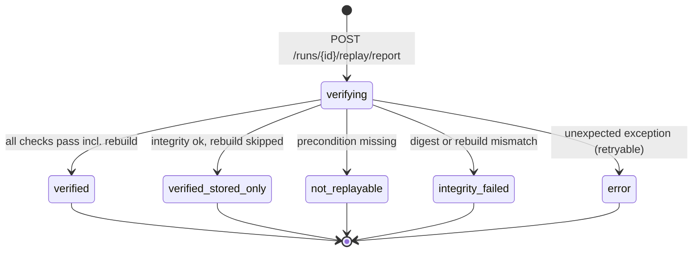
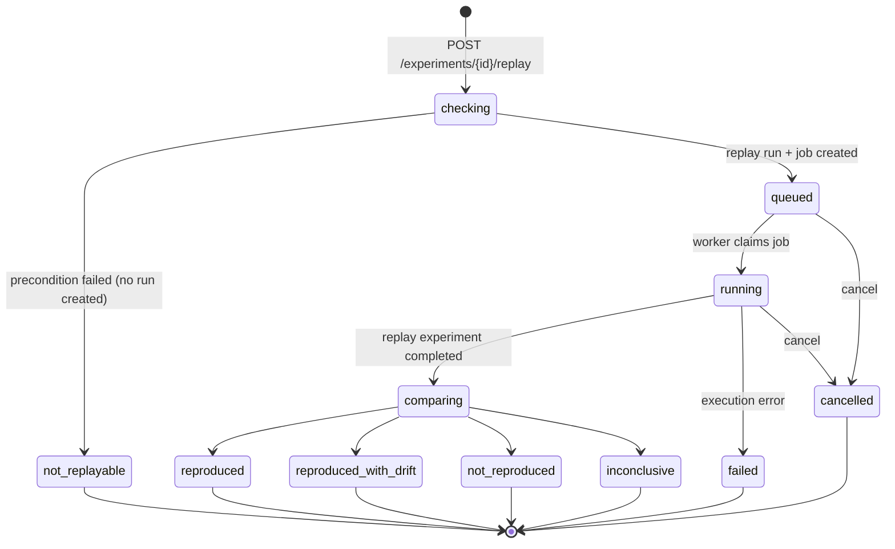
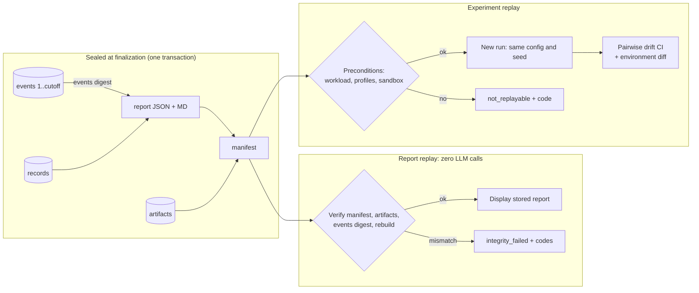

# Replay Engine

Status: **Implemented** (artifact store and canonicalization in Phase 1, events in Phase 2, finalization, report replay, experiment replay and the re-investigation start in Phase 4; implementation decisions in [ADR-0022](../engineering/adr/ADR-0022-phase4-verification-replay-implementation.md)). Decisions: [ADR-0010](../engineering/adr/ADR-0010-content-addressed-artifacts.md) (artifact store), [ADR-0015](../engineering/adr/ADR-0015-canonicalization-finalization-integrity.md) (canonicalization profiles, finalization protocol, integrity scope).

## 1. Three kinds of replay — never conflate them

| Kind | What it does | LLM calls | DB execution | New measurements? | Label in UI |
|---|---|---|---|---|---|
| **Report replay** | Verifies a finalized run's stored evidence against its manifest and redisplays it | 0 | none | No | "Replayed from saved evidence · integrity checked against stored digests" |
| **Experiment replay** | Re-executes a stored `ExperimentConfig` in a fresh sandbox, then compares statistically with the original | 0 | sandbox only | **Yes** — a new run and experiment linked to the original | "New measurement (replay of …)" |
| **AI re-investigation** | New LLM run on the same inputs (start contract implemented in Phase 4: consent, free capacity, own budget, parent link); the diff against the original is Post-MVP | yes | per mode | if it benchmarks | "Re-investigation of …" |

Every replay request creates a `replay_attempts` row ([DATABASE_DESIGN](DATABASE_DESIGN.md#replay_attempts)) with a state machine and structured failure codes (§8).

## 2. Canonicalization profiles

An artifact's identity is a digest over **canonical bytes** produced by a named, frozen **profile**. Profiles are compatibility contracts: once released, a profile's output for a given input never changes. Different rules → a new profile ID; old profile code stays in the codebase permanently (it is small and pure) so old artifacts stay verifiable.

| Profile | Applies to | Summary |
|---|---|---|
| `qc-json-v1` | All JSON artifacts (snapshots, plans, configs, agent outputs, report JSON, manifests, events in the digest stream) | RFC 8785 (JCS) plus QueryCure input restrictions |
| `qc-text-v1` | Text QueryCure generates (report Markdown) | UTF-8, LF line endings, exactly one trailing LF |
| `qc-raw-v1` | Text users submit (SQL query, DDL upload) | Exact bytes received, after strict UTF-8 validation; no normalization of any kind |
| `qc-events-v1` | The event-log digest stream (§5) | Concatenation of `qc-json-v1` event records, each followed by LF |
| `qc-row-v1` | Result-row values hashed for benchmark correctness fingerprints ([BENCHMARK_ENGINE §5](BENCHMARK_ENGINE.md#5-correctness-checks)) | Scalar encodings below, per PostgreSQL type |

### 2.1 `qc-json-v1` rules

1. **Input domain.** The canonicalizer accepts only `dict` (string keys), `list`, `str`, `int`, `float`, `bool`, `None`. Anything else raises `CanonicalizationError`. Typed values are converted first by explicit encoders (rules 5–6). Never feed it `model_dump_json()` or `json.dumps()` output: their formatting is not a contract across Pydantic/Python releases.
2. **Objects.** Members sorted by key, comparing keys as UTF-16 code-unit sequences (RFC 8785 §3.2.3). Duplicate keys in external JSON (uploaded plans) are rejected at parse time.
3. **Strings.**
   - Must be valid Unicode scalar sequences; lone surrogates are rejected.
   - **No Unicode normalization (no NFC/NFKC).** Normalizing would alter user data. Visually identical strings with different code points hash differently, by design.
   - Escaping per RFC 8785: only `"`, `\` and U+0000–U+001F are escaped (`\b \f \n \r \t`, otherwise `\u00xx` with lowercase hex). Everything else is literal UTF-8.
4. **Numbers.**
   - Integers must be within ±(2^53 − 1) and are serialized as plain decimal.
   - Values outside that range (large `BIGINT` sizes, PostgreSQL `numeric`) must be encoded as **strings** by the field's encoder. The kind's schema declares such fields.
   - Floats must be finite IEEE-754 doubles. NaN and ±Infinity are rejected; −0.0 becomes 0.
   - Floats are serialized with the RFC 8785 / ECMAScript Number-to-String algorithm: shortest round-trip digits; exponent form only for exponents ≥ 21 or ≤ −7, written `1e+21` / `1e-7`.
   - An integral float serializes as an integer (`2`, not `2.0`), so schemas must never depend on int/float type distinctions.
   - **Measurement policy:** raw measurements are integers in their smallest unit (durations `*_ns`, sizes `*_bytes`, counts). Floats appear only in derived values (ratios, CIs) and in values PostgreSQL emits as floats (plan costs). Derived floats are recomputable from integer samples.
5. **Timestamps.**
   - Instants: `YYYY-MM-DDTHH:MM:SS.ffffffZ`, always UTC, always 6 fractional digits (PostgreSQL's precision). Naive datetimes are rejected.
   - Dates: `YYYY-MM-DD`.
   - Durations are integer nanoseconds, never ISO 8601 durations.
6. **Other types.**
   - UUIDs: lowercase, hyphenated.
   - Enums: their `.value`.
   - Decimals: canonical decimal string with no exponent and no trailing zeros (`"12.5"`, `"0"`).
   - Bytes: base64url without padding.
7. **Field presence.** Every field defined by the kind's `schema_version` is always emitted (`null` when empty). Adding or removing a field means a new `schema_version`; old artifacts are never rewritten.
8. **Arrays.** Order is significant. Set-like arrays (`evidence_ids`, tags, artifact lists) are sorted by the producer before canonicalization, by a key documented on the field.
9. **Output.** UTF-8, no BOM, no insignificant whitespace, no trailing newline.

### 2.2 `qc-text-v1`, `qc-raw-v1`, `qc-row-v1`

- **`qc-text-v1`:** strict UTF-8. CRLF and lone CR become LF. Trailing newlines collapse to exactly one LF. No other whitespace or Unicode changes. Generated by QueryCure only.
- **`qc-raw-v1`:** the exact received bytes, accepted only if valid UTF-8 without BOM. Two queries differing only in whitespace or comments are different artifacts on purpose: comments can carry planner hints. A separate SQLGlot `query_fingerprint` field groups semantically similar queries; it is metadata, not identity.
- **`qc-row-v1`:** one encoding per value, as a tagged token.
  - `int2/4/8` → decimal.
  - `float4/8` → ECMAScript shortest round-trip; NaN as `NaN`, ±Infinity as `Infinity`/`-Infinity`, since PostgreSQL can return them.
  - `numeric` → canonical decimal.
  - `text`/`varchar` → raw UTF-8.
  - `timestamptz` → UTC per rule 5. `timestamp` → the same format without `Z`. `date` per rule 5.
  - `bool` → `t`/`f`.
  - `bytea` → lowercase hex.
  - `json`/`jsonb` → `qc-json-v1`.
  - arrays → recursive.
  - NULL → a sentinel distinct from every value.
  - Row hash = SHA-256 over the length-prefixed, tagged encodings of the row's columns, in order.

### 2.3 Digest definition

```
digest = SHA-256( ASCII(profile_id) || 0x0A || canonical_bytes )      → stored as lowercase hex, referenced as "sha256:<hex>"
```

The profile tag gives domain separation: identical bytes under two profiles get different digests, so `artifacts.sha256` stays a single unique key. To reproduce a digest outside QueryCure: `{ printf 'qc-text-v1\n'; cat report.md; } | shasum -a 256`. Exported reports include these instructions.

### 2.4 Cross-version guarantees

- **Golden vectors** in `backend/tests/fixtures/canonical/`: input value, expected canonical bytes and digest per profile, including the RFC 8785 number vectors and Unicode edge cases (astral characters, combining marks, control characters, lone surrogates expected to fail).
- CI runs them on every supported Python version (3.12 and 3.13). Any change in output fails CI; the fix is a new profile, never an edit.
- Dependency upgrades (Pydantic, psycopg, SQLGlot) cannot change digests, because canonicalization never delegates formatting to them.
- Verifying an artifact means re-canonicalizing the stored value with its recorded `canonicalization` profile and comparing digests. Report replay also requires the stored bytes to equal their re-canonicalized form, so an edit that canonicalization would hide (extra whitespace) is still `integrity_failed` (ADR-0022). An unknown profile ID is a `not_replayable: unsupported_profile` result, not a crash.

## 3. Evidence lineage

Lineage is a DAG: `artifact → evidence → finding → hypothesis → candidate → benchmark_run → verification_result → report section`.

- Evidence rows point at `(artifact_id, locator)`.
- Findings and hypotheses store `evidence_ids`. Candidates store `addresses_hypotheses`. Verification results store `experiment_id`/`candidate_id`. Report sections store the IDs they render.
- The UI's "Why?" affordance on any claim walks this DAG back to source artifacts and plan nodes.

## 4. Replay manifest

```json
{
  "schema_version": 1,
  "run_id": "…", "investigation_id": "…",
  "finalized_at": "2026-10-11T12:00:00.000000Z",
  "final_status": "completed", "outcome": "verified_recommendation",
  "app": { "version": "0.4.0", "git_sha": "…", "alembic_revision": "…", "benchmark_engine_version": "bench@1" },
  "inputs": { "query": "sha256:…", "param_sets": "sha256:…", "schema_snapshot": "sha256:…", "plans": ["sha256:…"] },
  "environment": { "target": { "server_version": "16.4", "settings_digest": "sha256:…" } },
  "llm": [ { "agent": "query_analyzer", "provider": "gemini", "model": "…", "prompt_version": "query_analyzer@3" } ],
  "events": { "cutoff_seq": 214, "count": 214, "digest": "sha256:…", "profile": "qc-events-v1" },
  "report": { "json": "sha256:…", "markdown": "sha256:…", "report_schema_version": 1,
              "builder_version": "report-builder@1", "md_renderer_version": "report-md@1" },
  "artifacts": [ { "role": "input.query", "profile": "qc-raw-v1", "digest": "sha256:…" } ],
  "experiments": [ { "id": "…", "config": "sha256:…", "environment": "sha256:…", "row_profile": "qc-row-v1" } ]
}
```

- `artifacts` lists every `run_artifacts` entry **except the manifest itself**, sorted by `(role, digest)`.
- The manifest is canonicalized with `qc-json-v1`. Its digest is stored in `replay_manifests.manifest_sha256` and printed in exported reports (§6.3).

## 5. Atomic finalization

Finalization turns a run's mutable progress into a sealed, replayable record. It is the body of the `write_report` node and runs as **one metadata-DB transaction**, `finalize_run(run_id)`.

```
BEGIN
 0. (implementation) emit `run.concluded` {final_status, outcome, stop_reason, synthesis_summary,
    materiality, no_action_evidence, usage, error}: the last content event, so the builder reads
    the terminal decision from the sealed log, never from graph state or the run row (ADR-0022)
 1. SELECT … FROM investigation_runs WHERE id = $run FOR UPDATE
    → if finalized_at IS NOT NULL: return the existing manifest (idempotent no-op)
 2. cutoff_seq := last_event_seq                      -- content events are seq 1..cutoff_seq
 3. events_digest := SHA-256 over the profile tag "qc-events-v1\n" followed by,
    for seq = 1..cutoff_seq in order: qc-json-v1({seq, type, payload, created_at}) || 0x0A
    → abort with EventLogGap if any seq in 1..cutoff_seq is missing
 4. report_json := build_report(records, cutoff_seq, events_digest, finalized_at := now())
    report_md   := render_markdown(report_json)
    → store both artifacts (ON CONFLICT DO NOTHING) + run_artifacts rows
 5. manifest := {…, events{cutoff_seq, digest}, report{json, markdown digests}, artifacts[…]}
    → store manifest artifact; INSERT replay_manifests
 6. UPDATE investigation_runs SET finalized_at, events_cutoff_seq, status, outcome, finished_at
 7. emit lifecycle events (seq > cutoff_seq): report.ready, run.status_changed
COMMIT
```

**No circular hashing.** The dependency chain is strictly one-directional: `events 1..cutoff → events_digest → report → manifest → replay_manifests row`.

- The report embeds `cutoff_seq` and `events_digest`; it never contains the manifest digest.
- The manifest contains the report digests; nothing stored inside the run contains the manifest digest. Only the `replay_manifests` row and exports do.
- The lifecycle events in step 7 come after the cutoff and are excluded from the digest by definition.

**Lifecycle events are outside the seal.** Events with `seq > events_cutoff_seq` (`report.ready`, `run.status_changed`) exist only to drive live UI updates. They are not covered by the events digest, are not checked by report replay, and are never treated as evidence. The **authoritative terminal status and outcome of a finalized run are `final_status` and `outcome` in the manifest.** Report replay reads them from the verified manifest, never from post-cutoff events or from the `investigation_runs` row.

**Sealing rules.**

- **Event emitter.** It already locks the run row to assign `seq`. After `finalized_at` is set, it accepts only the whitelisted lifecycle types (`report.ready`, `run.status_changed`) and raises `RunFinalized` for anything else.
- **Write rule.** No content record of a finalized run (evidence, hypotheses, candidates, verification results, run artifacts) may be written. Repositories check `finalized_at` in the same transaction.
- **Timestamps.** `finalized_at` is taken once from the database clock inside the transaction. `build_report` reads no other clock, so a rebuild from the same records is byte-identical.

**Failure behaviour.**

- **Exception before COMMIT.** Nothing is visible and the run stays `running`/`cancelling`. The node is retried, and it is idempotent: artifacts are content-addressed and step 1 short-circuits.
- **Crash after COMMIT but before the LangGraph checkpoint.** The node re-runs and step 1 returns the existing manifest.
- **Failed or cancelled runs.** These are finalized the same way, with a partial report and `final_status = failed | cancelled`.
- **Finalization itself fails permanently** (e.g., the metadata DB is unreachable past the retry budget). The run is marked `failed` with no manifest. Report replay then returns `not_replayable: not_finalized`; it never fabricates a manifest.

## 6. Integrity scope (what the digests do and do not prove)

### 6.1 What verification detects

SHA-256 verification proves **consistency relative to a trusted reference digest**. It detects:

- accidental corruption, truncation, and partial writes;
- application bugs that mutate records meant to be immutable;
- modification by anyone who can change artifact or event rows but **not** the reference digest;
- divergence between a saved export and the live record, when the user compares against the manifest digest they kept (§6.3).

### 6.2 What it does not prove

**Authenticity.** The reference digests live in the same metadata database as the data. An attacker with write access to that database, the application's DB credentials, or full server control can rewrite artifacts, events, the manifest, and `replay_manifests.manifest_sha256` consistently. Replay would still report "verified". Report replay is therefore **not** tamper-proof, signed, or certified, and the UI and docs must never say so.

### 6.3 Mitigations without new infrastructure

- **Append-only privileges.** The application DB role has only `INSERT`/`SELECT` on `artifacts`, `investigation_events`, and `benchmark_runs`. `UPDATE`/`DELETE` belong to a separate retention role used only by the `retention_sweep` job. This blocks application bugs and SQL-injection-style mutation through the app role, but not an attacker holding the owner or retention credentials.
- **External anchor.** Exported reports (Markdown and JSON) carry the manifest digest and the run ID. Anyone holding an export can later check that the live manifest digest still matches.
- **Honest wording.** The UI states "Integrity check passed against stored digests".

### 6.4 Deferred

Manifest signing with a key stored outside the database, and external timestamping or transparency logs, are tracked as an open decision ([CURRENT_PHASE D8](../planning/CURRENT_PHASE.md#open-decisions)). Signing would defend against database-only compromise, not full server compromise.

## 7. Report builder and renderer versioning

Three independent version axes, all recorded in `investigation_reports` and the manifest:

| Axis | Meaning | Changes when |
|---|---|---|
| `report_schema_version` (int) | Structure of the report JSON | Fields added, removed, or re-typed |
| `builder_version` (`report-builder@N`) | Pure function: persisted records → report JSON | Any change in output bytes for the same records |
| `md_renderer_version` (`report-md@N`) | Pure function: report JSON → Markdown | Any change in output bytes for the same report JSON |

Rules:

1. **Stored artifacts are the record.** Replay always displays the stored, digest-verified report JSON (in the UI) or Markdown. Regeneration is only a consistency check.
2. **Released versions are frozen.** Builders and renderers live as `reports/builders/v{N}.py` and `reports/renderers/md_v{N}.py`. Changing their output requires a new version. Old versions are kept by default. Retiring one requires an entry in [DECISIONS.md](../engineering/DECISIONS.md).
3. **Rebuild check.**
   - Builder `N` is available: rebuild the report JSON from records. The digest must equal the stored one. A mismatch is `integrity_failed: rebuild_mismatch`, meaning records changed after finalization or the builder is nondeterministic. Both are bugs, and both are surfaced.
   - Builder `N` is retired: skip the check. The status is `verified_stored_only` with warning `builder_retired`.
   - The same applies to the Markdown renderer (warning `md_renderer_retired`).
4. **Display fallback.**
   - The frontend declares the range of `report_schema_version`s it can render.
   - Outside that range, it displays the stored Markdown artifact with a banner. Older schemas get "archived format". A schema newer than the client (deploy skew) gets warning `schema_newer_than_client`.
   - Markdown always renders, so a verified report is always viewable.
5. **Optional "view with current renderer".** If the current renderer supports the stored schema version, the UI may re-render the stored JSON, labeled "re-rendered with report-md@M (original report-md@N)". This view is not a verification and never replaces the stored artifact.

## 8. Replay lifecycles and failure codes

### 8.1 Report replay (synchronous)



Checks run in this order:

1. Run finalized.
2. Manifest present and its digest matches.
3. Manifest schema and profiles supported.
4. Every listed artifact present and matching.
5. Event sequence 1..cutoff complete and digest matching. Events after the cutoff are ignored.
6. Rebuild check (§7).
7. Terminal status and outcome are taken from the manifest. If `investigation_runs.status` or `outcome` disagrees, the attempt still reports the manifest values and adds warning `run_row_differs_from_manifest`. A sealed row should never change, so this signals a bug or a manual edit.

All mismatches are collected (not just the first) into `result.checks[]`. The status reflects the most severe category.

| Status | Codes |
|---|---|
| `not_replayable` | `not_finalized`, `manifest_missing`, `artifact_purged`, `events_purged`, `unsupported_profile`, `unsupported_manifest_schema` |
| `integrity_failed` | `manifest_digest_mismatch`, `artifact_digest_mismatch`, `events_gap`, `events_digest_mismatch`, `rebuild_mismatch` |
| `error` | `internal_error` |
| warnings (any success status) | `builder_retired`, `md_renderer_retired`, `schema_newer_than_client`, `run_row_differs_from_manifest` |

### 8.2 Experiment replay (asynchronous)



**Execution.**

- An experiment replay executes as an `investigation_runs` row with `kind = experiment_replay` and `parent_run_id` set. It therefore reuses the job queue, SSE stream, cancellation, and finalization (its own manifest).
- The `replay_attempts` row carries the replay-specific state above. The run carries execution state.
- The replay uses the original `ExperimentConfig` unchanged except for `experiment_id`. In particular the **same `seed`**, so the interleaving schedule is identical. Sandbox DDL still requires approval ([AGENT_SYSTEM §8](AGENT_SYSTEM.md#8-human-in-the-loop)): the replay confirmation dialog shows the exact DDL, and confirming creates an `approval_requests` row (`kind = sandbox_execution`, `status = approved`, `decided_by` = the user) linked from the attempt.

| Status | Codes |
|---|---|
| `not_replayable` | `source_not_finalized`, `source_integrity_failed` (the source run fails report-replay checks, or an arm's SQL no longer matches its approval), `source_experiment_incomplete` (no stored result; added in Phase 4), `config_artifact_missing`, `unsupported_config_schema`, `workload_unavailable` (generator version removed), `workload_snapshot_changed` (user sandbox data changed), `sandbox_disabled` (profile has no live sandbox), `unsupported_row_profile` |
| `failed` | `sandbox_unavailable`, `ddl_failed` (where the original succeeded), `timeout`, `budget_exhausted`, `internal_error` |
| `cancelled` | `cancelled_by_user` |
| `inconclusive` (comparison) | `insufficient_evidence`, `drift_undetermined`, `verdict_inconclusive` |
| `not_reproduced` (comparison) | `verdict_changed`, `direction_reversed`, `result_fingerprint_changed`, `winner_changed` |

## 9. Statistical comparison: original vs replay

The comparison is computed per candidate × param set ("pair") from the **raw integer samples** of both experiments. Absolute latencies are shown side by side but never used for classification.

### 9.1 Steps per pair

1. **Correctness first.** Result fingerprints must match the original exactly. Same workload digest and same row profile mean the same data.
   - A mismatch gives `not_reproduced: result_fingerprint_changed`, the most severe signal: the generator or the data is not deterministic.
   - Different row profiles give `not_replayable: unsupported_row_profile`. This is checked as a precondition.
2. **Evidence quality.** If either side fails verdict gate 4 (n, CV) from [BENCHMARK_ENGINE §7](BENCHMARK_ENGINE.md#7-verdict-rules-deterministic), the pair is `inconclusive: insufficient_evidence`.
3. **Speedup drift.** `D = S_replay / S_original`, where `S = median(baseline) / median(candidate)`.
   - The 95% CI of `D` comes from a percentile bootstrap: 2,000 resamples, all four sample sets resampled independently.
   - The bootstrap seed is derived from `sha256(original_experiment_id | replay_experiment_id)`, so the comparison is reproducible.
4. **Classification.** With equivalence margin `m` (default 1.25, i.e. ±25% drift in the speedup ratio):

| Verdicts (original, replay) | D's 95% CI | Pair result |
|---|---|---|
| Same verdict and same reason code | ⊂ [1/m, m] | `reproduced` |
| Same verdict and same reason code | entirely outside [1/m, m] | `reproduced_with_drift` |
| Same verdict and same reason code | straddles a margin bound | `inconclusive: drift_undetermined` |
| verified ↔ rejected, or rejected for different reasons | any | `not_reproduced: verdict_changed` |
| Improvement direction flips (one CI wholly > 1, the other wholly < 1) | any | `not_reproduced: direction_reversed` |
| Either side `inconclusive` | any | `inconclusive: verdict_inconclusive` |

Requiring CI inclusion in the margin is an equivalence-style test: "no evidence of a difference" never counts as a reproduction. A wide CI gives `inconclusive`, not `reproduced`.

5. **Aggregate.**
   - The attempt status is the most severe pair result, ordered `not_reproduced > inconclusive > reproduced_with_drift > reproduced`.
   - If the original tournament winner is no longer first by the BENCHMARK_ENGINE §8 ranking, the attempt gets `not_reproduced: winner_changed`, even when every pair individually reproduced.

### 9.2 Comparison mode: same-environment reproducibility vs cross-environment comparison

Each experiment replay result records `comparison_mode`. It is decided by the environment classes in the table below:

- **`same_environment`:** every precondition and material field is equal. Only minor fields may differ. This is a **reproducibility check**: did the same setup give the same conclusion?
- **`cross_environment`:** at least one material field differs. This is a **cross-environment performance comparison**. The classification algorithm (§9.1) is identical, but the result is labeled differently and must never be called "reproduced".

| Status (stored) | UI label, `same_environment` | UI label, `cross_environment` |
|---|---|---|
| `reproduced` | Reproduced | Consistent across environments |
| `reproduced_with_drift` | Reproduced, effect size drifted | Same conclusion, effect size differs across environments |
| `not_reproduced` | Not reproduced | Conclusion differs across environments |
| `inconclusive` | Inconclusive | Inconclusive |

The stored status enum is unchanged; the mode selects the wording. API consumers must read `comparison_mode` together with `status`.

`result.environment` always records:
- both full `EnvironmentFingerprint`s;
- their digests;
- the classified list of differing fields (`field`, `class`, `original`, `replay`).

This is recorded even when the mode is `same_environment`, so minor differences remain visible.

### 9.3 Environment field classes

Both experiments store an `EnvironmentFingerprint` ([BENCHMARK_ENGINE §1](BENCHMARK_ENGINE.md#1-inputs-and-outputs)). Fields are classified:

| Class | Fields | Effect |
|---|---|---|
| **Precondition** | workload ID and data digest, row profile | Mismatch → `not_replayable` |
| **Material** | PostgreSQL major version, planner-relevant settings (`shared_buffers`, `work_mem`, `effective_cache_size`, `random_page_cost`, `seq_page_cost`, `jit`, `max_parallel_workers_per_gather`, `default_statistics_target`), sandbox image digest, benchmark engine version, CPU architecture, CPU model, core count, memory | Any difference → `comparison_mode = cross_environment`; UI banner: "Different environment: ratios may not transfer; absolute latencies are not comparable" |
| **Minor** | PostgreSQL minor version, OS/kernel version, non-planner `pg_settings`, wall-clock date | Listed in `result.environment`; mode stays `same_environment` |

**Implementation note (ADR-0022).** `container_runtime` is classified **material**: since ADR-0020 it records the measurement path (`docker-network` vs `docker-relay`, round trips about ten times apart), not a runtime version. The comparison also records the drift and its interval for pairs that fail gate 4 (diagnostic only; such pairs stay `inconclusive: insufficient_evidence`). The comparison seed is 52 bits of `sha256(original|replay)` so it fits the canonical JSON integer range. Same-machine measurements: [analysis/replay_variance](../engineering/analysis/replay_variance/README.md).

**Engine versions (ADR-0019).** A replay is scored with the source experiment's rules: `rules.evaluate(..., engine_version=source.engine_version)`, where `bench@1` is kept frozen. A source and replay produced by different engine versions are therefore always `cross_environment` (benchmark engine version is a material field), never "reproduced". Replicates of a noisy round are not replays: they are new experiments of the original run.

### 9.4 Stated limitations (included in every comparison result)

- **Coverage.** Two experiments are a small sample of environmental variance. `reproduced` means "consistent in this pair of runs", not "portable".
- **Multiple comparisons.** There is no correction across candidates × param sets. The conservative worst-pair aggregate is used instead.
- **Resampling.** Independent resampling ignores the block pairing within each experiment, as accepted in [ADR-0008](../engineering/adr/ADR-0008-benchmark-statistics.md).
- **Configuration.** The margin `m` and the bootstrap settings are stored in the attempt's `result.config`. Changing defaults never changes stored results.

## 10. AI re-investigation diff (Post-MVP)

| Dimension | Comparison |
|---|---|
| Hypotheses | matched by `category` + cited plan nodes; added, removed, confidence changed |
| Candidates | matched by `qc-json-v1` digest of their normalized SQL; added, removed |
| Verdicts | per matched candidate |
| Outcome | same or different |
| Cost | LLM calls, tokens, wall-clock |

## 11. Architecture


