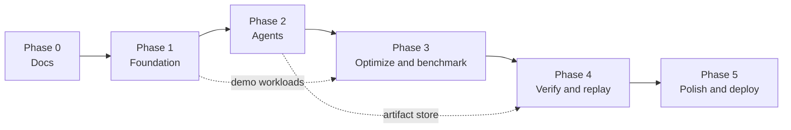

# Roadmap

Phases are sequential and **independently verifiable**: each ends with a demoable capability, passing tests, a phase report, and updated docs. Task-level detail: [TASKS.md](TASKS.md). Learning per phase: [LEARNING.md](../engineering/LEARNING.md).

Rough effort (solo, AI-assisted, part-time): P1 2–3 wk · P2 3–4 wk · P3 3–4 wk · P4 2–3 wk · P5 3–4 wk. Estimates, not commitments.

## Replay contracts that earlier phases must honor

Replay features ship in Phase 4, but their contracts bind from Phase 1 so no data has to be migrated or rehashed later ([REPLAY_ENGINE](../architecture/REPLAY_ENGINE.md), [ADR-0015](../engineering/adr/ADR-0015-canonicalization-finalization-integrity.md)):

| Phase | Must already hold |
|---|---|
| 1 | All artifacts are written through the frozen profiles (`qc-json-v1` / `qc-text-v1` / `qc-raw-v1`) with profile-tagged digests. `qc_app` is restricted to `INSERT`/`SELECT` on `artifacts`. No code path updates an artifact. |
| 2 | `investigation_events` is append-only with gap-free `seq`. Evidence IDs are deterministic. Every displayed value comes from persisted records or artifacts. The interim report writer reads no wall clock. |
| 3 | Samples are integer nanoseconds. `EnvironmentFingerprint`, `engine_version`, `row_profile` (`qc-row-v1`) and `seed` are stored per experiment. `benchmark_runs` is append-only. |
| 4 | `finalize_run`, manifests, report builder/renderer versioning, replay attempts, and comparison. Runs from earlier phases are not finalized and report `not_replayable: not_finalized`. They are never retro-sealed. |

---

## Phase 0 — Documentation & architecture (current)

- **Objective:** a complete, consistent documentation system that coding agents can implement from.
- **Deliverables:** all files in the README index, ADRs, designed diagrams.
- **Exit criteria:** links resolve; Mermaid parses; no contradictions found in review; user approves moving to Phase 1.

---

## Phase 1 — Foundation

- **Objective:** a running skeleton that can parse SQL and plans, inspect a database safely, and show plans in the UI — no LLM yet.
- **Dependencies:** Phase 0.
- **Deliverables:**
  - Repo scaffolding (`backend/`, `frontend/`, `infra/docker/compose.yaml`), CI basic workflow.
  - Metadata DB + Alembic migrations for `users`, `sessions`, `database_connections`, `artifacts`, `run_artifacts` (others arrive with their phase).
  - `sql/` parser/validator/fingerprint; `plans/` parser/metrics; artifact store (hashing) basics.
  - `connectors/` SSRF guard, hardened sessions, inspection gateway (schema/index/stats templates, plain EXPLAIN), capability detection.
  - Demo workload generators (`orders_ecommerce`, `rewrite_trap`, `no_benefit` first; others in Phase 3).
  - API: session, connections, inspect (sql/plan/schema), explain, workloads, health.
  - Frontend: app shell, tokens, theme toggle, connections page, workspace draft state with SQL editor, plan tree-table + basic React Flow graph.
- **Modules:** `core`, `domain`, `db`, `api`, `sql`, `plans`, `connectors`, `workloads`, `replay/artifact_store.py`; frontend `app`, `components/{editor,plan,claims,layout}`, `lib/api`.
- **Acceptance criteria:**
  1. Validator unit suite (TESTING_STRATEGY §2) passes, including fail-closed on unparseable input.
  2. Uploading a PG 17 `EXPLAIN (ANALYZE, BUFFERS, FORMAT JSON)` renders a tree with correct loops-aware self times (verified against hand-computed fixture).
  3. Connecting to the local `orders_ecommerce` DB with the documented restricted role returns capabilities and a plain EXPLAIN; a superuser connection is refused.
  4. SSRF tests: all private/loopback/metadata forms blocked in `demo` profile.
  5. `docker compose up` + `pnpm dev` gives a working UI on a fresh clone following README steps.
- **Tests:** unit (sql, plans, ssrf, artifact hashing), integration (gateway against seeded DB, migrations), security (validator, session hardening, SSRF, role checks), Vitest (PlanTreeTable, case conversion).
- **Security requirements:** SECURITY §4.1 L1–L3 and §5 implemented; secrets encrypted (AES-GCM helper lands here for connection passwords).
- **Learning objectives:** LEARNING Phase 1.
- **Exit:** acceptance criteria met; Phase 1 report written.

---

## Phase 2 — Multi-agent intelligence

- **Objective:** an investigation that runs the supervisor + Query Analyzer + Index Strategist + Workload Investigator, streams progress, and produces cited hypotheses (no benchmarks yet).
- **Dependencies:** Phase 1 (parsers, gateway, artifact store).
- **Deliverables:**
  - Tables: `investigations`, `investigation_runs`, `investigation_events`, `agent_executions`, `tool_executions`, `evidence`, `hypotheses`, `jobs`.
  - Job queue + worker; LangGraph graph through `synthesize_hypotheses → write_report` (report = findings summary); Postgres checkpointer; budgets; cancellation.
  - LLM layer: Gemini + OpenRouter via LangChain, structured output with repair, local env-key fallback (BYOK UI in Phase 5).
  - Evidence store with deterministic IDs; citation validator; prompt fencing.
  - SSE endpoint with resume; frontend timeline, findings tab, history page.
  - Eval runner with recorded fixtures + first 5 cases.
- **Acceptance criteria:**
  1. On `orders_ecommerce`, recorded-mode eval: top hypothesis category ∈ {`missing_index`, `poor_index_order`} citing Seq Scan/Sort evidence.
  2. Kill worker after the analysis fan-out checkpoint → restart → run completes with no duplicate evidence rows.
  3. SSE client reconnecting with `Last-Event-ID` receives every event exactly once (integration test).
  4. Injection fixture does not change tool calls.
  5. Budget exhaustion fixture ends with `inconclusive` and a partial report.
- **Tests:** routing unit tests, citation validator, queue concurrency, SSE resume, checkpoint resume, eval smoke.
- **Security:** fencing, tool allowlists, redaction of prompts in logs, secrets absent from checkpoints (test).
- **Exit:** acceptance met; eval baseline numbers recorded in the phase report.

---

## Phase 3 — Optimization & benchmarking

- **Objective:** candidates are generated, approved, and benchmarked in sandbox clones with a tournament ranking.
- **Dependencies:** Phase 2; Docker sandbox.
- **Deliverables:** Optimization Engineer; approval gate + approval API/UI; `optimization_candidates`, `approval_requests`, `experiments`, `benchmark_runs` tables; sandbox provisioner; benchmark engine (schedule, timing, correctness, stats); verdict gates 1–6; tournament ranking; tournament + benchmark comparison UI; remaining demo workloads.
- **Acceptance criteria:**
  1. Benchmark-engine eval table (TESTING_STRATEGY §6) passes with hand-written candidates on sf=0.1–1.
  2. A full run on `orders_ecommerce` reaches a `verified` composite-index candidate (or a documented inconclusive reason on noisy hardware).
  3. `rewrite_trap` rewrite is `rejected: result_mismatch`.
  4. Cancelling during measurement stops within one block and leaves no `qc_clone_*` databases.
  5. No sandbox DDL executes without an approved `approval_requests` row (integration test).
- **Security:** DDL allowlist, sandbox internal network, non-superuser benchmark role, resource limits.
- **Exit:** acceptance met; sample experiment artifacts committed as prerecorded demo fixtures (labeled).
- **Status (2026-10-12):** implemented; #1, #3, #4, #5 met; #2 documented `inconclusive` on noisy hardware; fixtures committed. See [PHASE_3_REPORT](reports/PHASE_3_REPORT.md).

---

## Phase 4 — Verification & replay

- **Objective:** trustworthy verdicts and reproducible reports.
- **Dependencies:** Phase 3.
- **Deliverables:** Benchmark Auditor (downgrade-only); `verification_results`, `investigation_reports`, `replay_manifests`; plan diff; report renderer (pure) with MD/JSON export; lineage drawer UI; report replay; experiment replay with comparison; regression detection across param sets surfaced in UI.
- **Acceptance criteria:**
  1. Report replay makes 0 LLM calls (transport-mock test) and all hashes verify; tampering one artifact fails replay.
  2. Experiment replay on `orders_ecommerce` produces agreeing verdicts and overlapping CIs on the same machine.
  3. `index_regression` → `rejected: regression`; `no_benefit` → never `verified_recommendation`.
  4. Every number in the report has provenance (renderer test scans for unlabeled numbers).
- **Exit:** acceptance met; full eval suite numbers in phase report.
- **Status (2026-10-16, owner-reviewed):** implementation complete; #1, #3, #4 met; #2 **partially demonstrated**: met in TASKS T4.7's form (reproduced or documented inconclusive: 1 of 14 same-machine pairs reproduced, 0 not reproduced), but the stronger wording here (agreeing verdicts and overlapping CIs) held only in part (verdicts agreed in 7 of 14, speed-up CIs overlapped in 12) because of noisy measurements. Margin kept at 1.25 (D9, [ADR-0023](../engineering/adr/ADR-0023-d9-experiment-replay-equivalence-margin.md)). See [PHASE_4_REPORT](reports/PHASE_4_REPORT.md).

---

## Phase 5 — Production polish

- **Objective:** a secure public demo and a portfolio-ready product.
- **Dependencies:** Phase 4.
- **Deliverables:** GitHub OAuth; BYOK settings UI; rate limiting; plan explorer polish (diff mode, edge weights); dashboard; landing page + demo gallery with prerecorded replays; OTel tracing; LangSmith opt-in; full CI (integration, e2e, evals, audits); deployment (Vercel + container host + Neon); security hardening review against SECURITY.md checklist.
- **MVP-marked items:** F-64, F-65, F-84, F-86, F-91, F-92, F-93 (FEATURES.md).
- **Acceptance criteria:**
  1. Public demo runs offline analysis with a user's key end to end; prerecorded benchmarks visibly labeled.
  2. Playwright suite + axe scan pass on CI.
  3. Security test suite fully green; manual review checklist signed off in the phase report.
  4. Demo infra cost within target (record actual).
- **Exit:** deployed; README status updated to reflect what's live.

---

## Post-MVP candidates (ordered)

1. Write-overhead micro-benchmark (F-47).
2. AI re-investigation + conclusion diff (F-74).
3. HypoPG pre-screen (F-29).
4. Grounded Q&A over a finished investigation (F-30).
5. Shareable read-only reports (F-77).
6. Text-format plans (F-06), `pg_stat_statements` CSV import (F-07).
