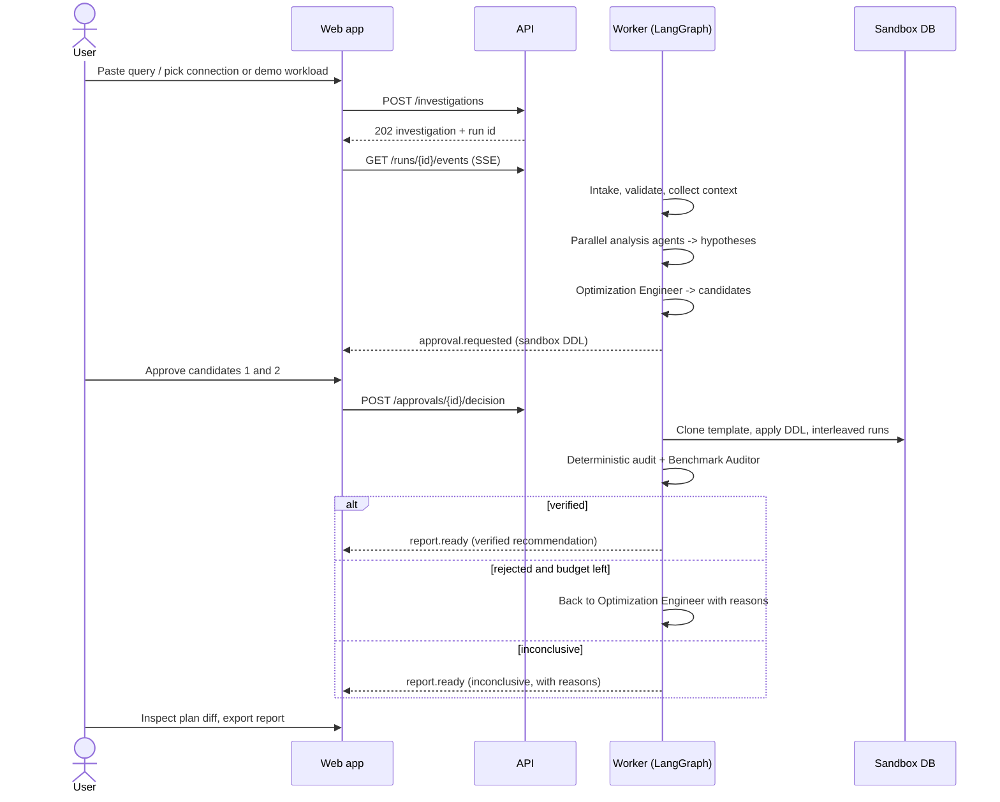

# Product Requirements Document — QueryCure

Status: Draft v1 (Phase 0). Owner: project author. Related: [FEATURES.md](FEATURES.md), [ARCHITECTURE.md](../architecture/ARCHITECTURE.md).

## 1. Problem

PostgreSQL performance tuning needs skills most application developers lack: reading plans, reasoning about selectivity and statistics, and — most often skipped — *proving* an optimization helps without breaking correctness or writes. Existing options are:

| Option | Gap |
|---|---|
| Manual `EXPLAIN` + intuition | Slow, error-prone, single-run "benchmarks" |
| Plan visualizers (e.g. explain.depesz.com, pev2) | Show the plan; don't investigate, propose, or verify |
| Index advisors (e.g. HypoPG-based, Dexter) | Index-only; little explanation; no correctness or workload reasoning |
| General LLM chat | Unverified, unevidenced, sometimes semantically wrong rewrites |

QueryCure combines investigation (agents), proposal (agents), and **verification (deterministic engine)** with explicit evidence and uncertainty.

## 2. Target users & personas

| Persona | Context | Needs | Mode |
|---|---|---|---|
| **Priya — product backend engineer** | Owns a Django/FastAPI service; a dashboard endpoint got slow. Not a DBA. | Plain-language root cause, a safe fix, proof it works, rollback steps. | A or B + C |
| **Marcus — senior engineer / tech lead** | Reviews index PRs; skeptical of "AI said so". | Evidence, plan diffs, statistical confidence, write-cost trade-offs. | B + C, reports |
| **Lena — learner / interviewer audience** | Evaluating the project or learning DB internals. | Built-in demo workloads, replayable investigations, clear explanations. | A + demo C (prerecorded) |

Non-target: DBAs managing fleets, OLAP warehouses, non-PostgreSQL engines.

## 3. Use cases

1. **UC-1 Diagnose a slow query (offline).** Paste SQL + `EXPLAIN (ANALYZE, BUFFERS, FORMAT JSON)` output + schema DDL → hypotheses and recommendations (unverified).
2. **UC-2 Diagnose against a live DB.** Connect with a restricted role → QueryCure collects plain `EXPLAIN`, schema, index and stats metadata → hypotheses.
3. **UC-3 Verify a fix.** Benchmark candidates in a sandbox loaded with a demo workload or a user-provisioned sandbox DB → tournament → verified/rejected.
4. **UC-4 Ask a question.** "Why is this slow?" / "Will this index hurt inserts?" — answered with cited evidence.
5. **UC-5 Review and share.** Export a Markdown/JSON report; replay it later without LLM calls.
6. **UC-6 Re-investigate.** Re-run with a different model or after schema changes; diff the conclusions.

## 4. Primary user journey

## 5. Functional requirements

IDs are referenced from [FEATURES.md](FEATURES.md) and [TASKS.md](../planning/TASKS.md).

### Inputs & connections
- **FR-1** Accept SQL text (single statement, ≤ 100 KB) with optional named parameter sets.
- **FR-2** Accept execution plans in PostgreSQL JSON format (`EXPLAIN (FORMAT JSON)`, with or without `ANALYZE/BUFFERS`); text-format plans are Post-MVP.
- **FR-3** Accept schema metadata as DDL text or as a QueryCure schema-snapshot JSON.
- **FR-4** Register PostgreSQL connections (Mode B) with restricted credentials; test connectivity; detect capabilities (server version, `pg_stat_statements` presence, `pg_read_all_stats` membership, read-only status).
- **FR-5** Provide built-in demo workloads with deterministic generators and scale factors.

### Inspection
- **FR-6** Parse and validate SQL (SQLGlot, PostgreSQL dialect); extract referenced tables/columns/predicates/order/limit.
- **FR-7** Collect schema, indexes, table/column statistics (redacted), and plain `EXPLAIN` in Mode B via templated queries.
- **FR-8** Parse plans into a normalized tree with derived metrics (self time, estimate error ratio, rows removed by filter, buffer hits/reads, sort method/spill).

### Investigation
- **FR-9** Start an investigation with an objective (free text, ≤ 2,000 chars) and execution mode(s).
- **FR-10** Supervisor plans, routes conditionally, runs independent agents in parallel, enforces budgets, and terminates explicitly.
- **FR-11** Every finding and hypothesis cites evidence IDs; hypotheses carry confidence (low/medium/high), contradicting evidence, and a verification method.
- **FR-12** Stream progress (status, agent/tool activity, findings, approvals, benchmark progress) via SSE with resumable event IDs.
- **FR-13** Support cancellation at any point; partial results remain viewable.

### Optimization & benchmarking
- **FR-14** Generate candidates of kinds: `create_index`, `drop_redundant_index` (advisory only), `query_rewrite`, `analyze_statistics`, `extended_statistics`, each with expected benefit, risks, prerequisites, rollback SQL.
- **FR-15** Require explicit approval before any sandbox DDL and before Mode B `EXPLAIN` on connections marked `production`.
- **FR-16** Benchmark baseline + candidates in isolated sandbox clones: warm-ups, ≥ 30 measured runs (configurable), interleaved order, timeouts, multiple parameter sets.
- **FR-17** Run correctness checks (result fingerprint comparison) for every candidate × parameter set.
- **FR-18** Compute median, p95 (n ≥ 20), coefficient of variation, bootstrap 95% CI of the speedup ratio; capture `EXPLAIN (ANALYZE, BUFFERS)` per arm; index size and build time.
- **FR-19** Run a tournament ranking passing candidates; produce verdicts with machine-readable reasons.
- **FR-20** Loop back to candidate generation on rejection (≤ 2 extra rounds, budget permitting).

### Reporting & replay
- **FR-21** Generate a report: root cause, evidence, recommendation, plan diff, benchmark table/charts, confidence, limitations, trade-offs, rollback, reproducibility block.
- **FR-22** Export report as Markdown and JSON.
- **FR-23** Report replay with zero LLM calls and hash verification.
- **FR-24** Experiment replay for deterministic workloads, labeled as new measurements.
- **FR-25** AI re-investigation with structured diff against a previous run.

### Settings
- **FR-26** BYOK: store per-user provider keys encrypted; select provider/model per investigation.
- **FR-27** Investigation history with search/filter, soft delete.

## 6. Non-functional requirements

| ID | Category | Requirement |
|---|---|---|
| NFR-1 | Security | All controls in [SECURITY.md](../architecture/SECURITY.md); no AI DDL on target DBs; secrets never logged. |
| NFR-2 | Correctness | No metric shown without provenance; verdicts computed deterministically. |
| NFR-3 | Reproducibility | Every report lists artifact hashes, PG version, model + prompt versions, workload seed. |
| NFR-4 | Latency (UX) | API p95 < 300 ms for non-streaming reads (local); first SSE event < 2 s after run start. |
| NFR-5 | Investigation time | Offline investigation typically < 3 min; with benchmarks < 15 min (budget-capped). Targets, not guarantees. |
| NFR-6 | Resilience | Worker crash → run resumes from last LangGraph checkpoint; at-least-once job execution with idempotent nodes. |
| NFR-7 | Cost | Public demo infra target: free tiers + one small paid container (≈ $0–10/month; verify current pricing). LLM cost borne by BYOK. |
| NFR-8 | Accessibility | WCAG 2.2 AA for core flows; keyboard-navigable plan explorer alternative (tree table). |
| NFR-9 | Observability | Structured logs with `investigation_id`/`run_id` correlation; OTel traces for API, worker, LLM, DB tools. |
| NFR-10 | Maintainability | Typed Python (`mypy --strict`), typed TS (`strict`), ≥ 85% line coverage on deterministic core modules. |

## 7. MVP scope

MVP = Phases 1–4 complete + the Phase 5 items marked MVP in [FEATURES.md](FEATURES.md).

**In:** Modes A, B (local profile), C (local Docker sandbox with demo workloads or a user-supplied sandbox URL); five agents + supervisor; tournament; correctness fingerprints; report + replay; SSE timeline; plan explorer; BYOK; single-user local auth and anonymous demo sessions.

**Out of MVP (see FEATURES for later tiers):** cloning a user's production data into a sandbox, cold-cache benchmarks, concurrent-load benchmarks, write-amplification benchmarks under realistic load, text-format plan parsing, MySQL/other engines, multi-tenant teams/RBAC, scheduled monitoring, auto-applying changes anywhere.

## 8. Success metrics

| Metric | Target | Measured by |
|---|---|---|
| Root-cause accuracy on eval suite | ≥ 80% top-1, ≥ 95% top-3 on deterministic fixtures | `evals` suite ([TESTING_STRATEGY](../engineering/TESTING_STRATEGY.md)) |
| Unsupported-claim rate | < 2% of findings without valid evidence refs (after validation retries) | Evidence validator logs |
| False "verified" rate | 0 on fixtures where the correct answer is "no benefit" or "regression" or "semantic change" | Eval suite |
| Rewrite semantic-change detection | 100% on the NOT IN/NULL and LIMIT-tie fixtures | Eval suite |
| Report replay fidelity | 100% hash match, 0 LLM calls | Replay integration test |
| Run completion | ≥ 95% of eval runs end in a terminal state within budget | Eval suite |

## 9. Acceptance criteria (product-level)

1. Given the `orders_ecommerce` demo workload and the canonical slow query, a full run produces a hypothesis citing the Seq Scan/Sort plan nodes and a composite-index candidate, and the tournament marks it `verified` with CI lower bound ≥ 1.10 — or explains why not.
2. Given the `rewrite_trap` workload, a `NOT IN → NOT EXISTS` rewrite candidate is **rejected** for result mismatch.
3. Given the `no_benefit` workload, the run ends with `no_action_needed` or `inconclusive`, never `verified_recommendation`.
4. Submitting `DELETE FROM orders` (or any non-SELECT) in Mode B is refused before reaching the database, and an equivalent attempt with a parser-evading payload is still blocked by the read-only transaction (security test).
5. Killing the worker mid-run and restarting it resumes the run from its last checkpoint without duplicating benchmark runs.
6. Replaying a completed report makes zero LLM calls and all artifact hashes verify.
7. Every number in a report has provenance; prerecorded numbers are visibly labeled.

## 10. Open questions

Tracked in [CURRENT_PHASE.md](../planning/CURRENT_PHASE.md#open-decisions).
